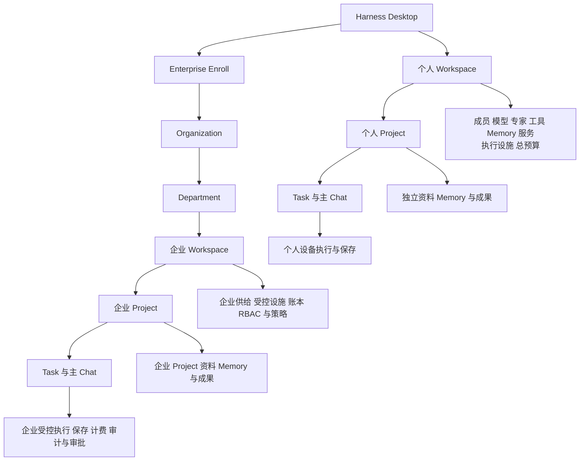
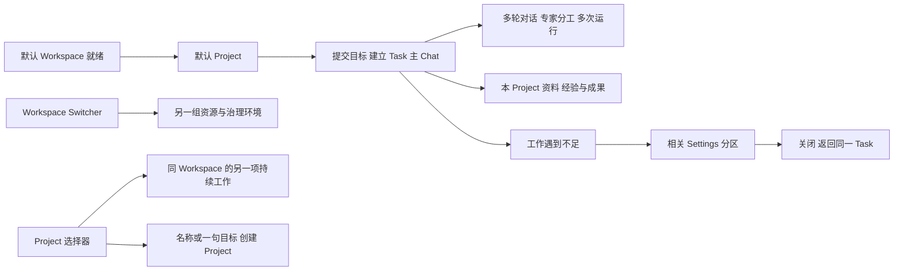
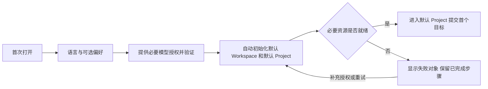
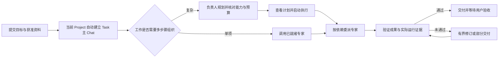
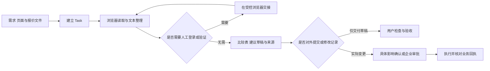
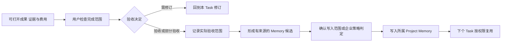
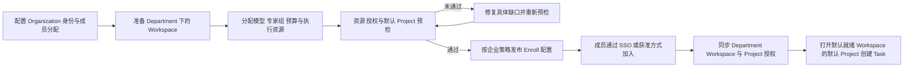
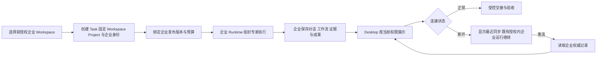
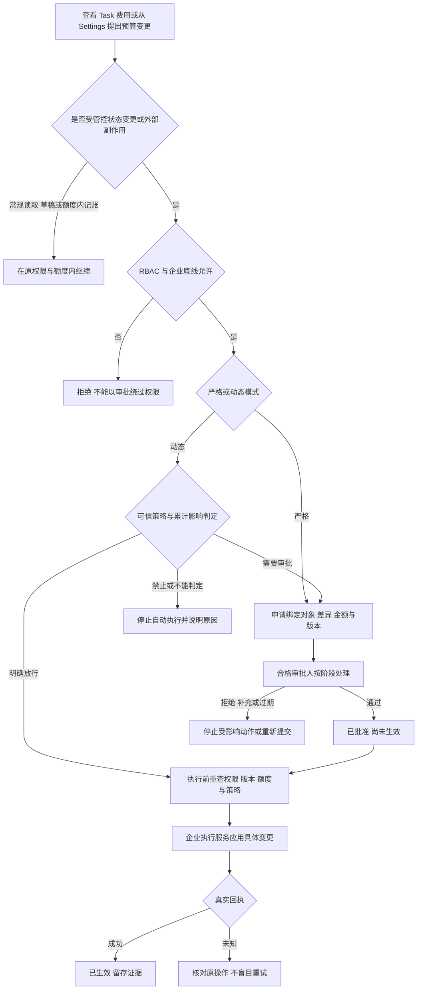

# Harness 核心业务流程与使用场景线稿

版本：0.4\
日期：2026 年 10 月 4 日\
依据：[统一产品 PRD v0.14](harness-product-prd.md)\
云端：[核心业务流程与使用场景线稿](https://chatgpt.com/space/page_38f26accee8c81919da4e2c1bb59a1c3)\
状态：产品流程与低保真线稿，尚未实施；画面中的金额、人员、任务和运行结果均为示例。

本文件将既有产品概念串成可评审的使用流程。用户在已初始化 Workspace 的当前 Project 提交目标，系统建立 Task 主 Chat，使用 Project 获准的 Workspace 模型、专家、Skill、MCP 与执行设施，资料、记忆和成果归属 Project。个人使用自己的设备；Enterprise Enroll 后使用企业 Workspace，企业资源对应的执行、数据、费用和治理留在企业环境。

十组线稿共 35 个步骤状态，包括桌面导航与九个业务场景；各组包含业务流程、页面线稿、关键状态与检查点。线稿用于讨论信息和操作顺序，不代表已经实现的界面。Task 规划是现有核心能力之上的扩展，简单工作仍能直接调用专家。模型内核、Sandbox 技术和真实 API 的实现选型沿用 PRD，不由线稿指定。

[打开全部交互线稿](design/harness-core-business-flows/index.html)。可以切换场景与步骤；画面内的产品操作只表示设计意图，不会登录、写入、收费或运行 Agent。

## 核心对象与工作归属

个人结构为 Workspace → Project → Task；企业结构为 Organization → Department → Workspace → Project → Task。Workspace 聚合成员、Provider / Model、专家模板、Skill、MCP、Memory 服务、Sandbox / 浏览器规格、总预算和治理。Project 组织持续工作的目标、资料、Task、成果和独立 Memory；默认继承获准资源，只能收紧。Task 是一个具体目标及一条主 Chat，多轮消息、专家内部会话、Run / Attempt 留在同一 Task。

人可以属于多个 Department；企业 Workspace 归属一个 Department。部门成员身份不自动取得全部 Workspace 或 Project 权限，切换不合并预算、Memory 或凭据。Workspace Memory 服务可由多个 Project 使用，资料集合和正文权限仍独立；跨 Project 分享通过显式发布和双向授权。Workspace 总额、可选 Project 子额度、Task 上限同时约束同一笔消耗，不重复扣费。

现有资源型 Project 的职责在目标设计中映射到 Workspace，并新增工作型 Project。旧 API、数据库和 CAP_PROJECT_* 保留兼容映射；本文与线稿不表示代码已经迁移。核心开发者和业务骨干使用相同结构，差别在知识、Skill、工具与交付标准。

## Workspace Project 与 Task 主 Chat 的桌面窗口

Desktop 保留紧凑 Mac 窗口工具栏、Task 列表、主 Chat 与按需检查器。独立 Workspace Switcher 位于侧栏顶部，搜索、分组并切换资源与治理环境；其当前项和底部“设置”、Cmd+, 打开同一 Settings。下方轻量 Project 选择器只组织持续工作，旁边入口管理本 Project 的目标、资料、独立 Memory、资源子集和可选子额度。侧栏主体仍是 Task 列表；展开 Task 后查看负责人和专家分工。

Onboarding 已建立默认 Workspace 与默认 Project，直接提交目标就创建 Task 主 Chat。继续追问、调整分工或重试留在同一 Task；独立新目标才新建 Task。Project 可选仓库、文件或网页资料，非 coding 用户无需代码目录。新建 Project 只填写名称或一句目标，沿用就绪资源；需要另一套供给或治理才创建 Workspace。

模型与连接、默认专家、Skill / MCP、Memory 服务、执行环境、总预算、记录与治理藏在 Workspace Settings。本 Project 设置单独标明所属层级和继承来源。企业成员无维护权限时只查看获准配置或提出申请，不能把下层覆盖用于扩大权限。

线稿步骤：Task 主 Chat → 展开 Agent 分工 → Workspace Switcher → 选择 Project → 新建 Project → 按需打开 Settings。

[查看任务树与桌面窗口线稿](design/harness-core-business-flows/index.html#navigation)

**检查点：** 用户不用先理解 Provider、Skill、MCP、Memory 或 Sandbox；默认设置可完成核心工作。任务展开和查看分工不触发新执行或费用。缺口提示给出“哪里不能完成、哪些可继续、怎样补齐”，再定位相关设置；企业无维护权限时提供向管理员申请的路径。Settings 关闭返回同一 Task，切换 Workspace 不迁移任务、不混用个人与企业资源。保留 Escape、可见焦点、任务侧栏隐藏和桌面窗口调整；设置窗口有焦点约束；新建 Project 继承资源且不新增余额；追加消息不新增 Task；Project 切换不带入另一项工作的资料与记忆。

产品对象与主题依据来自当前 [AppShell](../apps/control/src/components/layout/app-shell.tsx)、[ProjectSwitcher](../apps/control/src/components/project/project-switcher.tsx)、[Workspace 设置页](../apps/control/src/routes/$projectId/setting/index.tsx)、[共享交互规范](ui-interaction-spec.md)与[语义颜色](../apps/control/src/styles.css)。任务树与独立 Settings 是本 Desktop 方案的新交互，尚未实现到应用。

## 场景一 个人 Onboarding 自动初始化 Workspace

用户首次安装 Harness Desktop，提供必要的模型授权和可选工作偏好。系统初始化默认 Workspace 和其中的默认 Project，自动准备并验证模型、专家、Memory、Skill、MCP、Sandbox 与浏览器。资源就绪后进入 Task 首页，不要求逐个专家配置。BYOK 是 PRD 当前建议方案，不是已经确定的唯一商业接入方式。

线稿步骤：必要授权 → 自动准备 Workspace 与 Project → 开始第一项工作。

[查看个人初始化线稿](design/harness-core-business-flows/index.html#onboarding)

**检查点：** 关闭应用后恢复原初始化记录；模型验证失败不创建虚假可用状态；验证和索引费用单独归入 Workspace 初始化事件。默认专家是已准备模板，空闲模板不持续产生推理费用。个人接入云模型时说明必要上下文会发送至该 Provider。

## 场景二 在 Project 中创建 Task 与组织专家协作

用户可以直接提交目标、选择一位专家或调用专家组，系统在当前 Project 自动建立 Task 与主 Chat。单项工作直接执行；复杂工作由负责人基于实际可用资源形成计划，结合截止时间、预算、交付标准和依赖组织专家。规划前已固定 workspaceId、projectId、taskId 和主 Chat；多轮消息与专家内部会话沿用该 Task，规划费用也归入 Task。

线稿步骤：提交目标 → 检查计划 → 跟踪执行。

[查看 Task 协作线稿](design/harness-core-business-flows/index.html#task)

**检查点：** 简单 Task 不强制生成流程图；复杂计划图和步骤列表读取同一运行记录。专家共用 Task 上限、可选 Project 子额度和 Workspace 总预算；同一消耗只扣一次，不产生多个独立余额。缺少必要能力时说明缺口，不能生成不可执行节点。启动、暂停和修订等资源操作由右侧操作区承接；异常保留成果和已发生费用。

## 场景三 浏览器与文本完成采购比较

采购负责人在已就绪 Workspace 的当前 Project 提交需求、供应商页面及报价文件。专家在所属执行环境的受控浏览器中读取资料，处理文本，形成有来源的比较表和建议。浏览器与文本是完整工作站的核心底座，用户不用先安装 MCP。个人与企业遵循同一工作流程，执行位置和治理不同。

线稿步骤：浏览器取证 → 文本比较 → 对外提交检查点。

[查看浏览器与文本线稿](design/harness-core-business-flows/index.html#browser)

**检查点：** 登录授权不等于批准下单、发送或提交。报价缺失、页面过期、信息冲突应保留为待核实项。网页和附件中的指令作为来源内容处理。企业登录态、下载和证据在所属 Project / Task 授权范围留在企业受控环境，不能改用成员个人浏览器补位。

## 场景四 Coding Task 在 Sandbox 形成变更草稿

开发者授权本次所需文件，Task 在个人本机或企业受控 Sandbox 中读取输入、生成补丁并执行获准检查。Sandbox 产物先作为草稿，原文件改动、提交 PR 或发布分别是实际变更。这里定义用户流程，不预先选定虚拟机或容器后端。

线稿步骤：选择输入 → Sandbox 工作 → 审查差异。

[查看 Coding 与 Sandbox 线稿](design/harness-core-business-flows/index.html#sandbox)

**检查点：** 不默认读取整盘、挂载全部秘密或复用另一 Task 的上下文。测试未执行时显示未验证。原文件版本变化后重新核对差异；写入结果未知时查询原操作，不直接重复应用。个人设备睡眠或应用退出后的恢复遵循本机运行限制。

## 场景五 验收成果与积累 Project Memory

工作交付后，用户检查实际成果、来源、完成范围和未验证事项，选择验收、部分验收或要求修订。验收不自动执行所有后续写入。Task 中提出的经验先形成 Memory 候选，经个人确认或企业策略判定后写入所属 Project Memory；同 Project 的下个 Task 只读取获准经验；发布到 Workspace 共享集合是单独动作，跨 Project 读取仍需授权。

线稿步骤：检查成果 → 作出验收决定 → 检查 Memory 候选。

[查看成果与 Memory 线稿](design/harness-core-business-flows/index.html#delivery)

**检查点：** 已交付、已验收和正式 Memory 写入是三个不同事实；不将所有聊天自动转成长期记忆。Memory 保存来源、适用范围与版本。企业成果复制、下载、导出仍按企业政策处理，用户验收不能取消出域限制。

## 场景六 使用后微调 Workspace 与 Project 设置

默认体验已可用，用户不满意时再调整专家、模型偏好或工具。用户先从具体 Task 的不足提示了解影响与处理方法，再进入 Settings 的专家、模型、工具、Memory 或执行环境分区。支持直接补充资料或调用已授权替代工具；需要调整默认配置时才显示能力详情。具体修改、验证与应用保留对象差异、权限检查与回执。本图沿用 Provider → Model、Agent 模板、Skill、MCP、Memory 和 Sandbox；Workspace 是资源容器，Project 收紧继承范围并管理独立工作内容，不重复供应商连接。

线稿步骤：工作遇到不足 → Settings 调整默认专家 → 验证并应用。

[查看资源微调线稿](design/harness-core-business-flows/index.html#resources)

**检查点：** 连接成功不等于工具可以完成指定工作；运行能力和授权分别核验。普通更新只影响新运行，撤销或强制限制及时生效。企业成员仅操作具备维护权限的对象，不把企业 Provider 密钥下载到 Desktop。

## 场景七 管理员准备资源与成员 Enterprise Enroll

企业管理员在 Organization 中安排 Department、Workspace、默认 Project 访问、成员角色、SSO 或获准登录方式，分配模型、私有模型、专家组、预算和执行资源，完成 Enroll 预检及治理发布。成员接受邀请并认证后，直接打开已分配且就绪 Workspace 中的默认 Project，不重复配置企业资源。

线稿步骤：管理员准备 → 就绪预检 → 成员认证 → 成员即用。

[查看 Enterprise Enroll 线稿](design/harness-core-business-flows/index.html#enroll)

**检查点：** SSO 登录成功不等于取得 Workspace / Project 权限。管理员配置变更按严格或动态审批规则发布，不能用“初始化”跳过企业治理。无 Workspace 分配、资源未就绪和登录失败分别有状态；成员不被要求补企业 Key 或部署环境。企业加入不自动接管个人 Workspace。

## 场景八 调用企业专家组与持续受控运行

成员选择获授权企业 Workspace 的当前 Project，直接使用企业已发布的私有模型或专家组创建 Task。规划与执行从首次调用起在企业环境完成，企业 Sandbox、Memory、浏览器和工具受本 Workspace 与 Project 授权约束；费用记录到企业权威账本并关联 Workspace / Project / Task。Desktop 展示工作和必要交接，不承担企业运行。

线稿步骤：使用企业资源 → 查看受控运行 → 断连与恢复。

[查看企业 Task 线稿](design/harness-core-business-flows/index.html#enterprise)

**检查点：** Desktop 断连不等于企业任务取消；企业需要新确认时等待。企业执行服务失败与 Desktop 断连是不同问题，不能改用个人 Runtime、Memory 或 Sandbox。跨部门工作通过打开已授权 Workspace 的 Project 实现，原 Task 不迁移归属，跨 Workspace 资料交接必须获准。

## 场景九 Budget 与有副作用动作的审批

Settings 的预算与配额分区区分 Workspace 总额度、可选 Project 子额度、已记录费用、在途预留、Task 上限和未知费用。正常消费不等于修改 Budget。修改 Budget 从 Settings → 预算与配额进入；本 Task 的费用在任务详情查看。修改 Budget、业务记录、共享 Memory、权限或产生外部承诺的动作，在生效前按照权限与实际副作用判定审批。严格模式全部受管控变更先批准；动态模式按企业规则明确放行、要求审批或禁止。

线稿步骤：Settings 查看预算 → Budget 变更申请 → 审批与动态判定 → 核对生效结果。

[查看预算与审批线稿](design/harness-core-business-flows/index.html#approval)

**检查点：** Budget 上调与下调都是变更；下调不能抹除已发生费用和在途义务。组织底线不能被 Department / Workspace / Project 放宽，Agent 不能降低审批要求。同一 Task 或相关对象按累计影响判定，不能拆单绕过。批准绑定具体差异和有效版本，不能以批准整个 Task 放行任意后续写入；不自批。ALLOW 是政策允许，APPROVED 是人工通过，APPLIED 是真实变更生效。

个人 Workspace 对具体影响由用户确认，不显示企业组织审批链。Task 费用上限与企业审批的“严格模式”是不同维度，线稿分别命名。

## 流程覆盖与设计评审

| 场景 | 主要对象与参与者 | 核心决定 | PRD 依据 |
| --- | --- | --- | --- |
| 桌面导航 | Workspace Switcher Project 选择器 Task 主 Chat Agent 分工 Settings | 先完成工作，遇到不足再查看配置 | 第 10.1 与 10.2 章 |
| 个人初始化 | 用户 默认 Workspace 默认 Project Provider Model 核心资源 | 真实就绪后开始工作 | 第 2.5 与 5 章 |
| Task 协作 | Workspace Project Task 负责人 专家与专家组 | 直接工作或多步骤规划 | 第 3 与 6 章 |
| 浏览器与文本 | Task Browser Skill MCP 文档 | 读取草稿与业务提交分开 | 第 8.9 章 |
| Coding 与 Sandbox | Task Sandbox 文件与工具 | 草稿差异是否应用 | 第 6 与 11.2 章 |
| 成果与 Memory | Task 成果 验收 Project Memory | 完成范围与正式记忆写入 | 第 8.3 与 9 章 |
| 资源微调 | Task 不足提示 Settings Agent Memory Skill MCP | 验证与获准发布新版本 | 第 4.3 与 10.4 章 |
| Enterprise Enroll | Organization Department Workspace Project RBAC SSO | 成员资源是否真正可用 | 第 4.2 与 11.4 至 11.7 章 |
| 企业任务 | 企业 Workspace Project Task Runtime 受控资源 | 企业归属与连接恢复 | 第 4.4 至 4.6 与 14.6 章 |
| Budget 与审批 | Workspace Project Task Budget Requester Reviewer | 副作用 策略 差异与生效 | 第 7 与 11.8 至 11.9 章 |

评审时检查：用户是否能直接开始工作；每个步骤是否明确 Workspace / Project / Task 归属与继承来源；用到的资源是否真实存在且已授权；图示状态是否由真实回执支持；等待、失败、拒绝和断连是否有恢复路径；普通读取与草稿是否被无谓中断；实际业务变更是否在生效前完成策略检查。

本稿聚焦桌面窗口，保留键盘可操作、可见焦点和窗口缩放下的可读布局。流程与数据关系以 PRD 为准，页面是低保真提案，未验证的模型价格、Sandbox 后端、外部站点与连接器不视为已支持。
