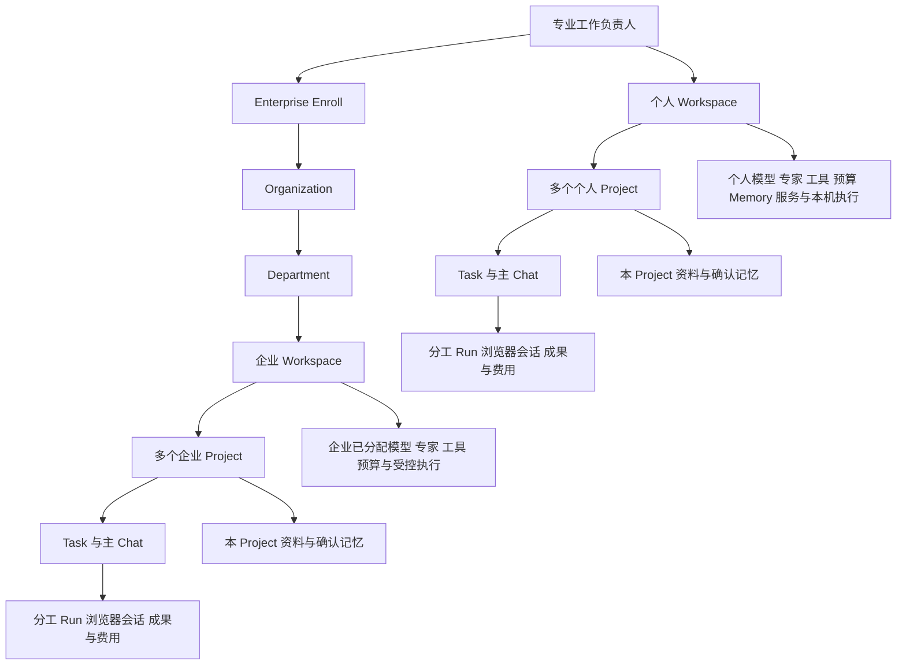
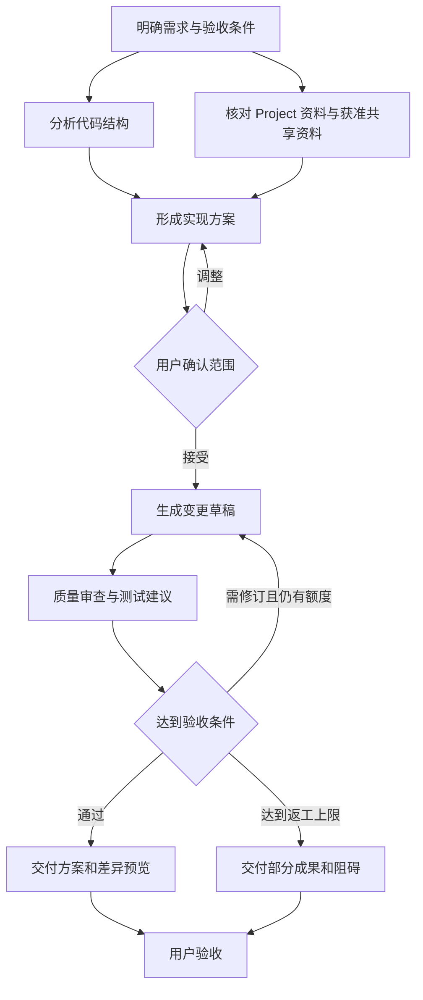
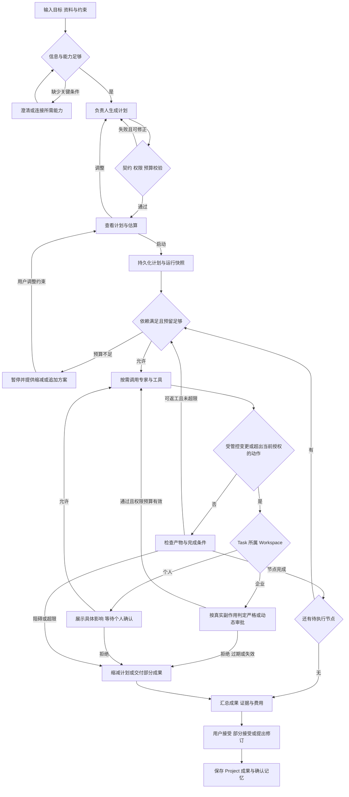
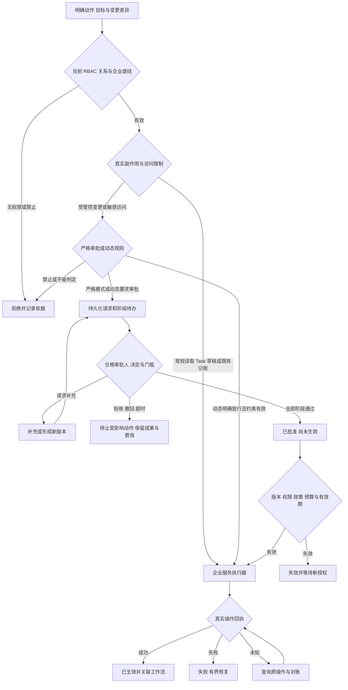
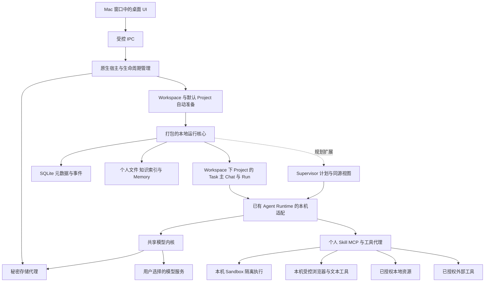
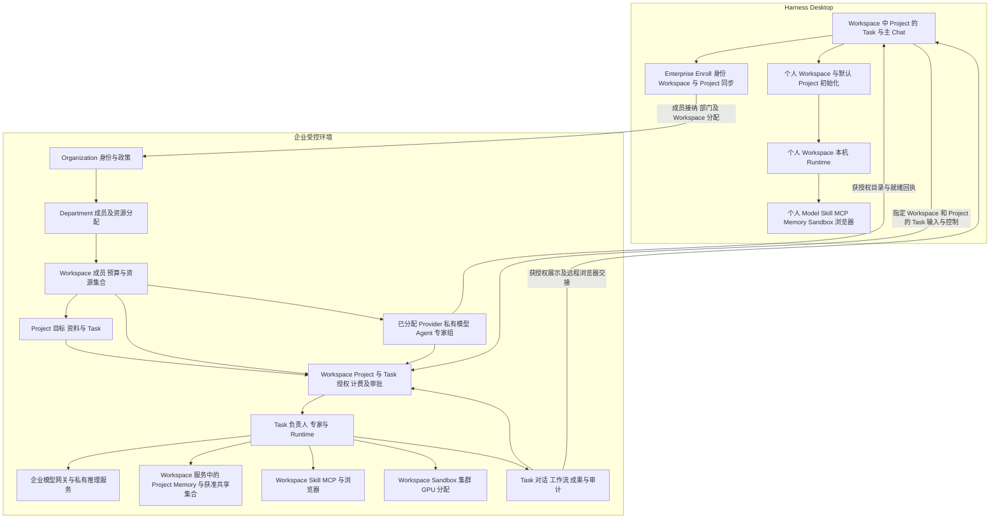

# Harness Desktop 与 Enterprise Enroll 统一产品 PRD

版本：0.14 统一稿\
日期：2026 年 10 月 4 日\
状态：产品需求与工程验收规格，尚未实施\
适用团队：产品、设计、桌面端、Agent Runtime、模型网关与企业平台

Harness Desktop 是面向专业工作负责人的完整个人 AI 工作站：用户设定目标、组织多个助手协作，并对交付成果负责。独立开发者、OPC、公司核心开发者与采购等业务骨干属于同一核心画像，工作领域通过上下文、Skill、工具和验收标准体现。产品以当前 Relay 的 Provider / Model、Agent、Skill、Memory、MCP、Sandbox、资源配置与用量费用能力为底座，先完成独立桌面化，再基于实际可用能力扩展专家协作、任务规划、任务预算与成果验收。Onboarding 自动初始化资源就绪的默认 Workspace 和其中的默认 Project，准备模型、专家、Memory、Skill、MCP、Sandbox 与浏览器；用户直接在 Project 中开始一条 Task 主 Chat，使用后再微调。个人工作在自己的笔记本或台式机执行，不依赖企业平台。

Enterprise Enroll 将人类加入 Organization，分配到一个或多个 Department，并交付管理员预先配置的企业 Workspace。企业将 Provider / Model、私有调教模型、Agent、专家组、预算和工具等资源分配到 Workspace，成员在获授权 Project 中直接创建 Task 使用。企业 Task 从首次调用或规划开始固定归属 Workspace / Project：对话、Memory、Sandbox、浏览器、工具、工作流及成果在企业受控环境执行与保存，接受企业计费、审计、基于 capability 的多角色 RBAC 和完整组织审批。企业支持 SSO 与获准的其他登录方式；个人工作继续完整独立运行。

本文件作为这一产品方向的统一主文档，覆盖用户体验、能力规格、数据与执行边界、企业身份与 RBAC、审批流、计费、架构、Magpie 复用、LiteLLM 双端替换和验收。Enterprise Enroll 是产品接入流程，企业后端称企业平台。实现沿用当前 Relay 仓库及 Tali 家族 UI 规范；最终品牌关系和具体技术选型待确认。

阅读路径：第 1 至 4 章明确产品与能力；第 5 至 11 章定义工作流程、费用、数据与交互；第 12 至 13 章是验收与质量标准；第 14 至 15 章是架构与模型迁移；第 16 至 18 章是商业验证、实施决策及证据来源。

## 1 产品定位与原则

### 1.1 产品原则

- 核心用户是需要多个助手协作并对专业交付负责的人，coding、采购或其他业务工作采用同一工作站。Mac 优先；首批验证仍选择独立开发者与技术型 OPC，聚焦可验证的任务模板。
- 日常界面围绕工作目标、Task 进展与成果；侧栏是 Task 列表，展开查看 Agent 分工。系统能力在 Settings 中按需展示，用户不需要先理解模型、Skill、MCP 或运行环境才能开始工作。
- Desktop 是完备工作站，个人可独立创建专家与专家组，使用 Skill、Memory、MCP 和 Sandbox，执行、检查与交付工作。
- Onboarding 自动初始化默认 Workspace 和默认 Project，准备与验证资源；无需部署 Web 程序或手工配置专家团队。完成后直接提交 Task 或调用专家，实际工作始终在 Workspace 下的当前 Project / Task 中。任务规划建立在现有模型、Agent、Skill、MCP、Memory 和 Sandbox 底座上，由负责人结合实际能力、时间、预算、复杂度与规模形成可检查计划。
- 企业管理员配置 Enroll 与 Workspace 资源并预检后，成员加入即用；人可跨多个 Department，工作、资源消费与经验积累始终围绕明确 Workspace。
- 企业能力相关任务、Agent 对话、Memory、Sandbox、工作流及产物必须留在企业 Workspace，由企业受控环境承载。
- 企业可以审计企业任务的对话和工作流、执行企业计费及合规策略；组织审批主要约束有副作用的状态变更，支持严格审批与动态策略，个人工作不建立组织审批链。
- 企业可以提供 Kubernetes、GPU 和更大规模的运行资源；容量、部署、数据归属与治理是两边的区别。
- LiteLLM 替换覆盖 Desktop 与现有企业版；两端最终均不依赖 LiteLLM。

### 1.2 产品定位

**Harness Desktop 将现有 Relay 的核心能力整理成专业工作负责人可独立使用的 AI 工作站。你可以直接调用专家，使用知识、Skill、工具与执行环境完成工作；在这一底座上，进一步让任务负责人组织多步骤计划与专家协作。**

**Enterprise Enroll 让同一个工作站获得企业准备好的专业能力，并把企业工作放入企业 Workspace。** 企业平台集中提供模型、Agent、专家组、Memory 和运行资源，管理其身份、费用、审计与审批。成员继续围绕任务工作，管理员负责供给与治理。

用户围绕 Project 和 Task 工作，Workspace 提供已准备的资源；模型连接、团队与工具由默认配置准备；资源设置承接后续微调。个人与企业能力都有来源标识；选择企业能力时明确提示工作归属及执行环境。首页建议文案：“把目标交给你的专家团队。”输入框提示：“你想完成什么？可以附上资料、截止时间和预算。”

### 1.3 五项主要取舍

| 议题 | 建议 | 原因与代价 |
| --- | --- | --- |
| 产品主入口 | 默认 Workspace 的默认 Project 中提交目标，自动建立 Task 与主 Chat | 系统完成初始化与资源选择；复杂 Task 再展开规划，使用后按需微调 |
| 顶层智能体 | 优先适配当前 Supervisor 与专家委派，提供“任务负责人”体验 | 用户不必先选运行平台；既有 Agent 调用保持可用，新增计划控制按真实运行契约扩展 |
| 协作规模 | 默认创建 3 个专家；简单任务可以只调用 1 个 | 多人协作需要额外协调和模型费用；角色多并不保证质量 |
| 流程图 | 在既有 Supervisor 计划与运行之上扩展同源图和步骤列表 | 先核验真实步骤与委派，再增加持久化、依赖和控制；不另存一份只用于演示的图 |
| 技术复用 | 共享模型、契约与编排核心；桌面与企业使用不同基础设施适配器 | 企业治理继续保留，桌面不携带 Kubernetes、PostgreSQL 和 OpenShell 部署要求 |

### 1.4 实施假设

- 模型接入暂按用户自带 API Key（BYOK）优先，托管额度后续加入；该选择尚待用户确定。
- 个人本地工作无需企业账号；Enterprise Enroll 使用企业认证。个人产品账号、同步和托管额度方案仍待验证。
- 首版优先 Apple Silicon；建议 macOS 14 及以上作为验证起点，最低系统版本由技术验证决定。
- 工作站名称采用 Harness Desktop，加入企业的流程称 Enterprise Enroll；企业平台与 Relay / Tali 的品牌关系另定。
- Desktop 的完整产品包含本机 Sandbox 与执行能力；内测可以限制已认证的环境和工具，未隔离代码不能以“功能完备”为由直接获得用户进程全部权限。

以上假设不改变“Desktop 完备独立运行、Enterprise Enroll、企业能力归企业 Workspace、Mac 优先、两端均替换 LiteLLM”的确定方向。

### 1.5 现有核心功能底座与任务规划扩展

产品先将当前 Relay 的核心能力整理成可独立使用的 Desktop，再基于这些真实能力扩展任务规划。已有配置、Agent 与运行链路是起点；桌面化需要补齐本机适配与简化交互。可视化计划、跨步骤预算、持久化任务图和结构化成果验收属于上层产品扩展，不作为现有功能已经完成的事实。

| 当前功能底座 | 已检查的依据与边界 | Desktop 与规划层的处理 |
| --- | --- | --- |
| Project 与模型连接 | 已有 Project 范围、Provider 注册、Model / Routing、实例密钥、用量归因与费用视图；模型链路当前依赖 LiteLLM | 保留功能与数据契约，桌面提供本机适配；模型内核双端替换独立推进，规划读取当前授权且就绪的模型 |
| Agent 定义 发布与运行 | 已有 Agent / Version / Instance、Agent Garden、实例资源绑定与运行接口；定义不等于正在运行 | 桌面简化发布和启动操作，保留版本与身份；用户可直接选择 Agent 发起工作，规划按需组合现有 Agent |
| Skill MCP 与知识资源 | 已有 Skill、MCP、Vector Database 的资源配置和相关运行访问路径；可配置不代表每个连接器实际可调用 | 核验实际绑定、鉴权、健康与输入输出，形成可用能力视图；缺少工具时说明缺口 |
| Memory | 已有 Memory 服务、运行时 recall / retain 及绑定校验；具体环境的持续读写需单独验证 | 个人实现完整本机适配，企业继续受控存储；规划使用当前 Project 获准的记忆 |
| Sandbox 与运行资源 | README 记录 Provider 到 Sandbox 的链路，当前由 Kubernetes / OpenShell 承载 | 保留真实运行能力，Desktop 实现本机隔离适配；规划只安排已就绪的执行环境 |
| Supervisor 与专家委派 | Hermes 已承担计划及 Kanban，Project Runtime Bridge 提供就绪 A2A 专家发现与委派；Bridge 不负责生成或持久化计划 | 优先复用 Supervisor、能力目录和委派契约，扩展可视化、时间预算和收敛控制；桌面打包与替代适配先验证 |
| 费用 审计与运行结果 | 已有费用视图与审计；Sandbox 保留工作文件，Traces 工作台仍有 fixture 展示 | 基础版先核对真实运行、用量与输出；任务预算、统一成果验收及完整计划追踪逐项扩展，不能用演示当证据 |

本节的现有 Project 指资源型实现对象，目标职责映射到 Workspace；工作型 Project、三层归因和 Task / 主 Chat 关系属于本版新增契约。表中现有 Project Memory 在迁移后进入默认 Project 的受控集合。

本表依据当前仓库代码与文档，未在本次修改中重新验证线上部署。相关入口见第 18.3 节；当前企业底座也不等于已经完成独立 Mac 适配。

交付次序为：核对现有功能及调用路径 → 形成完整、可独立使用的桌面底座 → 基于就绪模型、Agent、Skill、MCP、Memory 与 Sandbox 扩展规划及协作。基础版允许直接调用 Agent、使用工具、获得输出并查看消耗；简单工作无需先建任务图。完整的规划扩展仍是产品目标，按独立门槛验收。

规划用的“功能能力”描述实际能调用的模型、专家、方法、工具与运行环境；RBAC 的 CAP_* 描述谁可以尝试哪些企业动作。两者有关联，但不能把一个权限注册表直接当作可执行工具目录。规划层只能选用经过运行就绪与授权校验的能力，不能根据名称编造工具、Agent 或未经配置的执行路径。

## 2 用户场景与完整工作流程

### 2.1 统一核心用户与首批验证人群

核心画像是专业工作负责人：有目标、资料和交付责任，需要组织多个 Helper，在时间、预算与权限约束下规划、执行、检查和验收。这可以是一人公司的经营者，也可以是公司内承担关键交付的开发者、采购负责人或其他业务骨干；不要求具有管理职级或带领人类团队。

核心开发者与业务骨干在产品上是同一类用户。Coding 是一种专业工作的执行方式，采购、研究或其他工作使用各自的 Skill、资料和工具。统一产品先提供模型、专家、知识、Skill、工具和真实运行能力，再基于该底座组织目标、计划、执行证据与成果；具体领域通过系统默认模板、知识、Skill 和工具体现，用户不需要先完成领域配置。

首批验证保留已经选定的独立开发者与技术型 OPC：同时处理需求、研发、测试、产品研究和发布准备，需要在有限时间和模型预算下协调工作。该选择决定内测招募与首批认证任务，整体定位覆盖相同工作模式的其他专业领域。

购买动机是“减少重复组织、资料搬运和进度追问，稳定拿到成果”。首批待验证任务包括代码与文档分析、功能方案、变更草稿、研发周报、发布准备和技术决策记录。专业用户对 API Key、连接配置和部署的熟悉程度各不相同，产品承担默认资源初始化，只有必要授权要求用户输入；高级配置在实际使用后的微调入口展开。不能在没有访谈证据时假定所有用户都需要十个常驻 Agent。

### 2.2 专业任务差异与工作范围

下表是同一核心用户在不同专业 Task 中的执行方式，默认工具与方法由初始化或企业配置准备。专业知识、Skill、工具连接与验收标准按任务变化，共享 Workspace、规划、专家协作、Memory、预算、权限和成果能力。具体模板与连接器逐项认证后开放。

| 专业任务 | 上下文与 Skill | 工具与连接 | 可验收成果 |
| --- | --- | --- | --- |
| 软件交付与 coding | 仓库、需求、架构约定；设计、编码、测试、审查与发布方法 | 代码仓库、文件工具、Sandbox、已认证开发工具或 MCP | 方案、代码差异、测试与审查证据、发布准备包 |
| 采购分析与方案准备 | 采购需求、规格、报价、供应商资料与企业规则；需求澄清、报价核对、比较和选型方法 | 浏览器导航、检索、页面与表单操作，文本 / 表格工具；按需使用获准业务 MCP | 有来源的报价与供应商比较、采购建议草稿、待核实事项 |
| 研究 内容与经营分析 | 研究资料、产品信息、经营记录；检索、分析、写作与校核方法 | 浏览器研究、文本与表格处理、Project Memory 与获准 Workspace 共享资料 | 有来源的分析报告、内容草稿、行动清单与依据 |

工作范围是另一个维度：个人和 OPC 使用自己的模型、资料、完整能力与本机执行；同一个人在 Enterprise Enroll 后可以调用企业分发的 Model、Agent、专家组、Skill 和工具，相关任务全部进入企业 Workspace。工作岗位或专业方向不会自动决定 Workspace、RBAC 或审批权限，个人安装也不自动取得企业资料权限。

### 2.3 要完成的工作

1. 当我完成 Onboarding 时，直接进入就绪的默认 Workspace 的默认 Project；提交 Task 时按需添加资料，后续 Task 复用已确认的事实和经验。
2. 当我交付一个目标时，让系统拆分工作、挑选专家，并告诉我需要参与的时点。
3. 当我只有有限预算或时间时，让系统提出可行范围，而不是承诺无限工作。
4. 当任务执行时，快速知道进度、成本、阻碍和当前交付物。
5. 当工作结束时，获得可打开、可修改、可验收的文件、差异或报告，并将有效经验留在所属 Project 中，按需发布获准的共享资料。

### 2.4 基于底座的验证场景

**主场景：给代码仓库交付功能方案、变更草稿与验证结果。** 首轮直接调用已配置专家，提供需求与资料，在所属 Workspace 的 Sandbox 中使用受支持工具，取得输出并核对费用。底座可用后，再接入负责人拆分、委派、审查与可视化计划，比较对交付质量和组织工作的改善。个人任务使用本机资料与 Sandbox，企业任务使用入域资料、企业仓库和企业 Sandbox。原代码或资料写入仍需对应授权；未执行的测试建议不能显示为验证通过。

**第二场景：生成工作进展与发布准备包。** 读取用户选择的代码记录、当前 Project 资料与获准 Workspace 共享资料，形成变化摘要、发布说明草稿、待解决事项和检查清单。默认只形成草稿；发消息、提交 PR 或正式发布是额外权限下的动作。

软件交付与发布准备保持首批技术型 OPC 验证场景，同时以浏览器资料比较和文本整理验证非 coding 核心能力。采购、研究、写作与经营的专门模板、站点或连接器按认证进度拓展；浏览器与文本执行底座不推迟到企业版或后续行业扩展。每个任务模板需明确知识与 Skill、真实可用工具、交付物和验收标准；核心产品采用统一工作模式，首批认证范围保持集中。

### 2.5 贯穿产品样例

**个人首次使用：安装 → Onboarding 自动初始化默认 Workspace 和默认 Project → 直接创建 Task → 得到成果。** 用户只提供必要的模型授权、语言和可选工作偏好；系统自动准备默认模型策略、专家模板、Skill、本机 Memory、受支持 MCP、Sandbox 与浏览器执行环境，并验证就绪。进入默认 Workspace 的默认 Project 后直接说“根据这些资料整理一份比较表”或“检查这个仓库并形成变更草稿”。系统自动创建 Task、选择所需专家、使用 Workspace 资源，成果与确认经验留在所属 Project，费用同时汇总到 Workspace。用户对默认效果不满意时，再调整专家、模型或工具；不把配置团队作为开始工作的前置任务。

**企业首次使用：管理员准备 Enroll 配置与 Workspace → 成员认证加入 → 打开已分配 Workspace 的默认 Project → 直接创建 Task。** 管理员先配置 Organization、Department、成员与 Workspace 访问、预算、Provider / Model、私有模型、专家或专家组、Memory、Skill、MCP、Sandbox 和浏览器环境。成员通过企业 SSO 或获准登录方式进入 Organization，被分配到一个或多个 Department；Desktop 自动同步其可访问 Workspace 和已配置资源。默认打开管理员指定且对该成员就绪的 Workspace 中的默认 Project，成员无需填写企业模型 Key、部署 Runtime 或逐个配置专家。Task 在企业受控环境执行，费用从该 Workspace 预算扣除，结果与经验保存在所属企业 Project，保留 Workspace 来源和治理约束，按企业规则审计和审批。

**非 coding 样例：在浏览器和文本中完成采购比较。** 用户在已就绪 Workspace 的当前 Project 提交需求、候选供应商页面和获准报价文件 → 自动建立 Task → 专家在所属环境的浏览器中检索、导航、读取页面与表单，按已有授权完成必要操作，并处理文本资料 → 在 Task 中形成带来源的比较表、建议草稿和待核实事项 → 用户验收 → 经确认的经验写入所属 Project Memory。仅在任务确实需要业务站点登录、扩大访问或对外提交时请求必要输入或授权；已允许的页面读取和草稿处理不中断工作。不要求用户先寻找和配置 MCP 才能完成浏览器任务。

**跨部门样例：一个人参与采购和研发两个 Department。** 登录后打开当前有访问权的 Workspace 和其中的 Project，在该 Project 下建立 Task，使用该 Workspace 的预算、模型与工具，以及本 Project 获准资料和经验。切换到另一个 Workspace 才使用另一组资源；跨部门身份不自动合并两边的 Memory 或余额，跨 Workspace 交接须符合双方授权。

验收同时覆盖：Onboarding 或管理员配置完成后无需额外部署即可执行首个真实 Task；企业任务不能在个人设备执行或写入个人 Memory；个人 Task 不因 Enroll 自动进入企业审计；默认环境缺失时明确报告初始化未完成，不以演示代替就绪。

## 3 核心概念 Workspace Project Task 与组织关系

### 3.1 用户可见概念

**个人结构为 Workspace → Project → Task；企业结构为 Organization → Department → Workspace → Project → Task。** Workspace 聚合工作资源并承担供给、费用与治理；Project 组织一项持续工作的目标、资料、经验和成果；Task 是一次具体目标及其主 Chat。三层使用固定归属，个人与企业分别运行和保存。

| 名称 | 用户理解 | 关键边界 |
| --- | --- | --- |
| Workspace | 我可以使用哪一组资源，谁提供并管理它们 | 聚合成员、Provider / Model、Agent 与专家组模板、Skill、MCP、Memory 服务、Sandbox / 浏览器规格、总预算和策略；个人可独立使用，企业归属明确 Organization / Department |
| Project | 我正在持续推进哪项工作 | 属于唯一 Workspace，组织目标、文件 / 仓库 / 页面引用、多个 Task、成果与 Project Memory；默认继承可用资源，可收紧资源、数据访问和额度，不能扩大上层权限 |
| Task | 这次想完成什么 | 属于唯一 Project 和 Workspace；一条主 Chat 可以有多轮消息、规划、多专家协作、多个 Run / Attempt、费用、成果与验收 |
| Organization | 我通过 Enterprise Enroll 加入的公司组织 | 接纳成员，管理身份和组织政策；不取得个人 Workspace 数据 |
| Department | 公司分配成员和管理 Workspace 的部门 | 人可属于一个或多个部门；企业 Workspace 归属一个 Department，跨部门工作依据明确授权，不自动合并资源 |
| 任务负责人 | 协调本次 Task 的助手 | 使用本 Project 允许的 Workspace 资源组织目标、步骤、协作与检查，简单 Task 可以只调用一位专家 |
| Agent 与专家组 | 可复用的专家定义及协作方法 | 模板由 Workspace 准备或企业发布；Project 可以选择或形成获准覆盖；本次分工、会话和运行挂在 Task 下 |
| Provider / Model | Workspace 获准使用的推理来源 | 凭据、目录与模型策略在 Workspace 配置；Project 只使用继承且获准的候选，不因成员或目录可见就取得调用权限 |
| Memory | 可以积累和复用的知识与经验 | Workspace 管服务、共享集合与保留策略，Project 管本工作独立集合；Task 保留临时上下文，正式写入按确认或企业政策执行 |
| Skill / MCP | 可用的方法和工具连接 | Workspace 配置与验证，Project 可限制版本和动作，Task 使用运行快照；共享连接不表示共享全部业务数据或站点凭据 |
| Sandbox 与浏览器环境 | 工作使用的执行设施 | Workspace 供应规格、连接和运行策略；实例、浏览器身份、会话与文件按 Project / Task 授权隔离，个人本机、企业受控执行 |
| 预算 | 可用总额度和本次工作的上限 | Workspace 总额度、可选 Project 子额度、Task 上限共同约束同一笔消耗，不复制余额或重复扣费 |
| Enterprise Enroll | 加入企业并获得即用工作环境 | 组织接纳、Department / Workspace 分配、默认 Project 访问和资源就绪分别确认 |
| 成果 | 本次工作可以查看、修改和验收的交付物 | Task 产出并在所属 Project 汇集，始终保留 Workspace 来源与企业出域规则 |
| 组织审批 | 企业政策要求的变更授权流程 | 只在企业工作需要；Workspace 与 Project 不能放宽组织底线，批准不代替权限或执行回执 |

Onboarding 自动建立默认个人 Workspace 和其中的默认 Project；用户直接新建 Task，不填写三层对象表单。新建 Project 只需名称或一句工作目标，沿用 Workspace 已验证的资源，不再次配置模型、专家或运行环境。需要另一套资源或治理环境时才创建或切换 Workspace。

### 3.2 专家定义与 Task 运行快照

Workspace 自动准备负责人及方案分析、专业执行、质量审查模板。职责、方法、知识来源、工具资格和模型偏好按已认证默认工作模板设置。Project 可以选用其中模板并收紧资源范围；专业方向不改变人类 RBAC 身份。用户用后再调整默认配置，企业模板由获授权发布者管理。

“等待被调用”表示定义已就绪，不要求空闲时保持模型会话或容器。Task 首次调用或规划前冻结 workspaceId、projectId、taskId、主 Chat、角色与组版本、知识版本、Model / Routing、Skill / MCP、Project Memory 与获准共享集合、Sandbox / 浏览器目标、策略及预算。企业快照由企业签发；秘密与受限知识不必下载到 Desktop。

模板属于 Workspace 的供给，本次选择、分工、委派、Agent 会话和 Run 是 Task 的执行记录。不同 Task 的临时上下文和浏览器会话隔离。共享服务实例不授权读取其他 Project 或 Task 的正文。

普通版本更新影响新运行；撤销和强制合规限制在动作入口生效。个人模板经允许的入域与发布流程形成企业 Workspace 版本后，才可在企业 Runtime 使用。

### 3.3 专家组契约

专家组模板包括版本、成员职责、协调方式、输入要求、知识和工具依赖、可选计划模板、输出标准、并发及预算约束。用户在当前 Project 提交目标，系统建立 Task 并选择获准团队；简单工作无需多节点计划。

企业组发布到指定 Workspace，并由 Project 的资源范围进一步限制。每次调用绑定同一 Workspace / Project / Task；组内专家不能创建新额度、改变执行环境或自行接入其他 Workspace。取消、重试、部分交付和费用归因沿用统一 Task 契约。

### 3.4 个人与企业对象关系

每个 Project 固定属于一个 Workspace，每个 Task 固定属于一个 Project；组织和部门从企业 Workspace 的可信记录解析。个人 Workspace 无需虚拟 Organization 或 Department。一个 Workspace 中可有多个获授权 Project，归属关系不自动赋予所有资料访问权。

### 3.5 资源继承 成员与跨范围工作

有效资源是 Workspace 获授权且已就绪资源与 Project 允许范围的交集，再与 Task 委派、实际动作和当前企业策略相交。Project 未显式限制时沿用获准默认值；Project 成员权不能增加 Workspace 模型调用权，Workspace 管理权也不自动获得所有 Task 正文。缺少资源时说明具体问题，提供替代、补充资料或向维护者申请的路径。

Workspace 成员负责资源供给资格，Project 访问与参与关系负责本工作数据范围，Task 参与关系负责对话与成果可见性。管理员可预设继承式成员分配或单独限制 Project；任一方式必须有可信记录、有效期和撤销证据，不按客户端展开的树推断权限。

切换 Workspace 更换资源、预算、执行与治理环境，不迁移原 Project / Task，不合并 Memory 或凭据。切换同一 Workspace 的 Project 可以复用允许的模型、工具和模板，但加载独立资料、任务及记忆。跨 Project 交接引用或复制须同时满足来源、目标与数据政策；跨 Workspace 交接还须检查入域 / 出域及费用承担。

Task 创建时固定 Workspace / Project；改变工作归属采用新 Task 和明确资料交接，保留原历史与已发生费用。普通任务不会因切换当前界面而更换执行上下文；重命名 Workspace、Project 或 Task 不改变稳定身份。

### 3.6 Task 与 Chat 的对应关系

用户每次“新建任务”或“新建 Chat”都得到一个 Task 和一条主 Chat。主 Chat 是输入目标、补充资料、澄清、查看回复和修订的交互入口；一次消息、一轮模型输出或一次 Run 都不单独建立 Task。多个 Run、重试和专家内部会话统一关联同一 taskId 和主 Chat。

Agent 的内部消息按分工和运行详情展开，不作为同级 Task 插入侧栏。复杂工作中的节点或专家委派属于 Task 执行结构；只有新的独立目标才建立新的用户 Task。纯问答也建立轻量 Task，但不强制计划、Sandbox 或多专家。聊天结束不等于目标已完成，交付和验收仍依据事实。

## 4 Desktop 完备性与 Enterprise Enroll

### 4.1 功能完备性与企业差异

本章规定两端最终的功能范围，当前基础与新增规划扩展按第 1.5 节区分，基础完整性与规划完成分别验收。Desktop 与企业平台都提供完整工作能力，不以企业加入作为个人 Memory、Skill、MCP 或 Sandbox 的解锁条件。产品划分依据能力来源、工作归属、执行与存储环境、规模及治理；企业提供已准备的能力与受控工作环境。

| 能力 | Desktop 个人 Workspace | Enterprise Enroll 后的企业 Workspace |
| --- | --- | --- |
| Provider / Model | 必要授权一次提供，系统验证与选择默认模型；之后可微调已认证云模型或本地端点 | 接收企业已配置 Provider、Model、路由与使用授权，可包含私有微调模型 |
| Agent / 专家组 | 默认 Workspace 自动准备专家模板，Task 按需协作；使用后可编辑和创建自己的组 | 调用企业已发布 Agent / 专家组，或在权限允许下创建企业角色 |
| Skill | 初始化预置可用方法；可后续导入、版本化与微调 | 使用企业批准的方法与版本，在企业运行环境生效 |
| MCP / 工具 | 初始化内置工具与认证连接，业务授权按任务需要补充；本机受控调用 | 企业连接与凭据在企业环境托管，工具动作受企业权限和策略控制 |
| Memory | 本机长期记忆、检索、整理、版本、删除与导出 | 企业 Memory 提供同类能力，遵循 Workspace 授权、保留、审计及受控删除 |
| Sandbox / Runtime | 在自己的笔记本或台式机运行隔离环境、Agent 和代码工具 | 在企业受控 Sandbox / Runtime 运行，Desktop 查看与控制 |
| 浏览器与文本 | 本机浏览器真实操作、文本与文档处理，Task 产出可编辑成果 | 企业浏览器、业务站点身份、文本处理与证据全程受控，Desktop 可交接 |
| 规划与工作流 | 本机负责人编排，图与列表可控制、可恢复 | 企业负责人编排，同源图与事件保存在企业 Workspace |
| 成果与对话 | 本机保存，由用户管理 | 企业保存成果、Agent 对话、工具事件与工作流证据，成员按授权查看 |
| 预算与费用 | Workspace 预算池，Task 费用归因及使用上限 | 企业分配 Workspace 预算与资源，Task 按企业价目计量、归因和对账 |
| 审计与组织审批 | 个人查看历史并确认具体影响，无组织审批链 | 企业审计受控工作；严格模式所有受管控变更审批，动态模式按实际副作用和规则判定 |
| 资源规模 | 使用个人设备及自选服务的能力 | 集群、GPU、私有模型、大规模 Memory、持续运行与共享资源 |

“功能完备”不承诺任何模型、工具或无限容量都兼容。正式支持的协议、MCP、Skill 执行依赖和 Sandbox 环境需要认证清单；硬件、模型能力与并发规模按实际条件显示。Desktop 的 Memory、Skill、MCP 和 Sandbox 不能长期只有占位入口，也不能以加入企业作为获得这些基础能力的前提。

### 4.2 Enterprise Enroll 与加入流程

Enterprise Enroll 是将人类加入 Organization 并交付可用企业 Workspace 的流程。管理员先准备组织身份接入、Department 分配、Workspace 访问与角色、资源、预算和默认模板；平台验证模型、专家、Memory、工具、Sandbox 与浏览器的真实可用性。配置保存、资源部署、预检通过和成员可使用分别有回执，不能只因填完表单就宣称开箱即用。

成员流程为邀请或企业地址 → 企业 SSO 或获准登录 → 查看组织、数据与计费政策并完成加入 → 自动应用已有 Department / Workspace 分配 → 打开默认可用 Workspace 的默认 Project → 创建 Task。成员不重复设置企业 Provider Key、模型路由、专家依赖或运行环境。

管理员指定的默认 Workspace 及默认 Project 必须同时满足成员访问权限与资源就绪；有多个可访问 Workspace 时可直接切换。尚未分配 Workspace、Workspace 初始化失败或必要资源不可用时分别说明，提供重新同步或联系管理员入口；不能以个人 Key、个人 Memory 或本机执行补位。已经就绪的其他 Workspace 可以继续使用。

Enroll 不将整台设备、个人 Workspace 或私人 Memory 自动纳入企业。个人工作保留独立入口；企业资源只在获分配的企业 Workspace 中用于 Task，不能作为个人模型下拉菜单的普通候选。

### 4.3 企业能力的发布与分发

| 下发对象 | Desktop 可见内容 | 企业保留的内容与执行边界 |
| --- | --- | --- |
| Provider / Model | 名称、来源、能力、模型版本、路由或别名、费用与授权状态 | 上游 Key、私有端点的内部凭据和推理服务；不默认下发私有模型权重 |
| 私有调教模型 | 适用任务、版本、能力与可用范围 | 模型服务、调教资料及受限配置留在企业环境 |
| Agent | 职责、输入输出、版本、可用性和必要限制 | 企业角色定义、知识、工具秘密及运行时按授权托管，不必全部下载到 Desktop |
| 专家组 | 组职责、成员分工、协调方式、交付标准与预算估算 | 按企业组版本运行，成员、模型、Memory 与工具均继承企业 Workspace |
| Skill / MCP / Memory / Sandbox / 浏览器 | 可调用能力、范围、要求、费用及状态 | 企业方法、连接、记忆与实际执行环境在企业平台配置和管理 |

目录带企业标识、Workspace 分配、版本、授权范围、有效期与兼容要求。推送通知有更新，Desktop 拉取权威目录并返回应用回执；接收、应用与实际可调用分别记录。来源、私有模型版本和企业发布者身份不可由客户端自填冒充。

企业发布新 Agent 或模型无需成员重复配置。普通更新用于新运行，已有运行冻结版本；授权撤销、强制合规限制与停用在受控边界及时生效。推送目录不等于在个人设备自动执行企业脚本或启动 MCP 程序。

### 4.4 先确定 Workspace 与 Project 再使用资源

用户进入当前 Workspace 的 Project 后，Task 使用该 Project 允许的资源、资料和 Memory，并受 Workspace 总预算、可选 Project 子额度与 Task 上限约束。企业配置好的 Model、Agent 或专家组必须先分配到可访问的企业 Workspace，才能被其 Task 使用。客户端可以在企业目录中提示“到可用 Workspace 开始”，但不能先在个人 Task 中调用企业模型再补归属。

| 场景 | 处理 |
| --- | --- |
| 使用默认个人 Workspace | 自动建立 Task，使用该 Workspace 已准备的模型、专家、Memory、Skill、MCP、Sandbox 与浏览器 |
| 企业 Workspace 使用私有模型或企业专家组 | 使用管理员分配的已配置资源，Task、规划、对话、工具与成果在企业受控环境执行和保存 |
| 在企业 Workspace 自定义 Agent | 在权限允许时保存企业 Workspace 模板或 Task 快照，使用企业资源，不在个人 Runtime 执行 |
| 个人工作需要企业能力 | 明确进入有权限的企业 Workspace，在其中新建 Task；只将获准目标与资料入域，原个人 Task 不自动改归属 |
| 企业 Task 需要个人 Skill、MCP 或专家模板 | 经允许的导入或发布流程形成企业 Workspace 可用版本，由企业环境执行 |
| 跨部门人员开展工作 | 选择其已获授权的 Workspace，使用该 Workspace 资源与预算；多部门身份不合并资源 |
| 同一 Task 要使用别的 Workspace 或其他企业资源 | 先经获准分配纳入当前 Workspace；不能分配的工作分别建 Task，按授权交接资料，不隐式跨 Workspace 编排 |
| 企业模型不可用 | 暂停或使用当前 Workspace 中企业允许的替代资源；不改用个人 Key 或本机模型 |

Task 创建后 Workspace / Project 归属固定；计划、节点、子 Agent、浏览器会话、Memory 写入、Sandbox 文件、成果、评审摘要与费用均关联该 Workspace 和 Task。需要改变归属时创建新的 Task 并明确处理资料交接，保留原工作历史。界面显示 Workspace 名称、企业与 Department 归属、执行位置和费用来源，不要求用户理解额外的边界对象。

### 4.5 执行与产物边界

个人模式：Onboarding 自动准备 Workspace 的本机 Runtime、Memory、MCP、Sandbox 和浏览器，Task 使用真实就绪资源执行工作；调用用户自选云模型时仍按说明发送必要上下文，独立运行不等于所有推理离线。

企业模式：Desktop 提交目标、资料清单和指令，在企业 Workspace 创建运行身份，企业 Runtime 负责规划和专家调度。模型、Memory、工具、Sandbox 与产物库使用企业受控资源。Kubernetes、GPU 和企业云或私有部署可以承载这些资源，但不限定唯一基础设施方案。

企业任务不能把个人 Laptop 当作执行 Sandbox，也不能调用个人 Memory 或本机 stdio MCP。企业仓库使用获授权的企业连接；个人文件作为输入时先显示范围、目的和持久保存规则，再按允许的入域流程上传所需快照，不自动挂载整台 Mac。

Desktop 是企业任务的交互端：渲染获授权的对话、流程图和成果预览，发送暂停、修订、验收和审批请求。企业工作正文、Memory、Sandbox 文件、检查点与成果以企业存储为真相，默认不进入个人数据库、索引或备份。允许的展示缓存需要加密、有效期、清除和离线策略，不能被个人 Agent 检索。

企业成果下载、复制到个人 Workspace、导出和对外发送属于出域动作，默认受企业政策限制；允许的流转必须有授权、目标范围及审计记录，需要组织审批时先取得回执。删除客户端预览不表示企业已删除资料。

### 4.6 Memory Skill MCP 与 Sandbox 的双端契约

双端共用 Memory 查询、写入、整理、版本、撤销与删除语义；共用 Skill 版本、MCP 工具契约和 Sandbox 运行状态。个人使用本机存储和隔离适配器，企业使用企业服务和身份控制。Hindsight、Docling、pgvector 是现有企业实现候选，不是将完整 Memory 限定为企业功能的理由。

个人记忆可覆盖 Workspace 事实、经验、偏好与任务决策，提供来源、确认或抽取状态、搜索、编辑、删除和导出。企业记忆具备同类功能，额外施加 Workspace 权限、保留与审计规则。企业事实与任务摘要不得自动存入个人长期记忆；组织间也不共享未授权内容。

两边都能配置 MCP 和 Skill、运行工具与代码。个人确认控制自己的设备和数据；企业发布或审批控制企业连接与动作。企业 Agent 所需 MCP 凭据与工具运行留在企业环境，Desktop 接收调用状态而非执行秘密。

### 4.7 企业计费与资源规模

个人费用由 Desktop 记录；企业任务按企业价目和配额计量，由企业账本归因成员、Workspace、Project、Task、Agent / Group、Model、Memory、工具与 Runtime。个人预算不能提高企业额度、修改企业价目或免除费用；企业事件不能重复算入个人账本。

企业可以提供 CPU / 内存 / GPU 规格、并发配额、队列、最长运行时间与资源回收规则。Agent 编排一般不必给每个专家配置 GPU；私有模型推理服务或确需 GPU 的工具任务申请对应资源。授权额度和实际空闲容量分别展示，集群不足显示排队。

任务估算显示模型、工具、Memory、Sandbox、GPU 和存储等已支持费用，保留计量单位、价格版本与承担方。等待审批时应释放可释放的运行资源并保存检查点；不能释放的资源按明确规则继续计量。暂停或拒绝审批不退还已发生消耗。

企业计费包含用量、预算、内部归因或企业设置的收费规则；充值扣余额、支付、退款和对外结算另立账本，范围仍待确认。Magpie 可复用模型适配和用量采集，不能代替 Workspace / Project / Task 授权归因、预算账本、运行资源计量或商业结算。

### 4.8 企业对话审计与组织审批

企业任务从规划、澄清、专家执行、工具调用到成果验收，形成企业内保存的对话与工作流证据。授权审计员可以查询成员、Workspace、任务、Agent / Group、模型与时间范围，关联可见对话、工具结果、节点产物、费用和审批记录。敏感内容按脱敏、权限、保留和导出规则处理，不能把正文放进普通遥测或无范围日志。

组织审批主要约束有副作用、会使现有业务或资源状态发生变化的动作，例如 Budget 修改、成员和权限调整、Provider / Model 配置、Memory 正式写入、覆盖原文件、业务系统提交及成果外发。企业提供严格审批和动态策略两种模式：严格模式下所有此类变更在生效前取得审批；动态模式按受控规则判断放行、审批或禁止。审批绑定实际动作，不因创建 Task 或调用专家就要求审批；敏感读取可另受企业数据访问政策约束。完整流程见第 11.8 节。个人仍由用户确认影响，不建立组织审批链。

审批必须对应具体待生效请求：对象、当前状态与版本、目标状态、实际动作、差异、预算变化、资料和可选计划版本。请求、审批决定与实际执行状态分别管理；审批人由企业角色、资源范围、请求分派与职责分离决定，不能自批，负责人 Agent 不能自行代替组织批准。内容、范围或计划发生实质变化时重新审批，不能把旧批准复用于扩大后的动作。

审批通过后仍检查权限、额度和有效策略；授权撤销高于尚未执行的批准。拒绝或过期时暂停相关步骤，保留已有成果与费用，不重复请求同一审批形成循环。发起人明确看到等待原因、审批对象和可选的缩减或取消方案。

### 4.9 个人与企业共存及退出

| 情况 | 企业 Workspace | 个人 Workspace |
| --- | --- | --- |
| 已 Enroll，进行个人工作 | 不访问企业能力或企业资料时不产生企业运行 | 使用自己的完整功能，本机执行与保存 |
| 企业服务不可达 | 新企业任务停止；已有远程任务按授权继续，确认和审批等待；界面状态标明最近事件 | 自己的模型和本机能力正常可用 |
| 企业能力或成员授权撤销 | 阻止新请求，按策略暂停或终止运行；清除失效展示缓存，保留受控历史 | 无关个人资料和能力保留 |
| Desktop 退出或休眠 | 企业 Runtime 在既有预算内继续，重连对账；不转到本机重跑 | 本机任务按生命周期暂停与恢复 |
| 退出 Enterprise Enroll | 撤销访问、处理在途运行和缓存；企业记忆、对话与成果继续归企业，不能自动迁出 | 原有个人 Workspace、Project 与专家可继续独立使用 |
| 请求导出或迁移 | 遵循企业允许的数据流转与审批，保存回执 | 只接收被明确允许流转的内容，不自动同步企业历史 |

### 4.10 首发完整性与交付阶段

| 阶段 | Desktop | 企业功能与 Enroll |
| --- | --- | --- |
| 个人纵向验证 | 自动初始化默认 Workspace，直接创建 Task，真实使用模型、专家、Skill、MCP、Memory、本机 Sandbox、浏览器与文本工具 | 不成为个人验证前提 |
| Desktop 基础完整内测 | 默认资源开箱即用，Workspace / Project / Task 归属和浏览器、文本、代码路径真实；具备 Memory、工具、用量费用、微调与恢复 | 保留现有企业能力，建立 Enroll 与 Workspace 契约 |
| 规划扩展内测 | 基于现有能力生成步骤和依赖，复用或适配 Supervisor 与委派，增加图、预算和任务验收 | 企业规划及节点全程使用企业受控环境，共用授权与治理契约 |
| Enroll 试点 | 统一交互与来源标识，个人完整功能继续可用 | 分发 Provider / Model / 私有模型 / Agent / Group；全程企业执行存储、企业计费、对话与流程审计；在明确组合中验证 RBAC、SSO 与真实审批，完整治理按 G01 至 G23 验收 |
| 规模扩展 | 更多个人环境、工具与场景 | 更大 GPU / 集群容量、多队列、更多企业模板和高级治理 |

个人完整内测不能以 Memory 空入口、只能画图的工作流或没有真实执行的 Sandbox 验收。无法执行的原型必须标注验证阶段，不能作为完备 Desktop 发布。企业 LiteLLM 退役按第 15、12 章验收，不能把网关替换等同于 Enroll 完成。

### 4.11 范围边界

保持 Mac 桌面范围和键盘、缩放、窗口调整要求。首发可以限制受支持模型、MCP、Skill 和 Sandbox 环境；无限自主循环、未隔离任意代码、任意操作未授权桌面应用、自动生产部署和跨 Workspace 无感混编不纳入。浏览器内经认证的导航、读取、交互与文本处理属于首版完整底座，不能被“电脑操作”排除。企业 Workspace 不能因客户端存在本机能力而提供本机执行选项。

## 5 Onboarding 自动初始化 Workspace 与默认 Project

### 5.1 目标和成功事件

Onboarding 的交付物是一个资源就绪的默认 Workspace 和其中可以直接工作的默认 Project。用户只提供语言、必要模型授权和可选偏好；模型、专家模板、工具、Memory 服务、预算规则和执行设施由系统准备。完成后立即输入目标开始 Task，不要求先理解或配置三层对象。建议体验目标仍为 5 至 8 分钟，不包含申请 Key、外部认证和首次依赖下载，需真实内测验证。

个人就绪条件：workspaceId 和默认 projectId 已持久化，成员有效，模型与默认方法可用，Project 的资料 / Memory 集合和资源继承正确，本机 Sandbox 与浏览器的启动路径通过预检，费用状态明确。企业就绪条件：Organization 成员、Department / Workspace 分配、默认 Project 访问有效，管理员准备的必要资源及企业执行环境可用。配置存在、身份成功和真正可工作分别记录。

初始化完成后首个 Task 取得并接受真实成果才计为激活。个人无需企业账号，以后加入企业不重做自己的初始化，也不接管个人 Workspace。

### 5.2 窗口与交互结构

- 延续参考截图的留白、左侧简短说明、右侧工作演示、底部进度和主动作，每屏只处理一个必要目标。
- 语言跟随系统，工作偏好可跳过；不要求逐项配置专家职责、工具协议、Workspace 或 Project 的字段。
- 模型授权或 Enterprise Enroll 为必要连接；说明费用与资料目的地，Provider / Model 高级字段仅在识别失败或主动展开时出现。
- 准备过程默认显示“模型连接”“资料与工具”“工作环境”的真实状态，详细组件列表按需展开。
- 关闭、返回和稍后继续保留初始化记录；Key 不进入草稿。键盘、焦点和减少动态效果沿用共享规范。
- 演示可跳过并标注示例；真实就绪与真实交付不能由动画代替。

### 5.3 六步初始化流程

| 步骤 | 标题与目的 | 用户只需做什么 | 系统自动完成 | 主动作与离开条件 |
| --- | --- | --- | --- | --- |
| 1 语言与欢迎 | 开始你的第一项工作 | 确认语言，可跳过演示 | 创建初始化记录，跟随系统偏好 | 继续，无需企业账号 |
| 2 工作偏好 | 平常想完成什么 | 可选 coding、浏览器或文本，也可跳过 | 选择认证默认模板，不限制后续 Task 类型 | 继续 |
| 3 连接能力 | 用自己的模型，或加入企业 | 提供必要授权，或完成企业认证和加入 | 验证个人连接；企业读取现有成员、Workspace 及默认 Project 分配 | 连接并验证，或加入企业 |
| 4 自动准备 | 为你准备工作环境 | 等待或稍后继续，只回应必要授权 | 初始化 Workspace 资源、默认 Project 与记忆集合；企业同步管理员已准备的资源和授权 | 真实预检通过后进入下一步 |
| 5 已经可以工作 | 进入默认工作环境 | 直接继续，可稍后添加资料 | 打开默认 Project，提供空 Task 列表、目标输入、执行位置和费用说明 | 开始第一项工作 |
| 6 第一项 Task | 告诉团队你想完成什么 | 输入目标，可附资料和约束 | 在当前 Project 建 Task / 主 Chat，自动选择允许资源和专家；复杂工作按已认证规划能力展开 | 开始工作，真实成果与费用可查看 |

没有有效模型授权时可以保存进度、查看演示，不能显示真实就绪。连接测试、初始化索引费用归入 Workspace 初始化事件；若为特定 Project 索引则同时记录 projectId。演示不调用真实模型，成员不补企业 Key。业务站点登录在 Task 实际需要时由所属浏览器承接。

### 5.4 自动准备与后续微调

初始化器使用稳定 initId、workspaceId、defaultProjectId 和模板版本，逐步保存准备意图、资源标识、健康结果与回执。重试或重启复用同一 Workspace 和默认 Project，不重复创建模型、专家、Memory 集合或额度；只修复失败步骤。Sandbox / 浏览器实例按 Task 需要启动，预检须已验证启动路径，不要求空闲时常驻容器。

企业 Enroll 配置包含 Department / Workspace 分配、默认 Project 及访问规则、模型和专家、Memory、Skill / MCP、受控环境、预算、价目、策略及版本。发布前验证目标成员的实际访问与依赖，成员同步权威配置，不用本机默认值覆盖企业规则。

Workspace Settings 集中管理资源、成员、连接、Memory 服务、总预算、执行设施和治理。Project 的资料、目标、可选资源子集与子额度在 Settings 的“当前 Project”分区管理；默认继承，不重复创建连接。普通 Task 自动取合理默认值。个人用后微调，企业成员只调整获授权对象或提出申请。

新建 Project 只输入名称或工作目标，复用 Workspace 的就绪资源、创建独立资料 / Memory 集合和 Task 列表；不重复 Onboarding，不自动启动付费用户工作。新建 Workspace 才复用初始化流程，并明确另一组资源、费用和治理来源。

### 5.5 初始化异常与恢复

| 情况 | 可见反馈 | 恢复路径 |
| --- | --- | --- |
| 个人模型授权或网络失败 | Workspace 连接未就绪，默认 Project 不能开始需要该模型的工作 | 更新授权、重试或保留演示，不生成虚假可用状态 |
| 默认模型缺少必要能力 | 说明具体受影响工作 | 选择同 Workspace 且 Project 允许的已验证候选，或缩减目标 |
| 组件、集合或默认 Project 创建失败 | 显示失败步骤与保留内容 | 幂等修复，不重复 Workspace、Project 或额度 |
| 缺少系统文件或执行授权 | 说明实际影响 | 重新授权或完成较小任务，就绪状态保持准确 |
| 关闭、崩溃或更新后继续 | 显示上次实际准备进度 | 核验后恢复原初始化记录 |
| 企业已登录但未分配 Workspace 或默认 Project | 身份成功与工作分配未完成分别说明 | 管理员补分配并同步，个人 Workspace 继续可用 |
| 企业资源或默认 Project 不可用 | 标明具体缺口及维护入口 | 企业修复或选择其他获准环境，不回落个人执行 |
| 资料无法解析或业务站点需人工验证 | 指明文件或站点及受影响 Task | 替换文本、稍后导入或在所属浏览器交接，不复制其他 Project 凭据 |

过渡尊重减少动态效果和现有 300 ms 上限。进入工作台后使用紧凑桌面密度，不将初始化向导重复用于每次 Task 或每个新 Project。

## 6 基于现有能力的任务规划扩展

本章定义建立在第 1.5 节功能底座之上的规划扩展。先复用现有 Supervisor 的目标处理、Kanban 与专家委派，再增加能力快照、可检查步骤、依赖、时间预算和结果控制。可视化不是另一套与真实运行无关的图；计划应从统一运行契约读取并修改，具体持久化方式由技术验证确定。

用户在就绪 Workspace 的当前 Project 可直接调用专家，系统自动建立 Task，使用其 Skill、MCP、Memory、Sandbox 与浏览器完成单项工作；选择“规划这项工作”后才进入跨步骤组织。Supervisor 内部已有规划能力与本产品完整可视化规划是不同完成条件，不能因为 Agent 能生成步骤文本就认为任务图、恢复和预算控制已实现。

现有 Hermes 负责计划与 Kanban，Bridge 负责发现和委派，保持这一职责边界。桌面首先验证已有运行时的打包或薄适配；如需新执行器，也应在明确兼容契约、迁移证据和单一计划权威之后决定。不得在未盘点现有能力时预设重新开发通用工作流平台。

### 6.1 从目标开始

先在当前 Workspace 的 Project 建立 Task 并确定实际资源绑定，再发起规划模型请求。选择企业 Model、Agent 或 Group 时先创建企业运行身份，规划对话、后续澄清及计划也保存在企业环境。个人资料进入企业前形成可审查清单；运行中不能通过换模型直接改变 Workspace。

Task 入口接受自然语言、网页、文件、文本和当前 Project 的资料引用与获准共享资料，包含目标、交付物及可选时间、预算和质量偏好。进入默认 Workspace 的默认 Project 后可直接提交；创建其他 Workspace 不自动启动用户 Task，初始化验证费用单独说明。

对缺失信息，负责人区分：会导致目标不可判定的关键缺口，需要简短澄清；可以调整的普通选项，提出默认值并标注。优先问一至三个问题，不把所有任务都变成需求调查表。用户可以先保存草稿。

### 6.2 时间、预算、复杂度与规模

| 约束 | 用户如何表达 | 系统如何规划 | 无法满足时 |
| --- | --- | --- | --- |
| 时间 | 今天完成、运行 30 分钟、具体截止时间 | 区分日历截止与运行时限；估算关键路径，留出审查与等待空间 | 缩减范围、分阶段交付或请求调整；禁止直接承诺必定准时 |
| 预算 | 任务金额上限；可选单次规划上限 | 预算包含规划、执行、审查、重试与已知付费工具；派发前预留 | 返回较小方案，或者暂停；不自行增加额度 |
| 复杂度 | 默认由负责人估计，用户可选快速、标准、深入 | 决定澄清深度、分工、校验强度；展示判断依据 | 数据不足时标记估算不确定，不用自评等级当作客观事实 |
| 规模 | 文件、模块、交付物、批次范围 | 限定处理范围，拆分批次，限制同时运行数 | 大任务分里程碑，首批交付后再确认下一批 |

预算可以为空，但任务仍有防止无限循环的次数与运行时限。用户选择“严格费用上限”时，只使用具有已知价格和可界定费用的路径。截止时间不能通过默默降低验收标准来满足。

### 6.3 计划生成步骤

1. 汇总目标、已授权资料和真实能力清单；读取当前 Workspace 的 Model / Routing、可调用 Agent、已绑定 Skill / MCP、Memory 与 Sandbox 状态，识别交付物与验收条件。
2. 检查模型、Agent、工具、资料和运行环境能否支持目标；缺少能力先说明，提供缩减、人工处理或显式连接路径，不生成不存在的可执行能力。
3. 从已就绪且获准使用的能力选择最少专家与步骤；基础调用无需形成多节点图，简单扩展任务可以只有一个执行节点。
4. 生成依赖图，为节点分配输入、角色、输出和约束。
5. 程序验证图结构、引用、权限、预算与终止条件；不合法计划返回修正，有限次数后停止。
6. 提供计划摘要与估算区间。初次执行由用户启动；后续只有在用户已保存的授权范围内才可自动执行低影响任务。

规划固定所选能力的来源、版本、实际绑定与使用范围，执行前重新校验就绪、权限、预算和 Workspace。现有 A2A Agent Card 的 skill 描述不等于自由文本委派中的逐 Skill 强制执行保证；具体工具动作仍由 Runtime 与工具代理校验。

规划输出是面向工作的说明和结构化计划，不要求暴露模型内部思考过程。展示“为什么采用这些步骤”“哪些资料仍不足”“哪里需要你决定”即可。

### 6.4 计划的最小节点契约

所有节点另需携带 workspaceId、projectId、taskId、能力来源与版本、Memory 绑定、Sandbox 目标、产物存储位置、费用身份和适用审批。编译器拒绝跨 Workspace 依赖及企业任务的本机 Runtime，子任务不能降低父任务的归属。

| 字段 | 内容与约束 |
| --- | --- |
| 节点身份 | 稳定 nodeId、所属 planVersion、节点类型、标题 |
| 负责人 | 专家定义与执行快照；人工节点明确由用户处理 |
| 输入 | 资料引用、上游产物、范围和版本；不能只依赖隐含聊天记忆 |
| 依赖 | 前置节点、条件与结果要求；禁止不存在的引用和无出口的循环 |
| 交付物 | 输出类型、位置、结构和版本；例如分析文档、差异草稿、验证记录 |
| 验收 | 可检测条件与人工判断条件；至少有明确的完成判据 |
| 模型与工具 | 能力要求、候选策略、工具标识与允许动作 |
| 限额 | 超时、费用预留、最大模型轮次、最大工具调用和返工次数 |
| 影响范围 | 可读、可写资源与对外动作；是否需要用户检查 |
| 恢复语义 | 是否可安全重试、幂等键、检查点和未知结果处理 |

建议节点类型：分析、执行、审查、用户决策、交付。第一版自由编辑以修改目标、分工、节点范围和跳过可选步骤为主；不要求用户学习通用可视化编程。

### 6.5 示例计划

假设任务：“根据现有仓库和需求资料，为新功能形成实现方案、变更草稿和测试建议；尽量在 45 分钟内完成，费用不超过我设置的上限。”时间为示例目标，金额由用户设定，均不是服务承诺。

图中的回退边具有明确次数上限，执行器据此限制，不能成为开放循环。没有可用隔离测试能力时，节点输出“建议测试项”，状态不显示“测试通过”。用户确认范围在该场景有实际决策作用，普通摘要任务不插入同类停顿。

### 6.6 计划修改与版本

执行前修改产生新的计划版本和估算。执行中变更先暂停尚未派发的受影响节点，展示新增费用、时间、权限和交付物差异。已完成产物保留原版本；输入或前置假设变化的下游节点标记需要重新执行。未受影响的节点可以复用。

负责人可以提出调整方案，但不能自行扩大授权、金额或外部动作范围。计划与权限绑定其版本；批准 v1 不表示批准扩大范围后的 v2。用户降低范围或撤销权限时即时阻止新派发，并检查在途操作能否取消。

### 6.7 执行模型

负责人进行任务拆解与成果汇总，执行器校验计划与派发。个人负责人、专家和专家组在本机 Runtime 工作；企业 Model、Agent / Group 的负责人和节点在企业 Runtime 工作。工具代理核验 Workspace、资料、Memory、Sandbox 和费用身份，企业执行器拒绝个人端点或未经入域的本机路径。角色不自行获取跨 Workspace 凭据，也不能通过提示词绕过规则。

调度默认最多 2 个专家节点同时执行，作为内测起点。独立、无写冲突且预留预算足够的节点可并行；同一资源的写入串行或产生独立分支草稿，汇总时检查冲突。等待用户的节点释放运行槽位，不继续占用模型会话。

### 6.8 从目标到交付的完整流程

任意运行阶段允许暂停或取消。图中的计划修正、重试和修订必须引用次数与预算约束，达到上限后进入明确的终态或待用户状态。

### 6.9 状态定义

| 对象 | 状态 | 含义 |
| --- | --- | --- |
| 任务 | 草稿、规划中、待启动、运行中、等待用户、等待组织审批、已暂停、已交付、已验收、部分验收、失败、已取消 | 组织审批仅企业 Workspace；已交付可检查，完成采用已验收；异常保留已有成果 |
| 节点 | 未就绪、待执行、运行中、等待确认、通过、需修订、失败、跳过、取消、结果待核对 | 通过需要实际验收条件证据；未知外部结果不显示失败或成功 |
| 专家 | 定义已保存、可用、缺少资料、缺少能力、已停用 | 角色准备状态与当前任务运行状态分开 |
| 连接 | 草稿、验证中、可用、部分可用、失效、待重新授权 | 连通不等于全部模型能力可用 |

任务状态由节点、事件与验收事实推导，不能由 UI 点击乐观标记成功。运行记录区分计划请求、实际执行、工具返回、产物验证和用户验收。

### 6.10 明确的终止规则

- 内测建议节点最多 2 次自动返工；只有安全可重复的模型或读取操作允许自动重试，所有尝试均计量。
- 每个节点和任务有模型轮次、工具调用、运行时限与取消信号；默认值经真实样本调整，不作为通用质量保证。
- 负责人检测连续相同失败、重复产物或无新证据时停止循环并解释阻碍。
- 外部写入结果不确定时进入“结果待核对”，先读取确认，不盲目重放。
- 用户要求不能完成时，交付已有成果、原因和可选下一步；不能把大量聊天摘要标记为目标已完成。

### 6.11 暂停、崩溃与 Mac 睡眠

暂停：停止派发新节点，在可取消边界终止在途调用，保存检查点；已发生费用和写入事实保留。取消：终止当前计划，保留产物与运行历史；不宣称撤销已经发生的外部动作。

本地运行：关闭主窗口可以继续应用进程中的运行，菜单栏显示状态；完全退出应用需要选择暂停退出或保持后台，默认暂停退出。设备休眠后本地执行不保证继续；唤醒时先校验运行状态、价格与权限，再恢复。首次恢复允许用户决定是否继续。

关键事件与调用意图在派发前持久化，响应和证据追加记录。崩溃重启先对账在途调用；无法确定外部结果的节点保留待核对状态。自动重试只能依据幂等语义，不能依据“没有看到回执”推断未执行。

企业 Workspace 运行：退出 Desktop 不等于取消任务，既有授权内继续；需新确认或组织审批时等待。控制请求带幂等标识，以企业回执为准，未知结果先核对；重连读取企业事件、对话与成果，不从个人检查点重跑。企业执行服务不可用时暂停受影响节点，不转到个人 Runtime、Memory 或本机 Sandbox。

## 7 模型策略 预算与费用

### 7.1 Workspace 总预算 Project 子额度与 Task 上限

资源预算的权威池属于 Workspace。Project 可有独立子额度、周期或约束，也可默认沿用 Workspace 可用额度；Task 可设置本次费用和运行时限。Task、专家、规划、审查和重试的实际费用归入同一 Task，再按 Project 与 Workspace 汇总，只有一笔费用事实。

派发时同时校验 Workspace 余额、可选 Project 剩余约束和 Task 剩余上限；Organization / Department 有上层额度时也须满足。未设置 Project 子额度不表示新增余额，未设置 Task 金额仍有调用次数、运行时限和上层限制。个人金额不能提高企业额度。

明确区分“消费上限”和“预先分配额度”。只设 Project / Task 上限不锁定新金额；预先分配则从 Workspace 可分配余额中占用，避免其他 Project 重复使用。相同消费不能在 Workspace、Project 和 Task 三层重复扣账。

模型、工具及已声明 Memory、Sandbox、浏览器、GPU、存储费用记录 workspaceId / projectId / taskId、价格版本、承担方与幂等事件。通用健康测试和连接维护属于 Workspace 维护事件；Project 资料索引同时归因 Project；不能伪装成用户 Task。软件许可另列，不生成虚构赠送额度。

同一一致性事务核验并预留全部适用约束后才派发。多个 Project、多个 Task 和并行节点共用权威账本，不能各自读取同一余额后超支。每次重试重新预留，实际费用返回后幂等对账，未知用量保留预留，已发生费用不因取消或审批拒绝而消失。

界面在 Task 展示本次费用与上限，在 Project 详情展示本工作汇总，在 Workspace Settings 展示总预算、子额度分配与记录。预算上下调、周期、承担方、分配和价目变更按企业严格 / 动态审批，消费、预留与对账是已授权预算执行。跨层原子预留和新三层归因属于需实现的契约，不以现有费用视图证明已完成。

### 7.2 严格上限的真实边界

预算控制能限制应用新发起的调用，并对具有可界定价格和用量上限的调用预留费用。它不能撤销上游已经产生的费用，也不能保证服务商没有额外计费、延迟账单或不透明费用。

严格费用上限模式在价格、计费模型或输出上限未知时阻止自动运行，提供“补充价格”“换用已知计费模型”“改为费用估算模式”的选择。不能把未知费用写成 0。界面中的“本应用控制上限”与“服务商最终账单”分别说明，避免绝对不超支承诺。

跨币种账本保留原币费用；首版建议一个任务采用单一预算币种。必须换算时保存汇率来源、时间和缓冲；估算与实际分开，不凭过期价格展示精确金额。本稿不列具体模型现价。

### 7.3 模型策略

默认提供“优先质量”“平衡”“省预算”三种偏好，先满足 Workspace、能力、允许的 Provider 和数据规则，再比较价格与性能。企业 Agent / Group 使用其发布版本和企业允许的模型，包括指定私有模型；个人偏好不覆盖企业约束。记录实际模型、版本与路由，fallback 保持在同一 Workspace。

任务规划、实现和审查不要求各用一个不同模型。切换模型要解释原因；显式锁定模型不可悄悄替换。流式响应已经展示或工具动作已发生后，不进行无提示整段重放。任何 fallback 都要保留请求身份、预算和数据域约束。

### 7.4 用量页面

按任务、Workspace、专家、Provider 和模型查看 token、费用、尝试次数和等待时间。BYOK 场景优先展示“应用记录”和“估算”标签，不伪装成服务商账单。价格缺失、缓存使用未知、工具费用未知分别可见。空闲专家不产生推理费用，健康测试和索引所需模型请求分别归因。

按费用承担方和资源来源筛选与汇总用量。远程配额由资源方授权，客户端只在其内追加任务约束；远程费用以权威账本回执展示，断连期间注明最近同步时间。成本观察、预算控制与商业结算分别设计，Magpie 的模型用量采集可复用，但不能取代 Relay 的预算、集群资源计量与账务契约。

## 8 知识 Memory Skill 与 MCP

### 8.1 Workspace 服务 Project 记忆与 Task 上下文

Workspace 管理 Memory 服务、连接、集合目录、保留与治理策略，以及经明确发布的共享资料。Project 默认拥有独立资料、术语、约束、确认事实和经验集合；同一服务可以承载多个逻辑集合，但集合边界必须被检索、写入、索引和导出接口执行。

Task 保存当前目标、主 Chat、输入、临时上下文、Agent 会话、浏览器状态、节点产物和决策。运行只组装本 Project 获准片段、Task 输入、职责、工具和验收要求，不把整个 Workspace 的聊天、全部 Project 或其他 Task 历史复制给专家。

Project Memory 默认只供本 Project 的获授权 Task 使用。Workspace 共享集合必须由用户明确发布，或企业获授权维护者按策略发布；发布包含内容、来源、适用 Project、读写者和版本。Project 可选择获准共享集合，不能因共用服务就自动互读。企业摘要、索引和确认偏好保留企业来源，不能进入个人应用偏好。

主题、语言和通知属于应用偏好。模型连接、模板和运行设施属于 Workspace Settings；Project 内容通过资料与成果管理。Task 临时上下文正式写入 Project Memory 或发布到 Workspace 共享集合，是独立动作，须满足确认、权限与企业写入策略。

### 8.2 知识导入

个人和企业均支持资料导入、索引、来源引用与完整 Memory。个人采用本机解析、索引与长期记忆适配器，企业采用企业服务；具体数据库和解析器是实现选择。首发资料建议认证文本、Markdown、源码与文本 PDF，检索方式按质量验证选择。Desktop 不要求用户手工部署 Docling、pgvector 或 Hindsight，企业索引不能保存在个人资料库。

资料导入先显示文件范围、排除项、解析支持和是否发送到模型服务。默认排除密钥文件、隐藏凭据目录、构建产物和依赖目录；用户可检查清单。PDF 扫描件无法解析时明确提示，不展示完成索引。

文件变化产生新内容摘要并更新索引，正在运行的任务仍使用其固定资料版本。首版可以手动刷新；后续增量监听需可关闭。原文件与成果目录分别管理，删除索引不删除原资料。

### 8.3 记忆写入

Task 结束时提出少量有来源的事实、决策和经验。默认保存范围是“仅本 Task”或“在当前 Project 记住”，显示所属 Workspace / Project、确认状态与内容差异。个人确认后进入 Project Memory，企业还要满足适用写入与审批策略；模型推断和失败结论不自动升级为事实。

“发布到 Workspace 共享资料”是按需展开的独立动作，需明确内容、适用 Project、授权者及引用。不会随验收或普通记忆保存自动执行。跨 Project 复用须同时有来源与目标授权；跨 Workspace 复用还需入域 / 出域规则，企业经验不能自动成为个人全局记忆。

两端都支持搜索、整理、版本、编辑、撤销、删除和获准导出。可选 Memory 故障按声明降级，必需依赖失效则暂停；不得用另一 Project 集合或个人 Memory 补位企业资源。删除服务配置、删除索引与删除原始资料分别说明并取得真实回执。

### 8.4 外部内容与指令边界

网页、文档、源码注释、Skill 文本和工具返回可以作为证据，不能自行扩大任务授权。产品必须区分用户目标、已批准的运行配置、外部材料与运行观察。资料中的“忽略规则”“上传密钥”“执行脚本”不自动变成用户指令。

上下文防护需要配合工具代理、凭据隔离和执行器校验；仅靠一条 system prompt 无法保证资源隔离。模型请求前按范围筛选，工具请求时再次检查当前权限和计划版本。

### 8.5 用户可见体验

工具页以“能帮你完成什么”组织连接。任务需要新能力时展示具体用途、资源范围、读写权限和安装要求。用户可以先完成没有该能力的部分工作。

Skill 是版本化方法，MCP 提供工具发现与调用通道；Desktop 与企业都有完整接入和使用能力。个人 Skill / MCP 在本机范围配置和执行，企业 Skill / MCP 在企业范围发布、存储和执行。方法文本不会自动扩大权限；需要代码执行时使用所属 Workspace 的 Sandbox。

### 8.6 能力目录与接入等级

| 等级 | 内容 | 首版处理 |
| --- | --- | --- |
| 内置受控工具 | 范围内读取、成果写入、解析、差异预览及已认证代码工具 | 首发按认证清单支持；个人代理或企业代理按 Workspace 执行 |
| 受支持的只读远程 MCP | 查询允许的数据来源 | P0 可提供少量认证组合；验证传输、鉴权和错误；不承诺任意服务器可接 |
| 外部写工具 | 创建记录、修改文件、发送信息、提交代码等 | 按首发认证清单逐项开放；个人确认具体动作，企业依策略授权或审批 |
| stdio MCP 或第三方 runtime | 启动具有明确资源访问的程序 | 个人在本机隔离环境，企业在企业环境；认证进程与权限边界，不跨 Workspace 调用 |
| 受控浏览器与文本操作 | 导航、检索、读页面、表单交互、下载及文档处理 | P0 完整底座，Onboarding 自动准备；实际支持组合认证，个人本机、企业受控执行 |
| 任意终端或未授权桌面应用操作 | 能执行任意程序或控制未认证应用 | 不作为默认首版能力；独立隔离与权限 ADR，不影响已认证浏览器核心操作 |

工具安全等级来自实际接口审查，不能仅凭工具名称或返回的描述判断。声称只读的工具也可能有副作用；进入精选目录前应验证。

### 8.7 权限与检查点

用户可以授权“本任务读取这些文件”“本 Workspace 使用这个只读连接”；运行时记录生效范围与有效期。在已授权 Task 内生成隔离草稿、常规读取和记录运行事实不重复请求确认；企业将草稿写回原文件、正式写入 Project Memory 或发布到 Workspace 共享集合、修改连接或产生业务提交时，按真实副作用进入严格或动态审批。新增资源与扩大访问仍需要具体影响说明；原有 RBAC 许可不替代严格模式的批准。

对外发送、部署、权限变更和删除展示对象、当前及目标状态、内容与影响。个人由用户确认；企业严格模式先审批，动态模式依规则放行、升级审批或禁止，成员点击不能替代所需组织批准。模板授权不能涵盖所有后续动作。授权、工具请求与写入完成分别记录，审批回执绑定动作和计划版本。

### 8.8 连接生命周期

包括发现、鉴权、能力测试、保存、调用、失效、重新授权和移除。凭据使用秘密存储，工具获得受范围限制的代理能力。撤销连接后阻止新调用，保留历史证据；在途动作按实际取消能力处理。工具或 Skill 版本变化不隐式改变运行中的快照。

### 8.9 浏览器与文本是非 coding 的核心执行路径

浏览器操作和文本处理属于 Desktop 完整底座，不依赖 Enterprise Enroll，也不要求用户先手工安装 MCP。Onboarding 自动准备经认证的浏览器执行组件和内置文本工具；具体浏览器技术由 ADR 验证。现有运行平台提供的 Web UI 或终端入口不能作为已经具有 Agent 浏览器操作的证据。

| 能力 | Task 中的真实行为 | 验收与边界 |
| --- | --- | --- |
| 页面导航与读取 | 打开目标、搜索、切换必要页面、读取可见内容、提取文本和结构化信息 | 记录 URL、读取时间、来源与可核对输出；动态页面支持范围通过认证 |
| 页面交互 | 点击、筛选、填写表单、上传或下载获准资料 | 判断真实效果：查询和未提交草稿可继续，自动保存、提交或出域按严格 / 动态策略；记录回执并核对结果 |
| 文本工作 | 读取、整理、比较、写作、修订文档及文本资料，生成表格或报告 | 输出可打开和编辑，引用和未核实项清楚；应用修改原文件时核对基线 |
| 人机交接 | 登录、站点人工验证、关键提交与结果未知时交接 | 用户看到同一 Task 的实际浏览器状态，完成后从检查点继续；不虚构已登录或已提交 |
| 对外动作 | 发送、下单、支付、权限变更或删除等 | 绑定对象、内容、金额与真实变化；严格模式先审批，动态模式按规则判定；不能用页面点击或拆单绕过治理 |

个人 Task 的浏览器在本机受控环境运行；企业 Task 的浏览器在企业受控环境运行，Desktop 展示获准的远程浏览器画面或状态并提供人工交接。企业站点凭据、会话、下载、截图与过程记录保存在企业 Workspace，不使用个人 Laptop 浏览器执行企业工作。

浏览器的站点连接配置由 Workspace 管理，业务身份按 Project / Task 权限使用隔离会话或显式授权连接；同 Workspace 的不同 Project 也不能自动共享 cookie、登录态、下载和资料。不同 Workspace 的身份与企业来源始终隔离。产品不默认读取用户现有浏览器全部历史或已登录配置；只有明确连接并获准的站点身份可用。SSO 的系统浏览器登录与 Agent 的业务浏览器会话分别管理。

真实验证至少完成两个非 coding Task：跨页面资料收集并产出带来源比较表，以及对获准文本进行核对、修订并生成可编辑成果。还需覆盖登录等待、页面变化、会话过期、下载归属与未知提交结果；连接器和站点范围可限定，但不能只用静态页面截图或手工复制文字宣称浏览器工作完成。

## 9 成果管理与验收

### 9.1 每项交付必须包含

- 可打开、可导出的文件或内容；代码类成果提供差异和文件路径。
- 对应目标、完成范围与明确未完成项。
- 使用的资料来源和关键证据；来源缺失时标注推断。
- 验证记录：实际检查、检查结果与未运行检查。
- 实际模型记录、费用估算状态和计划版本；详细技术记录可展开。
- 下一步建议与是否需要额外时间、预算或权限。

### 9.2 审查和人工验收

质量审查专家检查交付是否符合目标、证据是否充分、格式与事实是否存在问题。独立会话或不同角色不等于独立事实验证；按专业任务选择文件哈希、解析器、构建与测试结果、表格计算核对或来源对照等工具证据。

用户可以接受、部分接受、提出具体修订或停止。只有接受范围计入验收完成；修改要求作为新计划版本或新的关联任务，显示额外费用和范围。首版没有后台静默修订已验收成果。

### 9.3 成果版本与 Project 积累

应用生成的产物默认位于独立成果目录，以任务、节点和版本关联。原始代码或资料文件保持其来源身份；应用补丁需要检查基线内容摘要，发现用户已经修改时展示冲突，不直接覆盖。删除任务使用可恢复的应用归档，资料源删除遵循其自己的明确操作流程。

成果库支持 Workspace、Project 与 Task 筛选、预览、打开本地位置、导出和历史版本。跨 Workspace 复制成果时，明确是否同时复制资料引用与记忆；密钥和连接凭据不进入成果包。

## 10 信息架构与桌面交互

### 10.1 Workspace 切换与 Project 下的 Task 树

完成 Onboarding 后进入默认 Workspace 的默认 Project，首屏显示目标输入和 Task 列表。用户直接开始一条主 Chat，系统创建轻量 Task 并安排必要专家；时间、费用、复杂计划和分工按需展开。新建 Project 不重新进行资源配置。

Desktop 延续传统 Mac 软件的紧凑工具栏、中性任务树、工作内容区与按需检查器。独立 Workspace Switcher 位于侧栏顶部，只切换资源、预算、执行和治理环境；列出获授权的个人与企业 Workspace，并提供当前 Workspace Settings。旧资源型 Project Switcher 在新产品中改名为 Workspace Switcher。

Switcher 下方显示当前 Project 名称和轻量选择入口，可切换本 Workspace 的 Project、查看资料 / 目标或新建 Project。主体仍是当前 Project 的 Task 列表，不展示模型、工具或系统能力菜单。展开 Task 显示 Agent 职责和进度，选择 Agent 查看其负责步骤、输入、产物与交接；内部专家会话不变成同级 Task。

底部“设置”和 Cmd+, 打开同一独立 Settings 窗口。Workspace 分区包括通用与成员、模型与连接、专家与分工、工具与连接、记忆服务与共享资料、执行环境、预算与配额、记录与策略。窗口另有明确标注的“当前 Project”分区，仅管理目标、资料 / Project Memory、允许资源子集、成员访问与可选子额度；默认继承，不重复 Provider Key 或执行设施。应用外观与账号为应用级偏好。

模型、Provider、Agent 模板、Skill、MCP、向量服务、Memory 服务、Sandbox / 实例、访问和运行策略、审计与总费用记录集中在 Settings。Task 内只呈现本次成果、费用、问题和下一决定。遇到不足先解释具体影响及能继续的工作，再深链到对应 Workspace 或 Project 设置；没有维护权限时提供获准替代或申请路径。查看不改变状态、不调用付费模型、不新增授权。

切换同一 Workspace 的 Project 后加载其独立资料、Task 与 Memory，不能继续展示原 Project 的 Agent 分工。切换 Workspace 同时清空旧 Project / Task 的展示并加载授权目录；失败保留原选择。运行身份不跟随界面选择改变，任务继续保留原归属。Workspace 与 Project 创建、切换和设置修改都显示真实回执。

个人或 Organization / Department 归属、Workspace / Project 和执行位置持续可辨识，用紧凑文本说明，不铺满重复面包屑。企业管理员的身份、资源分发、RBAC 和审批工作台保持独立，普通成员侧栏不出现组织管理菜单。获授权审批通过受影响 Task、通知或设置入口到达，不为独立配置变更虚构 Task。

### 10.2 主要页面的设计契约

线稿为使用示例数据的交互提案，应用尚未实现新层级；原型验证和生产 release_gate 分别报告。桌面键盘、双主题、缩放和窗口调整遵循共享规范。

| 页面与用户 | 首屏优先信息 | 主要操作 | 不可妥协的条件 |
| --- | --- | --- | --- |
| Onboarding，首次用户 | 必要授权、自动准备和真实就绪 | 继续、连接并验证、开始工作 | 自动准备 Workspace 与默认 Project，不要求资源配置或对象表单 |
| Workspace Switcher，使用者 | 当前来源、获准环境和执行位置 | 切换 Workspace，进入 Settings | 独立组件，不迁移旧任务或混合个人与企业资源 |
| Project 选择与创建，使用者 | 当前持续工作、名称与相关资料 | 切换、新建 Project，查看资料 | 沿用 Workspace 资源，只需名称或一句目标，独立加载资料与 Task |
| Task 主 Chat，负责人 | 当前目标、对话、进度、成果与下一决定 | 补充要求、启动、暂停、修订、验收 | 多轮消息和多专家 Run 保持同一 Task，费用和状态由真实事实推导 |
| Task 树与 Agent 分工，负责人 | 工作名称、状态、职责和进度 | 展开 Task，查看 Agent 分工 | 分工属于所选 Task，不将模板或内部会话作为主导航 |
| Workspace Settings，维护者 | 资源来源、默认配置、真实状态及缺口 | 深链查看，按权限验证和调整 | 模型与工具集中管理，查看不改变状态，企业变更按策略执行 |
| 当前 Project 设置，参与者或维护者 | 工作目标、资料 / Memory、继承资源与可选额度 | 调整工作范围、查看继承来源 | 只能收紧或选用 Workspace 授权，不能复制余额或扩大权限 |
| 浏览器，Task 参与者 | 实际页面、动作状态与待人处理步骤 | 获准登录、验证或具体提交 | Project / Task 隔离，个人本机、企业受控执行 |
| 成果，验收者 | 内容、来源、完成范围和未验证项 | 验收、修订或获准导出 | Task 产出、Project 汇集、Workspace 来源和企业出域规则保留 |
| 费用与预算，使用者或预算负责人 | Task 成本、Project 汇总、Workspace 额度 | 查看或提出具体预算变更 | 一笔费用多层汇总，上限和预分配分开，审批和生效分开 |
| 企业 Enroll 与分配，管理员 | Organization / Department、Workspace、默认 Project、资源预检 | 配置、预检、发布与查看成员就绪 | 身份成功不等于授权，成员加入即可开工 |
| 企业审批，Requester / Reviewer | 实际变更、阶段、负责人和期限 | 提交、补充或作决定 | 不自批，批准和已生效分开，个人无组织审批链 |

### 10.3 Task 与主 Chat 工作台

一条 Task 的默认工作视图是主 Chat，顶部保留简短目标、当前状态、暂停与下一决定。多轮输入、回复、成果链接和修订在同一记录中呈现。复杂工作可切换计划、浏览器、成果和详情，不默认同时展开多专家聊天、流程图和配置面板。

Task 标题区可辨识所属 Workspace / Project、个人或 Organization / Department、来源和实际执行位置。Agent 检查器展示本 Task 的分工与交付；运行详情按需查看模型、工具回执、内部会话、费用、Run / Attempt 和错误。纯问答不强制建立计划或启动 Sandbox。

计划图与步骤列表读取同一运行结构，节点可查看输入、产物、预算和证据；聊天承担澄清与修订，计划承担执行结构，成果承担交付。提交新消息不自动创建新 Task，切换 Project 不延续原 Task 的对话上下文。

企业对话、Memory、成果和运行引用企业权威记录，不被个人检索索引。企业界面不提供本机执行；资料入域、下载、复制和导出按企业政策说明影响。检查器可关闭，窄桌面窗口可隐藏侧栏，当前工作与关键控制仍可达。

### 10.4 设置与具体工作操作

持久化资源、预算、权限和外部副作用在 Settings 或当前工作操作区显示对象、Workspace / Project 范围、原值、目标值、差异、验证与真实结果。采用“修改 Workspace 总预算”“调整 Project 额度”“暂停任务”等具体名称，不能用同一个含糊“Budget”按钮混淆三层约束。

能力不足提示定位正确范围：模型连接或 MCP 失效进入 Workspace 设置；本工作资料不足进入 Project 资料；Task 输入缺口留在主 Chat。关闭设置回到原 Task，保留对话和工作进展。查看、筛选或切换视图不属于资源变更。

### 10.5 视觉与 Mac 行为

保持 Light、Dark、System 和既有语义色，使用 Mac 系统字体、紧凑工具栏、原生风格任务树与独立设置窗口。中性选中面表达当前 Task，品牌色用于主要执行动作；减少巨型标题、重复面包屑、卡片阵列和能力管理菜单。现有 Relay Web 管理界面保持其用途，新产品层级由后续实现承接。

建议原生窗口控制、系统文件选择和拖入、Finder 打开、菜单栏进度与可关闭通知；只在需要决定、交付或中断时通知。快捷键建议 Cmd+N 新任务、Cmd+K 检索、Cmd+, 设置。重要决定可用键盘和列表完成，不依赖画布拖动或仅靠颜色。

### 10.6 必须设计的状态

覆盖默认、悬停、焦点、选中、提交中、成功、失败、不可用和恢复；包括默认 Workspace / Project 准备中、Workspace 无授权、Project 空列表、新建 Task、多轮继续、Project 资料隔离、Workspace 切换失败、企业目录失效、预算不足、等待审批、受控导出、断连和未知结果。

桌面验收检查 1024×768、1280×800、1440×900、窗口调整和 200% 内容缩放；普通文本至少 4.5:1，关键控件与焦点至少 3:1。Settings 保持焦点约束，Escape 返回触发点，树状展开提供文字和 aria 状态。只做桌面验收，不纳入手机、平板或触摸支持。

## 11 权限 隐私与执行隔离

### 11.1 数据流要对用户可解释

个人任务在本机保存资料、Memory、对话与成果；自选云模型和工具按说明获得必要上下文。默认不上传整仓库、完整个人历史或秘密，诊断和遥测默认不含正文。

企业任务在企业 Runtime 执行，Memory、Sandbox、对话、工作流和成果均由企业保存。入域前展示组织、输入清单、用途、保存与审计规则；出域遵循企业授权及适用审批。Desktop 预览与临时缓存按企业规则处理，不建立个人长期副本。

组织身份、Department 成员关系、Workspace 权限与 Task 参与关系分别验证，个人、不同企业及不同 Workspace 之间隔离。企业审批、目录授权及计费不能扩大个人文件访问；Enrolment 不自动审计个人工作。企业产物不能通过摘要、复制、缓存或个人工具降为个人数据。

### 11.2 MVP 的安全执行边界

Desktop 完整内测需要真实本机 Sandbox，并在已认证环境运行代码和工具。文件代理核验真实路径、符号链接、范围和读写权限，依赖及网络按声明开放，不能把设备全部权限交给程序。企业使用企业 Sandbox 和工具代理，不能通过本机 MCP 或文件路径绕开企业 Workspace。

本地子进程不等于安全沙箱。Tauri capability 或一个文件白名单也不能自动隔离拥有用户权限的任意 Shell、插件或 stdio MCP。开放这些能力前，需要针对实际进程与文件 / 网络访问制定 OS 级隔离或隔离运行环境的 ADR，并证明阻止越权的负向用例。

Apple App Sandbox 是操作系统提供的一类访问约束机制；是否满足本产品插件与开发任务需求，需要专门验证，不能把框架和应用签名当作 Agent 隔离保证。[Apple App Sandbox](https://developer.apple.com/documentation/security/app-sandbox)

### 11.3 用户可以管理的控制项

模型 Provider 与端点、资料范围、允许的工具、写入范围、任务预算、通知、后台运行、诊断、导出和删除。每项控制有明确生效范围；撤销不会追溯撤销上游已经收到的数据。应用成果导出默认排除秘密、缓存和不必要的运行原始内容。

### 11.4 企业身份 登录与 Enterprise Enroll

企业版的完整产品包含身份接入、多角色 RBAC 和可配置审批流。登录负责确认身份；Enroll 建立 Organization 成员关系，并应用一个或多个 Department 及具体 Workspace 的分配；Role Binding 决定可以做什么；企业策略与审批决定该动作能否在当前条件执行。这四件事分别记录，登录成功或加入企业均不自动获得所有模型、Agent、正文或 Workspace 权限。

| 登录方式 | 产品要求 | 与授权的关系 |
| --- | --- | --- |
| 企业 SSO | 完整企业版首批支持 OIDC，配置企业 IdP、Discovery、JWKS、客户端及回调，验证连接后启用；Keycloak 等可作为经认证的身份接入方案 | 只接收经验证的身份与组声明；通过明确的企业、部门、Workspace 及角色映射授权 |
| 企业本地账号 | 支持管理员邀请的用户名或邮箱与密码登录、重置、停用、会话管理；是否开放由企业策略决定，不开放匿名自助注册 | 使用同一 Role Binding 和审批模型，不因登录方式改变权限 |
| SAML 或其他身份源 | 可通过企业身份代理统一接入 OIDC；直接 SAML、LDAP 目录适配等作为扩展接入，逐组合认证后展示为可用 | 协议适配不增加角色权限；不把尚未接通的登录按钮当作支持 |
| 多因素与增强验证 | 企业可要求 SSO 的 MFA 或可信的增强验证凭据；本地管理员、审批人和敏感动作需具备对应多因素验证路径 | 高风险审批绑定本次验证与有效期；未满足策略时禁止决定或执行 |
| 自动化身份 | 企业运行服务使用独立服务身份和短期凭据，绑定 Workspace、Project、Task 与已授权动作；不使用人的密码或可复用浏览器会话 | 不能作为人类审批人；不能继承管理员的全部能力 |

Desktop 的企业登录使用系统浏览器与授权码流程，采用 PKCE，并校验 state、nonce、签名、issuer、audience、时效与回调目标；凭据交换边界按最终认证架构实现，客户端不保存企业 IdP 的机密客户端密钥。企业令牌保存在受保护的凭据存储，不能混入个人模型 Key 或日志。采用外部浏览器与 PKCE 的原生应用要求参照 [RFC 8252](https://www.rfc-editor.org/rfc/rfc8252)；身份验证契约参照 [OpenID Connect Core](https://openid.net/specs/openid-connect-core-1_0.html)。

账号以受信任的身份源和稳定主体标识关联，例如 OIDC 的 issuer 与 subject，不能只因邮箱相同自动合并企业身份。邀请具有企业、部门或 Workspace、候选角色、时效与一次性回执；实际绑定需企业授权。SSO 的 JIT 建号可以由企业启用，但未匹配授权规则的用户只能处于“已认证但未分配”，不能自动成为管理员。

登录可成功但 Enroll 失败，也可 Enroll 成功但无可用能力；界面分别说明原因。企业账号、成员关系、设备会话、组映射与服务委派均可撤销。企业强制 SSO 时不能因 IdP 故障自动开放普通本地登录；恢复路径使用企业预先配置的应急账号和独立审计，具体会话寿命、MFA 与恢复方案在认证 ADR 中确定。个人 Workspace 继续无需企业账号。

### 11.5 基于 Capability 的多角色 RBAC

沿用现有稳定的 Role ID、CAP_* 标识和持久化角色目录，不另建一套依赖 UI 角色名称的授权。产品层级采用 Organization → Department → Workspace → Project → Task；现有授权契约的 PLATFORM、DEPARTMENT、PROJECT 是权限范围枚举，保留稳定值，不增加产品对象。PLATFORM 在企业部署中对应组织治理权限，其与 Organization 标识的绑定需由认证和数据模型 ADR 明确；旧 PROJECT 枚举由兼容映射器解析为资源型 Workspace，不自动覆盖新增工作型 Project。Workspace 内再以可信资源关系限制 Agent、Task、Session、Memory、Sandbox 与成果。企业组织边界是额外隔离条件，不意味着平台或部门管理员自动获得全部 Workspace 内容。

| 内置角色 | 作用范围 | 主要职责 | 必须保留的限制 |
| --- | --- | --- | --- |
| Platform Administrator，ROLE_PLATFORM_ADMIN | 指定 Organization 的平台治理 | 企业身份接入、部门组织、平台模型与运行资源、全局设置和角色目录管理 | 不自动继承 Workspace 的运行、对话正文与审批权限；Workspace 访问须明确授权 |
| Department Administrator，ROLE_DEPARTMENT_ADMIN | 指定部门 | 部门成员、Workspace 组合、模型资源分配和部门配额 | 不跨部门；部门管理身份不能代替 Workspace 成员及敏感正文授权 |
| Workspace Administrator，ROLE_PROJECT_ADMIN | 指定 Workspace | Workspace 成员与角色、企业能力配置、运行、费用与治理的完整操作职责 | 仍受企业显式禁止、数据边界、额度及组织审批限制，不能自批或直接授予服务执行能力 |
| Agent Developer，ROLE_AGENT_DEVELOPER | 指定 Workspace 的授权资源 | 创建和维护拥有或受托维护的 Agent、专家组及方法，提交受管控变更 | 不自动获得任意终端、整个 Workspace 记忆或其他成员对话；维护关系须持久化证明 |
| User，ROLE_USER | 指定 Workspace 内被分配的能力与参与 Task | 调用企业分配的模型、Agent 与专家组，管理自己的任务并验收成果 | 不能修改 Provider 密钥、模型发布、角色或企业价目；不能读取他人任务正文 |
| Auditor，ROLE_AUDITOR | 获授权 Workspace 或专项范围 | 审查操作证据、流程、费用、策略与审批记录 | 默认只读与脱敏元数据；正文、原始 Memory、Trace 内容及导出需要独立授权与适用审批 |
| Reviewer，ROLE_REVIEWER | 获分派的审批范围 | 查看必要请求内容、评论、作决定及获授权的转派 | 不能代替执行器实施变更，不能批准自己发起或实际受益且被职责分离策略禁止的请求 |

表中职责是完整企业版的目标，不表示当前每个角色已有全部可用 API。现有 Workspace Administrator 预设包含完整的人类 Workspace 能力；新增治理通过企业策略和审批约束生效，不能把“拥有 CAP”解释为跳过批准或 Workspace 边界。审核元数据和查看敏感正文继续使用不同 capability。

一个成员可以在多个部门或 Workspace 拥有不同角色，也可在同一范围被分配多个角色。沿用“已分配角色”与“当前工作角色”分离：每次请求明确且由服务端验证当前角色，默认按该角色授权，不把全部已分配角色无条件合并。角色切换不改变真实人类主体，不能通过切换到 Reviewer 批准自己提出的请求。后续若支持组合角色，需要明确可组合清单和逐 capability 的关系校验，不能扩大其他 grant 的资源范围。

人类 RBAC 角色、用户的专业领域与产品中的专家职责分别定义。研究专家、开发专家、采购专家或任务负责人不对应管理员、审批人等人类权限；为用户创建多个专家不能产生多个可自行批准的“组织成员”。

ROLE_AGENT_DEVELOPER 表示拥有或受托维护企业 Agent、专家组及方法的构建权限，可以授予任一专业领域的合格构建者。Coding 用户可以仅持 ROLE_USER 使用企业团队，采购负责人也可以获授 ROLE_AGENT_DEVELOPER 来维护采购专家组；岗位名称或 coding 能力不自动赋权，Reviewer 等治理权限仍按 capability、资源范围和企业策略分配。

### 11.6 权限粒度 资源关系与有效判定

最终执行判定为：有效 Organization / Department / Workspace 成员与 Project 访问关系 + Task / Project / Workspace 与资源授权范围匹配 + 当前角色的对应 capability grant + 该 grant 的资源关系 + 当前策略 + 必要审批 + 当前预算与资源限制。任一不满足即拒绝；显式禁止优先于角色允许和历史批准。无声明路由、未知动作和无法证明的关系保持拒绝，不仅隐藏按钮。

| 权限领域 | 需要分开的动作 | 现有 Capability 基础与补齐要求 |
| --- | --- | --- |
| 成员与角色 | 查看、邀请、分配、撤销、自定义角色发布 | 沿用 CAP_PROJECT_MEMBER_* 与 CAP_PROJECT_ROLE_*；部门与平台在各自层级管理，不跨层自动赋权 |
| Provider Model 与 Routing | 查看目录、配置、验证、密钥轮换、发布分配、实际使用 | 现有 CAP_PROVIDER_*、CAP_MODEL_*、CAP_MODEL_ROUTING_* 覆盖管理；面向成员的模型使用和目录分配契约需补齐，不以“查看”或“配置”代替调用许可 |
| Agent 专家组与任务 | 查看、配置、发布、分配、调用、暂停取消、验收 | 复用 CAP_AGENT_REGISTRATION_*、CAP_AGENT_INSTANCE_*、CAP_AGENT_ASSIGNMENT_*；专家组、Task 与发布分配的新增动作需登记明确契约 |
| 会话与成果 | 元数据、正文、消息、参与、分享、下载和出域 | 沿用 CAP_AGENT_SESSION_* 并补齐 Task / Artifact 的具体操作；拥有 Task 不等于可导出企业成果 |
| Memory 与知识 | 间接 recall、搜索、元数据、正文、编辑、删除、保留及导出 | 复用 CAP_AGENT_MEMORY_* 与 CAP_VECTOR_DATABASE_*；间接 recall 不授予原始 Memory 内容访问 |
| Skill MCP Sandbox 与浏览器 | 查看配置、发布、绑定、工具调用、站点身份、网络和文件范围、终端 | 复用 CAP_SKILL_*、CAP_MCP_*、实例绑定与运行策略；认证具体工具动作和资源边界，终端属于敏感权限 |
| 费用与配额 | 查看费用、导出、调整预算、资源配额和价目管理 | 复用 CAP_COST_*、CAP_USAGE_* 与范围内 quota 能力；预算负责人不必拥有任务正文 |
| 审批 | 起草、提交、查看、评论、决定、转派、撤回、规则管理和执行 | 沿用 CAP_APPROVAL_*；CAP_APPROVED_CHANGE_APPLY 与 CAP_APPROVAL_OVERRIDE 保留服务专用，不能分配给人类或普通 Agent |
| 审计与策略 | 元数据、敏感正文、导出、完整性、保留和策略变更 | 复用 CAP_AUDIT_*、CAP_TRACE_*、CAP_ACCESS_POLICY_*、CAP_RUNTIME_POLICY_*；角色名不能扩大正文可见范围 |

CAP_* 表示企业业务权限，与桌面框架的 Tauri capability 属于不同机制。新增 capability 只在契约明确范围、关系、敏感性、真实副作用、变更对象、API / Runtime 消费者及负向验收后启用；审批判定不能只由名称后缀或工具声明产生；上表未列出具体新 ID 的动作属于待补齐契约，不能用通用“管理员”判断占位。

OWNER 来自资源所属关系；MAINTAINER 来自明确维护绑定；ASSIGNED 来自 Agent / Group 或任务的分配记录；SESSION_PARTICIPANT 来自业务会话成员；PROJECT_ANY 兼容期只覆盖映射的资源型 Workspace 中该 capability 的关系；访问新增 Project / Task 正文仍需可信访问与参与授权。Task、Memory、Sandbox、浏览器会话与 Artifact 的归属来自服务端可信记录，不接受客户端指定另一用户、Workspace 或 owner 来证明关系。

企业目录是授予当前成员且可实际调用的能力视图。显示模型或专家卡片不证明调用获准；调用时重新检查分配、版本、状态和预算。按授权过滤集合、全文检索、计数、下载链接、WebSocket 与事件流，不能只保护详情 API。服务端的具体请求判定是真相，Desktop 的 effectiveCapabilities 只是界面提示。

Agent 运行身份具有 Workspace / Project / Task / 可选 Plan / 能力版本与动作范围的委派。有效权限不得超过委派者在当前企业范围的权限、已批准动作、Agent 发布版本的工具约束和企业政策；它不能携带人的全权限会话。单独获准的后台任务保存企业委派记录和终止规则，用户停用、关系撤销或政策禁止时阻止新的模型、工具、Memory 与成果访问。

### 11.7 自定义角色 授权发布与撤销

完整企业版支持从内置模板复制自定义角色，选择对应范围内的 capability 和逐项资源关系，展示副作用、敏感正文和当前可用性。内置角色由系统版本管理，不直接修改；企业角色与能力定义的发布、绑定、撤销有版本、操作者、理由及审计。未实现的能力不得显示为可工作的权限。

初始支持 Workspace 范围自定义角色，配合平台与部门管理角色覆盖完整授权；跨 Workspace 或新授权层级的自定义模板需分别实现范围契约。模型运营、资源运营、预算负责人或专项审计员可以由现有能力组合形成，不为每种岗位增加固定的超级角色。角色管理与角色分配分开授权；管理者只能在授权边界内发布或分配角色，不能把自己或他人提升到超出其可授予集合的权限。

授予记录保存主体或可信 IdP 组、Role 版本、企业与范围、来源、有效期及批准依据。SSO 组映射沿用现有规范路径与精确匹配；自定义角色的稳定标识及映射另行扩展。手工授权和外部组授权保留来源：撤销组关系不能隐式重建同等手工授权；确有独立手工授权时显示其来源，并受企业是否允许双来源的策略约束。

发布前预览受影响成员、扩大的动作与敏感数据范围；涉及提权、SSO 映射、审批策略、审批人和配额的敏感变更进入相应审批策略。变更不得由同一人独立完成申请、最终批准及服务执行；不能通过修改审批规则、转派或临时授权绕过当前待办的职责分离约束。

停用用户、过期角色、撤销分配或退出 Enroll 后，在下一个动作入口立即停止新增授权，并撤销相关会话与委派，展示缓存按企业规则清除。已经提交的外部动作先核对结果；是否能取消按实际执行能力报告。策略缓存使用版本和撤销机制，不能等用户下次 SSO 登录才回收权限；多个客户端与企业副本必须收敛到相同有效授权。

### 11.8 完整组织审批流

审批流是企业策略与业务执行的一部分，具备持久化申请、指定审批人待办、分阶段决定、服务执行、结果核对与完整证据。个人确认仍由用户管理自己的设备；企业中“提交”“批准”“已生效”“任务已验收”是不同状态。

审批触发首先判断实际动作是否具有副作用，再判定适用策略。副作用是创建、修改、删除被治理的业务数据、资源配置、权限或预算，以及发送、发布、下单、支付、导出等产生外部影响的动作。浏览器点击、MCP 名称、HTTP 方法或 Agent 自述不能替代这一判断；“读取页面”实际提交了业务操作时仍是变更。

| 动作类别 | 示例与边界 | 审批处理 |
| --- | --- | --- |
| 常规读取 | 查看获准页面、资料、Budget 余额或状态 | 按 RBAC 读取，不因严格变更模式自动要求审批；敏感数据另按企业访问政策 |
| Task 内的草稿与计算 | 在隔离临时目录生成文稿、补丁、比较表或变更方案，尚未作用于现有业务对象 | 可在已授权 Task 中进行；采用草稿覆盖原文件、发布到业务系统或写入共享 Memory 时重新判定 |
| 业务与资源状态变更 | Budget 调整，增删成员，修改 Provider / Model、Agent、Skill / MCP 配置，正式 Memory 写入，修改或删除原文件 | 严格模式全部审批；动态模式按明确规则判定 |
| 外部影响或承诺 | 发消息、发布、提交订单、支付、成果出域、持续收费资源申请 | 按真实目标、内容、金额和影响判定，严格模式审批；动态模式仍受企业强制规则限制 |
| 系统过程与记账事实 | 追加真实运行事件、用量事实、账本预留与对账、在既有规格内恢复运行 | 在原授权及额度内由服务执行并留痕，不为每条系统记录递归创建审批；改变额度、保留政策、资源规格或外部目标仍按变更处理 |
| 未确定的动作 | 工具未认证、语义不明的提交、无法核对影响的脚本或新工具版本 | 不自动放行；先明确能力与实际影响，再按策略判定，不能用“只读”标签占位 |

“Task 内草稿”仅指不写入现有业务对象、不修改共享资源、不产生新外部承诺的隔离产物，不是任意写入的豁免。项目级配置、持久 Memory、正式成果发布和外部系统变化始终属于受管控变更。审批请求、评论和状态机本身按专用权限更新并保留证据，审批策略或审批人配置的修改则属于需要治理的业务变更。

| 模式 | 生效规则 | 用户看到的行为 |
| --- | --- | --- |
| 严格审批 | 所有有副作用的受管控动作执行前必须具有有效人工批准，低金额、可逆或管理员身份不自动豁免；禁止规则优先 | 可先分析、计算和生成草稿；到实际变更时等待审批，获批后由执行服务应用 |
| 动态策略 | 按 Organization 底线、Department / Workspace 规则、主体与角色、真实动作、目标、金额、预算占用、数据类别、可逆性和执行期间的可信事件判定 | 符合明确自动放行规则的动作继续；达到条件时升级审批或禁止，界面说明命中规则和原因 |

模式和规则由有权限的企业管理者配置，沿用既有审批治理发布；不由模型根据“我认为风险低”自行切换。Organization 的强制审批和禁止为上限约束，Department / Workspace 可以收紧，不能用较低层级的动态规则取消。没有匹配的写入放行规则、缺少关键判定数据或规则冲突时阻止自动执行，等待合格审批或管理员修正，不默认为 ALLOW。

动态判定在动作提交前及实际执行前进行，结果为 ALLOW、APPROVAL_REQUIRED 或 DENY，并记录策略版本、条件、可信输入、理由和时间。ALLOW 是政策允许，不生成虚假的人工审批记录。Task 执行期间预算、输入、目标、工具行为或权限变化可以提高审批级别；已经需要审批的请求不因金额拆分、风险标签改写或切换到较宽松模式自动取消。相关政策放宽本身需要独立审批，已提交动作不能追溯撤销。

同一 Task 或相关业务对象的金额、累计变更与外部影响参与判定，不能把一个大动作拆成多个低额动作绕过阈值。阈值、可信事件和可逆性逐工具认证；企业可以选择严格或动态模式，本稿不把其中一种强制设为所有企业的默认。

Budget 的新增、上调、下调、周期、币种、承担方、额度分配和计费规则变化均为受管控变更；严格模式全部审批，动态模式可按变化类型、累计金额、已用及预留额度和授权关系匹配规则。**在已批准额度内发生正常消费、预留、释放和对账是预算执行，不是修改 Budget 配置**，仍受账本和限额校验。降低上限不能抹掉已发生费用或在途预留；低于已有义务时阻止新派发并明确提示，不能伪造余额或退费。

审批详情以变更前后差异为主：原 Budget / 新 Budget、增减金额、关联 Workspace / Project / Task、当前消耗、在途预留、执行目标和生效时间。批量审批可以覆盖一组明确对象、动作、差异及上限，每个实际变更必须核验在批准集合内；“批准整个 Task”或计划标题不能授权后续无限写入。新增对象、扩大金额、改变目标或不兼容版本时重新审批。

首批动作模板如下，审批人和阶段由企业规则配置。支持单人、多阶段串行、阶段内会签或指定人数门槛；没有合格审批人时阻断相关动作。仍沿用 Workspace 无 Environment 维度的现有契约，不从隐藏部署标签推断审批政策。

| 变更类型 | 审批依据 | 路径建议 |
| --- | --- | --- |
| Budget 与资源额度调整 | 原值、新值、增减额、累计变化、已用及预留、期限和承担方 | Workspace / Department 预算审批人，按阈值升级 |
| 业务记录 原文件与共享 Memory 变更 | 对象、基线版本、内容差异、影响范围及恢复方式 | 相应资源负责人，按企业数据规则追加阶段 |
| Provider Model Agent 或专家组配置与发布 | 来源、版本、配置差异、获分配 Workspace 与成员 | 模型或资源负责人及适用治理审批 |
| 发送 发布 订单 支付与成果出域 | 精确内容、目的地、金额、承诺、回执方式 | 业务责任人及条件匹配的财务或合规审批人 |
| 成员 Role SSO 映射及审批策略变更 | 权限与政策差异、受影响主体、可授予范围 | 独立治理审批人，不能由受益者自批 |

发起变更须具有目标动作及提交能力，并满足关系；缺少权限保持拒绝，不能用审批按钮把任意动作升级为可执行。纯访问或角色申请属于独立授权流程，获批的限时绑定生效并重新判定后才可执行原动作。符合政策的 Task 草稿、常规读取及已批准预算内的运行不中断，不改变企业成员开箱即用的默认流程。

每个审批阶段固定候选规则、合格审批人和决策门槛，按当前权限核验每次决定；只能查看该请求所需且获授权的内容。至少支持评论、同意、拒绝、请求补充、受控转派、撤回、过期和重新提交。不能自批，同一真实主体通过多个角色、账号映射或重复请求投票不能算多票；会签按不同可信人类主体计票。替补和委托须显式授权、限时、不能增加权限，并保留原分派与决定责任；通知和超时升级不自动视作同意。

申请绑定目标 capability、资源当前及期望版本、变更前后差异、输入与动作摘要、出域目标、Workspace / Project / Task、可选 Plan / Run、预算增减与已有义务、审批模式、决策条件、Role / Policy 依据、时效、审批链版本及幂等标识。改动实质内容、扩大预算或改变执行目标需形成新版本，并使相关旧批准失效；请求补充后按实质变化重走受影响阶段。拒绝后的原动作不执行，修改后提交新版本。

状态至少覆盖 DRAFT、PENDING、NEEDS_INFORMATION、APPROVED、REJECTED、WITHDRAWN、EXPIRED、INVALIDATED、APPLYING、APPLIED、FAILED 和 RESULT_UNKNOWN。APPROVED 只表示决策通过；只有真实执行回执可进入 APPLIED。结果未知时先查原操作，不能直接重试写入；修复失败后仅在输入、批准、权限和时效仍有效时按幂等规则恢复。服务执行能力不能成为人的通用权限。

审批执行器采用短期、仅绑定获批对象与动作的企业服务身份；执行前和关键访问入口重新校验原申请者、服务身份与当前规则。管理者也不能绕过显式禁止；应急操作若被企业启用，需要独立批准、限时范围和完整证据，不能直接给人类 CAP_APPROVAL_OVERRIDE。

等待审批只暂停受影响节点，独立且已授权的节点可继续。检查点、回收与费用按第 4、7 章处理。Enterprise Enroll 不可达时 Desktop 不能离线批准或伪造通过；重连读取企业权威请求和运行事件。个人启动确认、组织批准和成果验收分别展示。

### 11.9 企业治理工作台与 Desktop 体验

企业 Web 管理工作台为身份管理员、部门和 Workspace 负责人、Agent Developer、Reviewer 与 Auditor 提供按权限组织的入口，沿用当前 Relay 的桌面 Web 范围和共享 UI 规范，不增加移动端设计。

| 企业入口 | 核心任务与首屏信息 | 交互与权限要求 |
| --- | --- | --- |
| 身份与登录 | 已启用登录方式、SSO 健康、成员状态、组映射与会话 | 管理员测试再启用；秘密脱敏；登录故障与未分配分开 |
| 成员 角色与分配 | 当前范围、来源、有效期、角色能力和可授予集合 | 查看有效权限及原因；批量变更先预览影响，敏感变化按策略审批 |
| Enroll 与 Workspace 初始化 | 默认 Workspace、Department / Workspace 分配、认证模板、预算和资源预检 | 管理员发布可用配置，成员直接开工；初始化错误与未分配分开 |
| 能力与资源 | 分配到 Workspace 的 Provider / Model、私有模型、Agent / Group、Memory、Skill、MCP、Sandbox / GPU 及浏览器 | 版本、授权与健康分别展示；能力发布不泄露上游凭据 |
| 审批中心 | 模式与命中策略、我的申请、待我审批、历史、阶段和期限 | 详情显示变更前后差异、累计金额、实际副作用及版本；放行和人工批准分开，决定以真实回执为准 |
| 费用与配额 | 企业、部门、Workspace、Project、Task 承担方、Budget、消耗、预留及未知费用 | Budget 上下调均显示原值、新值、策略、审批和实际生效；正常消费与修改配置分开，正文另授权 |
| 审计与合规 | 主体、当前角色、Workspace、capability、关系、策略、审批及执行结果 | 默认脱敏元数据，敏感正文与导出独立授权，跨范围读取被拒绝 |

Desktop 普通成员只处理企业目录、自己的或被分配的任务、允许的成果和“我的申请”；获授 Reviewer 角色时才出现“待我审批”。组织治理设置留在获授权的企业工作台。没有权限的入口隐藏或解释不可用；具有权限但尚未实现的能力不能以正常可操作按钮展示。服务端越权拒绝必须可理解，不能因客户端显示错状态而执行。

执行界面说明“需要某审批阶段”“由谁处理”“批准前哪些节点等待”，并展示读取时间与企业连接状态。审批人所见资料按任务范围授权，无权读原始正文时提供经策略允许的脱敏摘要或受控访问申请；系统不得把全文复制到邮件通知、普通日志或个人 Workspace。全部变更采用右侧操作抽屉，保留键盘、焦点、双主题与桌面缩放验收。

### 11.10 现有基础与实现差距

本节保留现有实现的 Project 和 CAP_* 名称作为证据。资源型 Project 映射 Workspace，新增工作型 Project 的访问、集合隔离、子约束与 Task / 主 Chat 关系需独立实现；稳定权限标识的适配见第 14.9 节，不能只改 UI 名称。

现有 capability 契约已有 sideEffect 与 sensitiveContent 元数据，可作为审批策略输入；当前 sideEffect 主要由动作名称后缀粗略推导，不能直接证明每个 API 或工具的真实副作用。需要逐动作核验分类、目标对象和变更语义，补齐严格模式、动态判定、累计阈值、策略版本及执行前重检；本稿定义的两种模式尚未实现。

当前仓库可复用：7 个内置角色及其稳定 ID、版本化的 RoleDefinition / CapabilityDefinition / RoleCapabilityGrant、范围内成员绑定、多角色分配与当前工作角色、Project admission 与拒绝证据、CAP_* 注册表、本地账号和 OIDC SSO、外部组映射与撤销。以实际 API 与可信资源关系为准，不以目录条目数量证明可用。

仍需实现或补齐：Organization 成员与 Department / Project 分配、Desktop Enroll 认证契约及管理员预检、自定义角色 CRUD 与发布、授权范围和有效期、MAINTAINER / ASSIGNED / SESSION_PARTICIPANT 的可信持久化关系、自动初始化 Project、统一且可真正使用的 Task / Session、浏览器及文本执行、企业模型与专家组使用分配、运行委派、敏感访问、跨副本撤销，以及本章的完整审批后端和多因素路径。

现有 APPROVAL_REQUIRED 是 admission 决策原语，当前 Project 适配器未接完整审批规则；审批界面规格是原型，不能完成真实审查和资源变更。Approval Request 持久化、分阶段待办、审批 API、决定状态机及获批动作执行服务均须独立交付。SAML 直连、SCIM 供应、Passkey 等扩展不视为已经支持。相关事实依据：[Capability 授权](capability-authorization.md)、[审批交互原型](design/approval-interaction-spec.md)、[身份实现](../apps/control/server/auth/better-auth.ts)、[角色切换与成员判定](../apps/control/server/projects/project-access.ts)。

## 12 功能需求与验收契约

### 12.1 Desktop 基础与规划扩展需求

| 编号 | 需求 | 验收依据 |
| --- | --- | --- |
| D01 | 单应用安装与首次启动 | 无企业账号或服务依赖，不手工安装开发环境、数据库或集群；有失败恢复路径 |
| D02 | 自动且可恢复 Onboarding | 准备默认 Workspace、默认 Project 与资源，返回、重启沿用初始化记录；不重复部署或增加额度，演示身份清楚 |
| D03 | 模型授权与默认选择 | 必要授权一次提供，系统识别、验证并应用默认模型；高级连接按需展开，能力与费用状态真实 |
| D04 | 专家定义与快照 | 职责、知识、方法、工具和模型可配置；运行引用固定版本，空闲不持续推理 |
| D05 | Workspace 资源集合与资料归属 | 默认 Workspace 包含成员、预算和已准备资源；Task 唯一归属 Workspace 下的 Project，并关联主 Chat；资料有版本、索引与撤销 |
| D06 | 目标与约束 | 时间、预算、规模及交付要求可表达，关键缺口可澄清 |
| D07 | 真实可执行计划 | 图与列表同源；依赖、Workspace、权限、产物与上限经程序校验 |
| D08 | 计划变更 | 展示影响，重新校验受影响节点，保留有效已完成成果 |
| D09 | 有界协作 | 最少必要角色、有限并发、重试与返工；达到上限明确终止 |
| D10 | Workspace / Project / Task 费用与预算 | 用量、价格及未知费用归因 Workspace 与 Task；补齐两层原子预留，多个 Task、节点和重试不重复扣账或超额度 |
| D11 | 个人确认与权限 | 已授权低风险动作不重复询问；扩大范围显示具体影响，无组织审批链 |
| D12 | 运行状态与证据 | 调用、等待、验证、费用和验收分别记录，不以动画伪装完成 |
| D13 | 暂停取消与恢复 | 保存检查点，崩溃和休眠后核对未知动作；不盲目重放 |
| D14 | 输出管理与任务验收 | 基础可检查真实工作文件、差异、报告、来源和版本；规划扩展按任务标准关联证据、交付与部分验收 |
| D15 | 桌面可用性 | 双主题、键盘、焦点、缩放、窗口调整与 Mac 行为满足规范 |
| D16 | 秘密与数据生命周期 | Keychain、范围读取、备份、导出和删除可验证，日志不含秘密 |
| D17 | 完整个人 Memory | 真实跨任务记忆、来源、检索、整理、版本、编辑、撤销、删除与导出，不是空入口 |
| D18 | 本机 Sandbox | 在已认证环境真实运行代码与工具、产生可核对输出；文件、网络、超时及取消边界通过验证 |
| D19 | Skill 与 MCP | 默认认证方法与工具自动准备，真实版本及连接生命周期可验证；使用后可微调，不要求先手工安装才能开工 |
| D20 | 个人专家组 | 创建和整体调用多个专家，组有分工、输入输出、版本和有界协调，不要求企业加入 |
| D21 | Enroll 后个人功能独立 | 同一 Desktop 仍完整使用个人 Workspace 的模型、Memory、Skill、MCP、Sandbox、浏览器与文本能力；个人工作不进入企业审计 |
| D22 | 默认 Workspace 自动初始化 | 安装和最低必要授权后自动准备模型、专家、Memory、Skill、工具、Sandbox 与浏览器；完成后无需额外部署就能发起首个真实 Task |
| D23 | 真实浏览器工作 | Task 可导航、检索、读页面、交互并核对结果，登录或人工验证可交接；Workspace 会话和凭据隔离，不能只显示演示截图 |
| D24 | 真实文本工作 | 对获准文件或文本核对、整理、修订并产出可打开可编辑成果；来源、差异、未知项与原文件冲突可检查 |
| D25 | 所有工作挂在 Task 下 | 直接调用专家、组或提交目标自动创建轻量 Task；Workspace / Project / Task / Run、费用、浏览器、产物与经验关联，复杂计划可选 |

D01 至 D25 是 Desktop 最终完整规格，基础工作站与规划扩展分别报告。基础内测覆盖 D01 至 D05、D11 至 D20 的基础能力和 D22 至 D25，以及 D09 的运行限额、D10 的真实用量与 Workspace / Project / Task 归因；必须从自动初始化的默认 Workspace 完成真实代码、浏览器和文本 Task。D06 至 D08、D09 的跨步骤协调，以及 D10、D12 至 D14 的扩展预算、计划状态、检查点与结构化验收按相应门槛验证。D21 随 Enroll 试点验收。Task 基础容器和归因不因计划功能尚未完成而推迟；Memory、浏览器、MCP 或 Sandbox 缺失不能宣称底座完备。

### 12.2 必过的端到端场景

1. **开箱即用的首次 Task**：安装 → 最低必要授权 → 自动初始化默认 Workspace 与默认 Project → 直接输入目标 → 自动建立 Task 并调用默认专家 → 真实使用 Workspace 资源 → 查看成果、Memory 与费用 → 验收。不手工创建模型路由、团队、数据库或容器，不强制任务图。
2. **小任务简化**：单份摘要或技术说明使用一个必要专家，依然保留明确输入、成果与验收；不生成多角色表演。
3. **复杂任务调整**：用户缩减功能范围，系统产生计划差异，保留可用分析，重新执行受影响草稿与审查。
4. **Workspace 与 Task 预算竞争**：同一 Workspace 的两个 Task、一个 Task 的两个节点同时预留，不能超 Workspace 余额或 Task 上限；子任务不扩额度，同一消费不重复扣账，未知费用保留预留。
5. **模型失败**：连接失效、429、流中断分别展示；合规且获允许的 fallback 可记录地执行；锁定模型时暂停。
6. **上下文隔离**：同一专家参与两个 Workspace；未授权 Workspace 资料不会出现在另一个模型请求或工具调用中。
7. **崩溃恢复**：读取操作可以安全恢复；未知外部结果先核对；未发生动作与已发生动作的费用和产物记录不丢失。
8. **权限拒绝**：用户拒绝新增工具，系统完成独立节点，并交付部分结果与阻碍，不陷入等待死循环。
9. **草稿与原文件冲突**：用户在生成差异后修改原文件，应用检查基线并展示冲突，不覆盖当前内容。
10. **桌面可访问性**：以键盘完成设定、直接调用、查看输出、启动与暂停；启用规划后其计划与验收同样可达。深浅主题和 200% 缩放下关键动作完整。
11. **规划扩展真实交付**：复用同一已就绪 Workspace 的资源 → 提交目标与约束 → 从真实能力形成计划 → 核对分工 → 启动与修订 → 检查执行证据和费用 → 验收。步骤状态来自真实 Runtime，不能仅由生成的描述驱动。

12. **浏览器真实交付**：在已就绪 Workspace 中提交页面资料比较 Task，真实跨页面导航、读取、交互并形成有来源成果；覆盖登录等待、会话过期、页面变化、下载归属与未知提交，不能以手工复制替代执行。
13. **文本真实交付**：无需预配置专家或 MCP，直接提交文本核对与修订 Task，产出可编辑文件、来源与差异；原文件冲突可恢复。
14. **初始化恢复与可选微调**：故障或重启沿用同一 Workspace 和已准备资源，完成后直接使用；修改默认专家或模型只影响明确的新运行，不能因失败重复创建余额或团队。
15. **新增个人 Workspace**：自动准备新的资源集合，Task 始终有唯一 Workspace，资料、Memory、凭据、浏览器会话和预算不隐式共用。

测试样例需要真实任务的交付判据和负向用例，不能仅断言调用函数存在。Mock 可验证界面状态，不能证明真实模型、工具执行或成本记录。

### 12.3 企业替换验收

| 编号 | 门槛 | 证据 |
| --- | --- | --- |
| E01 | 无遗漏消费者 | LiteLLM 依赖清单逐项闭合，含 embedding、管理与运行平台 |
| E02 | 协议与平台兼容 | 真实现有平台场景的正常、流式、工具与错误响应测试 |
| E03 | 身份和隔离 | 虚拟密钥、Team / Workspace、吊销、域限制与越权负向测试 |
| E04 | 路由兼容 | 实际使用策略映射，UNKNOWN 不被当作就绪 |
| E05 | 账务一致 | 多副本预算、重试费用、重复请求、在途未知和历史归因对账 |
| E06 | 控制平面兼容 | Provider 注册、模型删除、实例创建和运维报表全部切换 |
| E07 | 可回滚迁移 | 试点切换和回滚演练，原记录与新费用保持一致 |
| E08 | 完整退役 | 全部新旧运行路径确认、旧 Key 吊销、备份保存，LiteLLM 部署与必要配置依赖移除 |

“桌面内测完成”和“LiteLLM 全部替换完成”必须分开报告；E01 至 E08 未完成时不能宣称已完成全量替换。

### 12.4 Enterprise Enroll 与 Workspace Project 验收

以下验收覆盖 Enroll、能力分发、企业执行存储、审计计费和以副作用为主的审批完整闭环，不能替代 E01 至 E08 的企业迁移验收。所有结果需要真实接口、产物或负向测试证据；静态目录和演示图不算通过。

| 编号 | 场景 | 必须成立的结果 |
| --- | --- | --- |
| C01 | 不加入企业的独立工作 | 默认 Workspace 自动就绪，专家、Skill、Memory、MCP、本机 Sandbox、浏览器与文本真正可用，Task 交付可验收 |
| C02 | Enroll 并进入已配置 Workspace | Organization 接纳、Department / Workspace 分配和资源就绪真实；Provider / Model、私有模型、专家有版本与授权，无成员重复配置，上游秘密不进入 Desktop |
| C03 | 在企业 Workspace 选用企业模型 | 首次调用前在获授权企业 Workspace 建立 Task 和运行身份，企业 Agent、对话、Memory、浏览器、Sandbox 与产物全程受控 |
| C04 | 调用企业专家组 | Task 使用发布版本；成员、子任务、工具和费用关联同一 Workspace / Project / Task，使用 Workspace 已分配资源和预算 |
| C05 | 个人资料进入企业任务 | 有输入清单和入域授权；不整盘挂载，不直接把企业产物写回原个人 Workspace |
| C06 | 混用个人、企业 A 与企业 B | 直接跨 Workspace 编排或 fallback 被拒绝；仅经获授权的数据流转交接 |
| C07 | 企业摘要进入个人 Memory | 写入、索引与个人 Agent 检索被阻止，格式转换不消除来源 |
| C08 | 企业任务引用个人 MCP / Skill | 本机连接不能直接执行；获准导入后形成企业版本，在企业环境运行 |
| C09 | 企业 Runtime 故障或改为本机执行 | 任务暂停或使用企业获准替代资源，不能落到个人 Laptop、Memory 或 Sandbox |
| C10 | 保存企业对话、图与成果 | 企业记录从规划到验收可关联；Desktop 展示权威事件，不建立个人持久正文库 |
| C11 | 展示缓存、备份与过期 | 企业正文不进入个人备份与索引；缓存受权限、加密、有效期和撤销约束 |
| C12 | 企业审计读取 | 获授权审计员能关联对话、工具、工作流、费用和审批；其他 Workspace 或企业的内容不可读 |
| C13 | 副作用触发的组织审批 | 严格模式所有受管控变更在生效前审批；动态模式按权威规则判定，真实申请、决定和执行回执可追踪 |
| C14 | 批准后修改动作 Budget 或计划 | 批准绑定实际变更集、旧值与期望版本；新目标或金额使不兼容批准失效，角色或策略撤销阻止新动作 |
| C15 | 用户确认与审批混淆 | 个人仅用户确认；企业需审批的动作不能由成员点击“继续”代替 |
| C16 | 提交或取消请求断网并重试 | 读取原运行与控制回执，不能重建 Sandbox、重做写入或重复收费 |
| C17 | 关闭 Desktop 与重连 | 企业既有授权内继续，新增确认或审批等待；重连读取企业事件而非本机重跑 |
| C18 | 企业 Model / Agent / Group 更新或撤销 | 普通更新用于新版本，强制限制及时生效；失效能力不显示就绪 |
| C19 | GPU 额度与容量不足 | 分配配额和实际容量分开，排队可取消并有原因，不假装执行中 |
| C20 | 模型与 Sandbox / GPU 费用 | 各计量来源有规格、价格版本和承担方；重复事件不重复算入个人费用 |
| C21 | 等待审批与资源回收 | 保存检查点，释放可释放资源；已发生、等待及闲置费用按公开规则对账 |
| C22 | Enroll 后进行个人任务 | 个人完整能力保持可用，对话、Memory 与工作流不进入企业审计 |
| C23 | 成员停用或退出企业 | 企业访问撤销与缓存清除；企业历史、记忆和成果归企业；无关个人文件保留 |
| C24 | 已加入但未分配或目录不兼容 | 明确“已加入但无可用能力”，受影响企业工作不启动；个人工作可继续 |
| C25 | 成果出域与数据迁移 | 下载、复制、导出和外发按政策授权，必要时审批；有目标与审计回执 |
| C26 | 企业 Budget 价目与额度变化 | Budget 上下调、周期、分配及计费配置均受严格 / 动态策略；正常消费不算改 Budget；历史费用和预留不被篡改 |
| C27 | 本地网关给个人 CLI 使用企业模型 | 请求被拒绝；企业工作只能走企业运行接入契约，不能仅靠模型代理绕过 Workspace |
| C28 | 管理员 Enroll 配置到成员首个 Task | 管理员配置、部署和预检后，成员登录自动应用已有分配、打开默认就绪 Workspace 并完成真实 Task；身份成功、未分配和初始化失败分别显示 |
| C29 | 多 Department 与跨部门工作 | 同一人可有多个 Department / Workspace 绑定，每次 Task 固定 Workspace；部门身份不授予所有 Workspace，模型、Memory、凭据和预算不自动合并 |
| C30 | 企业浏览器与文本工作 | 浏览器、登录态、下载、文本处理和证据在企业环境，Desktop 可受控交接；本机浏览器、个人 cookie 和另一 Workspace 资源不能补位 |

Desktop、Enrolment、企业工作闭环和 LiteLLM 退役分别报告验收状态；其中任何一项尚未覆盖时，不用其他项的完成代替。

### 12.4.1 三层对象与主 Chat 必过场景

| 编号 | 场景 | 必须成立的结果 |
| --- | --- | --- |
| W01 | 默认初始化与新建 Project | 自动创建 Workspace 和默认 Project；新 Project 沿用就绪资源，只创建工作资料集合，不重复连接或发放额度 |
| W02 | 一条 Task 的多轮 Chat 与多专家 Run | 追加消息、澄清、重试及 Agent 会话保持同一 Task / 主 Chat，只有独立目标才新建 Task |
| W03 | 同 Workspace 多 Project | 模型和工具按允许范围继承，资料、Task、Project Memory、浏览器身份及成果默认隔离 |
| W04 | 三层费用与并发 | 同一消费只有一笔账，Workspace / 可选 Project / Task 约束共同校验，并行 Project 不能重复使用已预留余额 |
| W05 | 发布共享记忆 | 验收或保存 Project Memory 不自动共享；显式发布绑定来源、内容、适用 Project 与企业写入策略 |
| W06 | 切换 Workspace 或 Project | 正确加载本范围 Task，原工作身份不变；失败保留原选择，个人与企业执行不混用 |
| W07 | 兼容迁移与 RBAC | 旧资源 Project 映射 Workspace，新增 Project 访问独立校验；资源与余额不复制，旧 PROJECT_ANY 不自动开放所有工作正文 |
| W08 | 配置与治理归属 | Workspace 资源设置、Project 子约束和 Task 分工分别正确；任一下层都不能扩大上层权限、预算或取消企业审批 |

### 12.5 企业身份 RBAC 与审批验收

以下 G01 至 G23 是完整企业版的治理验收，和 C01 至 C30 的 Enroll / Workspace、E01 至 E08 的模型迁移分别报告。SSO、审批 UI 或静态角色表单各自可演示，不能代替完整闭环。

| 编号 | 场景 | 必须成立的结果 |
| --- | --- | --- |
| G01 | SSO 与本地登录 | 已启用 OIDC 与获准本地登录均使用同一企业角色绑定；未启用入口不可用，SSO 强制策略不自动降级 |
| G02 | Desktop 授权回调攻击与身份混淆 | PKCE、state、nonce、签名、issuer、audience、回调和时效的错误路径被拒绝；同邮箱身份不自动跨 IdP 合并 |
| G03 | 登录成功但没有授权 | JIT 或新邀请成员不能自动获得管理员、模型或正文；Enroll 和能力分配有独立回执 |
| G04 | MFA 与身份扩展可用性 | 管理及敏感审批满足企业验证强度；未认证的 SAML / 其他接入不会显示为已支持 |
| G05 | Organization Department Workspace 隔离 | 可信组织归属、部门成员与 Workspace 角色逐层校验，管理角色不自动继承业务权限；跨企业、跨 Workspace 的 API、事件和资源读取受隔离 |
| G06 | 多角色与切换 | 仅可切换到当前有效绑定，实际请求按工作角色判定；切换角色或映射账号不能自批或重复计票 |
| G07 | 自定义角色 CRUD 与发布 | 复制、编辑、差异预览、批准、发布、绑定及撤销有真实版本与证据；不能改变内置定义或授予超出可授予集合的权限 |
| G08 | 逐 Capability 的关系约束 | OWNER、MAINTAINER、ASSIGNED、SESSION_PARTICIPANT 来自真实记录；一个 grant 的 PROJECT_ANY 不扩大其他 grant |
| G09 | 成员使用企业能力 | 被分配 User 可完成真实企业任务；仅看目录、无分配或已撤销时不能调用 Model / Agent / Group |
| G10 | 列表 正文与敏感读取 | 集合、搜索、统计、WebSocket、下载和事件流同样过滤；Auditor 默认无原始 Memory / 对话 / Trace 和导出 |
| G11 | 撤销与并行运行 | 用户停用、组移除、角色过期、分配撤销在各副本及客户端收敛，下一动作失败关闭；未知在途操作先对账 |
| G12 | Agent 与服务权限 | 运行身份不超过委派及工具许可，无人类审批权；普通人不能获配 APPLY / OVERRIDE 服务能力 |
| G13 | 动作分类与提交权限 | 真实副作用逐动作核验；草稿和业务提交分开，未知动作不自动放行；具备动作及提交权限仍需满足审批政策 |
| G14 | 串行 会签与条件路径 | 持久化请求经历正确阶段；合格独立主体满足人数门槛；缺审批人、越权、重复决定和自批均被阻止 |
| G15 | 补充 转派 撤回 超时 | 阶段、责任、评论、通知与历史可核对；补充实质变更产生新版本，转派不能绕过职责分离 |
| G16 | 批准与执行前的重新判定 | 目标、资源基线、Task / Plan、金额、权限或策略变化时重检；不兼容批准失效，禁止和组织底线优先 |
| G17 | 批准 生效与未知回执 | APPROVED 与 APPLIED 分开；仅企业执行器可应用获批动作；失败和未知回执不造成重复操作或扣费 |
| G18 | 端到端证据与个人边界 | 人类主体、角色、CAP、关系、策略、审批阶段、Run、成果及费用可关联；通知脱敏且个人工作不进入企业治理 |
| G19 | 严格模式覆盖所有受管控变更 | Budget 上下调、权限、资源配置、Memory 正式写入、原文件和外部业务操作均先审批；低额、可逆或管理员身份不豁免，实际调用不能绕过 |
| G20 | 动态规则与执行期间升级 | 金额、累计变化、预算、目的地或可信事件命中规则时升级审批或禁止；ALLOW 记录政策依据，未知或冲突不自动放行，Agent 不能自改策略 |
| G21 | 防拆分及策略降级 | 同一 Task / 相关对象累计判定，拆成多个低额动作不能绕过阈值；策略放宽经独立审批，已需审批动作不因切换模式自动释放 |
| G22 | 精确变更集与状态基线 | 批准只覆盖指定对象、动作、差异、金额和版本；执行前对象已变化时不覆盖新状态，新增变更重新审批，批准整个 Task 不等于任意写入 |
| G23 | 草稿 正常消费与系统记账 | 授权内隔离草稿及真实日志 / 费用事实不中断；写回现有业务对象重新判定，既有额度内消费不是改 Budget，下降额度保留已有费用与在途义务 |

企业完整版本需覆盖以上实际使用面及负向场景。治理试点允许明确限定认证组合和策略模板，但不以原型、注册 capability 或只有 APPROVAL_REQUIRED 的阻断当作完成；SAML 直连等扩展另行逐项报告认证范围。

### 12.6 基于现有能力的规划扩展验收

P01 至 P06 验证规划确实建立在已完成的功能底座上，与 D06 至 D09 等规划规格共同验收。基础工作站、规划扩展、企业治理和模型迁移分别报告，不能相互代替。

| 编号 | 场景 | 必须成立的结果 |
| --- | --- | --- |
| P01 | 不进入规划直接调用 | 默认 Workspace 自动就绪，直接调用自动建立轻量 Task，并获得真实成果及 Workspace / Project / Task 费用记录；不强制建计划图或手工配置资源 |
| P02 | 以实际能力生成计划 | 候选来自当前 Workspace 的真实目录、绑定与健康检查；就绪 Agent、工具、模型及资源有来源与版本，不把 CAP 注册项当作执行能力 |
| P03 | 目标需要不存在的能力 | 显示缺口，提供缩减、人工处理或显式配置路径；不生成可执行占位节点，不自动安装或启用未知工具 |
| P04 | 计划 图与 Runtime 一致 | 从现有 Supervisor / Kanban 或认证适配器读取同一权威计划；真实执行映射到步骤与证据，Bridge 不维护另一份计划 |
| P05 | 能力变更 失效或授权撤销 | 执行前重新验证版本、绑定、Workspace、许可和预算；节点说明阻碍，不能沿用失效目录或转到个人运行 |
| P06 | A2A 返回非终态或结果未知 | 尚无轮询、流式或通知支持的路径标明等待或受阻；不把非终态响应当作交付，恢复核对原运行而不重复派发 |

任务图、预算与恢复的程序契约继续按第 6、7、13 章验证；专家调用与新模型内核分别使用其真实运行证据。首批以同一目标比较直接调用与规划后的交付、干预和费用，验证规划确实带来组织工作的价值。

## 13 非功能需求与运维

### 13.1 体验与资源目标

下表为技术验证目标，不是测量结果或产品性能承诺。基准建议使用一台 Apple Silicon、16 GB 内存的 Mac，记录实际型号、系统、网络、资料量和是否索引中。

| Workspace | 初始验证目标 | 说明 |
| --- | --- | --- |
| 冷启动 | 主界面可操作时间 P95 不超过 3 秒 | 不等待云模型、索引或 Provider 健康请求 |
| 常规操作 | 按钮与状态反馈在 150 ms 内出现 | 操作完成耗时另计；不等于模型响应时间 |
| 空闲内存 | 记录全应用进程树，初始目标低于 300 MB | 单独测量浏览器、Sandbox 活跃和索引负载；依据实测修订，不类比参考包体宣传 |
| 初始化就绪 | 从必要授权成功到默认 Workspace 可执行，记录 P50 / P95 和逐组件失败率 | 首次下载、真实部署与暖启动分开；不为达时间目标跳过预检 |
| 空闲资源 | 无持续模型请求；CPU 与后台唤醒趋近空闲 | 定期检查可关闭；单独测量索引和运行负载 |
| 任务进度 | 节点与等待状态在事件发生后及时刷新 | 超过预期响应时展示实际等待原因和最近事件 |
| 计划生成 | 为样例任务测量耗时区间与失败率 | 云模型耗时不做本地性能保证；必须可取消 |
| 磁盘 | 显示资料、索引、成果与记录占用 | 用户可清理缓存，不能误删源文件和已验收成果 |

### 13.2 可靠性

Workspace 初始化、Task 与事件写入具备事务或等价一致性；应用退出、崩溃、网络恢复和系统睡眠分别验收。调用幂等键不代替外部 API 幂等能力，需要逐工具确定。检查点存在不等于外部动作可重放。初始化重试需沿用同一 Workspace / 资源标识，权限失败、组件下载、启动失败和资源孤立分别恢复；浏览器会话恢复先核对页面及外部结果，不盲目重复提交。

新版本执行核心和数据 schema 兼容关系明确，个人数据升级前备份，运行固定版本。个人 SQLite、Memory、预算和 Sandbox 提供恢复；企业对话、工作流、Memory 与产物由企业服务备份及恢复。恢复不能默认重跑全部任务，企业不可达不切换个人执行。

企业能力清单、执行 API 与客户端声明兼容版本；企业服务可以独立升级，不能要求所有成员同时升级才能恢复基本访问。紧急策略与授权撤销在网关和运行服务端强制执行，客户端刷新失败不能放行。远程执行需要持久化事件、任务租约和单一调度权威，并验证服务重启后不会重复执行已有外部动作。

### 13.3 可观察性与支持

本机支持包包含版本、平台、脱敏健康、节点状态、错误分类和关联标识，不自动收集 Key、目标、对话或工具正文。个人可预览后选择附加资料；企业内容使用企业授权的诊断与审计路径，成员不能把企业对话作为个人支持附件直接外发。

错误区分配置、权限、能力不匹配、服务故障、费用、工具、资料和产物验收。每类错误对应重试、修改、重新授权、缩减范围或交付部分成果中的具体动作。

企业新增模型网关拥有独立可用性和容量监控；不能因桌面采用单机数据设计而省略企业 HA、共享账本或运维能力。

## 14 双端技术架构

### 14.1 推荐方案与备选

| 方案 | 适合条件 | 主要代价 | 建议 |
| --- | --- | --- | --- |
| Tauri 2、React 桌面 UI、已认证 Runtime 的打包适配 | 希望复用当前 Web UI、Agent 契约与运行能力，并使用系统 WebView | Rust 与 JS 边界、sidecar 打包、IPC 与原生权限需验证 | 作为首选技术验证方向，不在验证前锁死 |
| SwiftUI 与原生后端 | 长期极强的 Mac 原生体验优先，原生开发资源充足 | 现有 UI 和部分业务逻辑复用更少 | 作为方向性备选 |
| Electron 与本地 TS 核心 | 团队优先 JS 开发效率和一致浏览器行为 | 包体、常驻资源和桌面集成需实测 | Tauri 验证不满足时比较实际证据 |

Tauri 官方文档说明其 WebView 架构，并支持嵌入外部二进制以避免要求用户另装运行环境。用打包 sidecar 承接现有运行组件具有实现路径，但具体语言、Supervisor、包体、性能与兼容性仍需验证，不能据此预先替换现有核心。[Tauri 架构](https://v2.tauri.app/concept/architecture/)、[外部二进制打包](https://v2.tauri.app/develop/sidecar/)

### 14.2 目标组件

图表示个人 Workspace 的完整本机能力路径与其上规划扩展。原生宿主管理生命周期与秘密接口，本机核心通过自动初始化准备 Workspace 及模型、专家 Runtime、Memory、Skill / MCP、Sandbox、浏览器和文本工具；直接工作也有 Task 容器，规划可随后展开；计划扩展通过同一执行契约调用这些能力。具体隔离技术由 ADR 验证；第三方可执行代码不能获得可信核心全部权限。企业能力不进入这条本机执行路径，使用第 14.6 节的企业 Runtime。

### 14.3 复用与改造清单

| 现有能力 | 桌面处理 | 企业处理 |
| --- | --- | --- |
| React、shadcn、主题与语义组件 | 复用并验证 WebView；简化导航 | 保持企业工作流 |
| TanStack Start 服务端与 API | 提取可共享业务逻辑；桌面使用静态 UI 和本地命令接口，不能直接复制 SSR 服务部署 | 保留 REST 与 WebSocket 服务形态 |
| Agent / Version / Runtime 契约 | 执行时自动冻结快照，隐藏手工 Publish / Release | 保留现有显式发布和实例语义 |
| LangGraph 与专家运行库 | 按现有具体 Agent / Playbook 使用验证打包、取消和恢复；不能据此默认重写整个平台规划 | 继续对接现有运行适配器 |
| Hermes、OpenClaw、Deep Agents 与 A2A Bridge | 用户不必在 onboarding 选择运行平台；先验证已有 Agent Runtime 打包及默认 Supervisor 适配，复用发现与委派，再扩展计划视图和控制 | 保留已有平台、Supervisor / Kanban、专家目录与启动协议；Bridge 不变成规划器 |
| PostgreSQL / Prisma 控制存储 | 桌面使用 SQLite 适配器及迁移机制 | 继续使用 PostgreSQL 控制数据 |
| 资料与 Memory 服务 | 完整的本机 Memory / 索引 / 版本和删除适配器，无外部服务部署前提 | 企业 Memory 保留受控服务实现及治理，切换模型 / embedding 路径 |
| Sandbox 与 Runner | 实现并验证本机 Sandbox 和受支持代码执行，不要求用户手工部署企业集群 | 企业 Runtime 与 Sandbox 保留企业隔离和调度，不能下放个人设备执行 |
| LiteLLM | 被共享模型内核替换；桌面从第一版无此依赖 | 通过兼容适配、迁移与退役完整替换 |

### 14.4 个人 Workspace 的本地模型端点

内部运行通过模块调用与受控 IPC，默认不向网络开放代理。若用户需要给现有 CLI 或 IDE 连接模型，作为独立的本地网关能力提供：只绑定 loopback，随机或经过检测的端口，使用受范围限制的客户端 token，检测端口冲突并支持关闭。

localhost 端点仍需鉴权，WebView 不获得上游 Key。每个客户端 token 固定绑定个人 Workspace 和获准 Project 范围，用户工作携带有效 Project / Task 或由网关自动建立轻量 Task，费用与授权不脱离 Workspace。该个人网关只能使用个人来源模型与身份；不能把企业模型代理给本机 CLI 或个人 Agent，否则会把工作移出企业 Workspace。企业外部客户端要通过受支持的企业任务接入契约，在企业 Runtime 创建工作。协议认证和 Workspace 归属校验分别验收。

### 14.5 数据与生命周期

个人 SQLite 保存 Workspace、Project、Task、主 Chat、专家模板、Task 协作与 Run、可选计划、Memory、事件、预算和验收，个人文件库保存产物与索引。企业正文、对话、Memory、Sandbox 与成果由企业平台持久保存；Desktop 只保留必要连接元数据和获准展示缓存，不纳入个人索引及备份。个人迁移备份与企业保留策略分别执行，清理缓存不能删除权威成果。

Key 与连接凭据建议使用 macOS Keychain，由原生秘密代理管理；业务读取只返回秘密引用和连接状态，输入 Key 时短暂存在于受控字段，不进入日志、索引或普通数据库。采用该接口仍需验证访问控制、解锁、应用更新和凭据恢复行为。[Apple Keychain Services](https://developer.apple.com/documentation/security/keychain-services)

首版计划通过官网发布签名、公证的应用和更新包；应用、sidecar 与更新机制共同验证。更新默认等待运行任务安全暂停，不能在执行节点中途替换运行核心；失败时回滚到一致版本。[Tauri macOS 签名与公证](https://v2.tauri.app/distribute/sign/macos/)

### 14.6 Enterprise Enroll 与企业受控执行

企业模型、专家和组从首次调用或规划开始只供所属企业 Workspace 的 Task 使用。个人设备负责 UI 与获准资料入域，不承载企业 Memory、Sandbox、浏览器或工具执行。共享代码与契约不共享持久化、秘密、预算或执行身份；企业私有模型服务和内部凭据不默认下发到个人设备。

企业接口包含 Organization 加入、Department 成员分配、Workspace 成员与角色、Project 访问与资源子约束、Enroll 配置及预检、版本化资源目录、Task 创建、资料入域、Agent / Group 运行、浏览器交接、事件与对话、成果、Memory、预算、审批、允许的数据交接和撤销。组织与部门从服务端 Workspace 归属解析，所有工作通过 Workspace / Project / Task 关联，Workspace、Project 和 Task 使用同一套可信归属契约。

### 14.7 Workspace Project Task 与审批契约

每项用户工作在首次模型调用或规划前持久化 workspaceId、projectId、taskId 和 primaryChatId；Project 的 workspaceId 来自权威归属，Task 的 projectId 同样由服务校验。纯问答、直接专家调用、浏览器 / 文本和复杂规划共用这一契约。专家会话、消息、Run / Attempt、planVersion / nodeId、资料版本、Model / Routing、Memory 集合、Sandbox / 浏览器、成果和费用均关联同一 Task；追加消息或恢复运行不创建另一份 Task 预算。

Workspace 承担资源供给、总预算和治理，Project 承担工作目标、资料集合、任务组织、成果与可选子约束，Task 承担一次目标的执行。编译器拒绝未授权或跨 Project 的隐式依赖，工具代理拒绝 Project / Task 集合不匹配；相同 Workspace 并不是资料互通或跨任务执行的许可。

企业运行记录可信 organizationId、departmentId、成员与当前 Role、Project 访问、资源分配、capability / 关系、委派、策略及审批。组织和部门由 Workspace 解析；客户端不能改变 Workspace 所有者、Project 归属或将企业 Task 指向本机资源。输出、摘要和导出持续保留 Workspace / Project 来源。

审批绑定实际变更对象、Workspace / 可选 Project / Task / Run、输入摘要、目标版本、差异、金额与有效期；独立 Workspace 配置变更不虚构 Task。批准后重新校验原主体权限、所有适用额度、当前策略与版本，结果未知先核对原操作。

企业正文、Agent 会话、流程与产物由企业受控存储服务管理，Desktop 读取获准引用和展示缓存。普通日志不得收集全量正文。共同接口、事件和授权消费者需逐项适配并验证，不以新增字段或展示树认定迁移完成。

### 14.8 企业治理服务与共同授权契约

企业平台增加或完善 Organization 身份与部门成员、Workspace 资源分配及自动准备、统一 Task 关联、版本化角色与绑定、资源关系、策略判定、Approval Request / Stage / Decision、获批动作执行及审计服务。复用现有 CAP_*、角色目录与 admission，依赖领域按自身 API 兑现能力；Desktop 和企业 Web 工作台读取同一有效授权与审批服务，不维护各自的第二套规则。

身份、角色和审批记录至少包括企业与授权范围、稳定主体、登录与委派来源、角色版本、capability 及其关系、策略版本、有效期、请求和目标版本、各阶段候选与决定、执行幂等标识和结果回执。角色定义、分配绑定、角色目录版本与运行的当次授权证据分开保存。审批记录包含敏感数据摘要与受控引用，按访问与保留规则读取，不能把全部秘密复制进请求表。

认证支持企业 OIDC 和获准本地账号；IdP 适配、MFA 和 Desktop 回调由独立身份契约验证。现有 SSO 组路径映射延续稳定标识，自定义 Role 与新增使用 capability 通过版本化契约扩展。企业停用和撤销由权威绑定、授权版本或等价即时失效机制传播，不能把长寿命令牌中的旧角色当作永久真相。

RBAC 的可用性需要路由、后台队列、模型网关、Memory、工具代理、产物和事件服务共同检查。内部调用只信任企业签发且有范围的身份；服务间授权与人的业务授权分开，审批执行身份只能实施绑定请求。集合过滤、数据读取和执行前校验使用可信关系，客户端字段和 effectiveCapabilities 不替代服务端判定。

变更执行采用统一动作描述：可信副作用类别、具体资源、当前及目标版本、变更差异、金额、累计事实、可逆性和策略版本。严格模式必须绑定有效人工审批；动态模式的 ALLOW / APPROVAL_REQUIRED / DENY 由企业策略服务给出并留痕，Runtime、浏览器、MCP、Memory 与 Budget API 在生效前消费同一判定。只读描述、前端按钮状态或 Agent 风险评分不能绕过写入边界。

建议先交付两条真实链路：User 经 SSO Enroll 调用分配的企业专家完成受控任务；Agent Developer 在自己的 Agent 提交受策略约束的变更，由独立 Reviewer 审批，再由服务执行并核对回执。随后验证多角色、定制岗位、会签、撤销、敏感审计与失败恢复，完成 G01 至 G23 后报告完整治理能力。

### 14.9 既有资源 Project 到新层级的迁移

当前 Relay 的数据库、API 和 capability 中的 Project 是资源、成员、预算及运行边界。本次产品规格将其职责映射到 Workspace，同时新增工作型 Project；仓库实现尚未随本文改名或迁移。

| 既有对象或契约 | 新产品职责 | 迁移要求 |
| --- | --- | --- |
| 资源型 Project 及其成员、Provider / Model、Skill / MCP、Memory 服务、Sandbox 与额度 | Workspace | 保存 legacyProjectId 与稳定 Workspace 映射，资源、秘密和余额只迁一次，不能为每个新 Project 复制 |
| 既有 Project 资料、经验、会话和产物 | 默认工作型 Project 或显式核验后的工作归属 | 保留历史来源及权限，先进入默认受控集合，不按名称猜测归属，不自动公开给其他 Project |
| 既有实例、Run、Supervisor / Kanban task_id | Workspace 运行资源与可核验的 Task / Run 关联 | 持久化可信映射；无法证明的历史工作保留历史记录，不伪造 Task 或重新执行 |
| ROLE_PROJECT_ADMIN、CAP_PROJECT_*、PROJECT / PROJECT_ANY 等稳定授权标识 | 兼容期资源型 Workspace 权限 | 保留 ID，通过版本化适配器解析旧范围；新增工作型 Project 的访问和动作另设明确契约，不能将同名字段当作权限等价 |
| 既有 Project 账本与预算 | Workspace 权威账本 | 保留消费与预留，新增 Project / Task 归因维度，不重扣历史费用或重复发放余额 |

新 API 和事件显式区分 workspaceId、工作型 projectId 及 legacyProjectId，不允许一个 projectId 在同一协议版本同时表示两种对象。新 Project 的资源限制、成员与正文授权需要独立持久化和所有消费者校验；新增权限 ID 在授权 ADR 中登记后才启用。

先核验资源与历史映射，建立 Workspace 与默认 Project，迁移或关联已知资料和工作，验证三层归因、隔离及预算，再切换新入口。回滚保留已发生费用、企业来源与动作回执，不重放外部写入。个人 SQLite 和企业 PostgreSQL 分别适配，共享产品契约。

退出条件：资源不重复、余额不增加、历史费用不重扣；Task / 主 Chat 一致；同 Workspace 的 Project 默认资料隔离；Enterprise Enroll 后企业工作仍全程受控；稳定 CAP_* 与新的工作型 Project 授权不会相互扩大。

## 15 模型内核 Magpie 复用与 LiteLLM 替换

### 15.1 职责划分

新内核暂称 Relay Model Core，是工程模块名，不新增用户必须理解的产品对象。负责 Provider 适配、能力登记、模型策略、请求身份、重试与 fallback、用量归一化、费用账本和追踪事件。工具权限与 Agent 编排由其他模块负责，避免再次构建一个包含所有功能的巨型模型服务。

个人模型内核随 Desktop 打包，使用本机秘密代理、SQLite 和预算；企业模型内核在企业环境提供网关，与企业 Runtime、身份、共享账本及受控存储结合。可共享适配器、协议测试与价格契约，数据库和部署分别适配。Desktop 调用企业任务 API，由企业 Runtime 请求模型；不把企业模型入口作为个人 Agent 的直连端点。私有推理服务与 GPU 工具消耗分别计量。

LiteLLM 官方架构将鉴权、预算、限流、路由、协议适配和用量记录列为代理职责。因此替换要按能力映射和验收完成，不能只用一个 HTTP 转发层替代。[LiteLLM 请求架构](https://docs.litellm.ai/docs/proxy/architecture)

### 15.2 需要承接的能力矩阵

| 能力 | 桌面需求 | 企业替换要求 |
| --- | --- | --- |
| Provider 与模型发现 | 预设、手工模型 ID、连通与能力验证 | Workspace 和部门 Provider 资源、幂等注册、删除和补偿语义映射 |
| API 协议 | P0 认证的 OpenAI 兼容和 Anthropic 路径 | 现有消费者实际使用的 Chat Completions、Responses、Messages、embedding 等全部验收；未用协议不盲目扩大范围 |
| 请求与响应 | 工具调用、流式输出、结构化结果按实际能力支持 | 错误码、取消、工具 ID、用量和推理相关字段兼容；不可转换内容明确拒绝 |
| 路由 | 能力优先、质量 / 预算偏好、有限 fallback | 候选、优先级、权重、会话亲和、健康、冷却和重试等已使用策略逐项映射 |
| 密钥与身份 | 内部身份；外部客户端使用局部 token | per-Instance 虚拟密钥、既有 Team / Project 作用域向 Workspace 映射、吊销和运行身份不退化 |
| 费用 | 单机原子预留、实际 / 估算 / 未知区分 | 多副本共享预留、并发一致性、既有 Project / Team 配额向 Workspace 映射、用量归因和对账 |
| 数据域 | 用户明确允许的 Provider 和资料范围 | 继承现有域规则，未知候选失败关闭；严格域隔离使用独立网关和出站边界 |
| 运维 | 随应用启动、诊断和恢复 | 健康探针、指标、日志、追踪、容量、告警、版本升级和回滚 |
| 兼容与迁移 | 桌面不需要旧 LiteLLM 管理 UI | 企业控制 API、实例注入配置与报表均切换；不留下必须维护的 LiteLLM 管理界面 |

“目标覆盖”与“首版支持”分开：桌面初版可以只支持少数协议，企业退役必须覆盖现有生产路径。默认模型能力登记为 UNKNOWN，只有测试或可靠元数据确认后可用于强制要求该能力的节点。

### 15.3 内核契约建议

用户 Task 的模型请求必须关联 workspaceId、projectId、taskId、primaryChatId、run、attempt、Agent / Group 版本、Provider / Model 分配、routingSnapshot、Memory / Sandbox / 浏览器绑定及预算预留；需要规划时补 planVersion 和 node。企业请求还包含从可信 Workspace 归属得到的 organizationId、departmentId、instance、Enrolment、真实主体与授权依据。Legacy Team 标识只在 LiteLLM 迁移兼容层映射，不增加产品层级。

Workspace 初始化与维护的验证调用使用单独事件类型和 Workspace 费用归因，不能伪装成用户已完成 Task。个人本地网关 token 固定绑定一个 Workspace 和获准 Project 范围；外部客户端的新用户工作携带有效 Task，或由受控入口自动建立轻量 Task，不形成无归属费用。企业网关只接受获准企业 Runtime 身份，不接受个人 Runtime 冒用。

适配器输出规范化文本、结构化工具调用、结束原因、用量、错误和协议能力。价格服务提供版本化计费规则；账本是费用真相，模型适配器不得跳过 Workspace / Project / Task 计量。请求成功和费用对账完成分别记录。

建议先提取 ProviderCatalog、ModelCapabilityRegistry、ModelRequestExecutor、RoutingPolicy、BudgetLedger、SecretStore、UsageEvents 的公开契约，再替换内部实现。具体语言与目录结构由 ADR 确认，不因重命名 LiteLLM 字段而宣称解耦。

### 15.4 企业迁移阶段

| 阶段 | 动作 | 退出条件 |
| --- | --- | --- |
| A 依赖盘点 | 搜索 LiteLLM 配置、管理 API、Provider IDs、模型别名、key / Team、路由、报表和 embedding 消费路径 | 生产消费者与数据依赖清单完成，负责人明确 |
| B 契约建立 | 先在现有实现前提取接口与回归样例；新内核提供对应实现 | 实际协议样例、路由和计量测试通过 |
| C 新桌面路径 | 桌面只使用新内核；验证核心能力与真实任务 | 无 LiteLLM、无手工服务部署的桌面闭环成立 |
| D 企业并行验证 | 导出支持的配置与业务数据，显式映射；对录制和脱敏请求测试；先不复制生产付费调用 | 路由、身份、域约束、账本和多副本一致性达到验收 |
| E 企业试点切换 | 选择受控 Workspace / Instance，发新 token、更新注入配置；新任务使用新网关，旧在途请求排空 | 关键平台与知识路径通过，异常可回滚；没有隐性跨域 fallback |
| F 扩大并退役 | 分批迁移，吊销旧 token，移除 LiteLLM 部署、密钥依赖与管理流程 | 全部消费者切换；保留历史费用证据；备份与回滚期限明确 |

不假定旧虚拟密钥可以直接复用：现有代码主要保存指纹或标识，不能从哈希恢复明文。需核实旧 token 的验证方式与可迁移元数据；无法安全兼容时重新签发并逐实例切换。新旧 token 的撤销和排空时间分别记录。

路由有效配置无法通过公开接口完整读取时，逐条列出缺口并要求显式映射；不能根据一个路由名称推断它的策略。历史费用数据使用公开导出和业务记录保留；不依赖 LiteLLM 私有表结构完成在线兼容。

现有 Control 与 LiteLLM 共用 PostgreSQL 实例，Control 使用 tasklattice schema。退役不能删除整个共享数据库；需逐 schema 识别、备份、核对和清理。本文提出计划，不执行任何现有数据或部署删除。

### 15.5 企业切换与回滚门槛

- 验证正常、流式中断、工具循环、取消、429、5xx 和不可恢复错误；实际重试费用有归因。
- Hermes、OpenClaw、Deep Agents 以及专家 Runtime 的实际模型协议全部测试，知识 embedding 也纳入。
- 现有实例运行身份、虚拟密钥限制、既有 Project / Team 额度向 Workspace 映射和域规则不降低。
- 同时派发和重复请求不会重复扣账或绕过预留；未知上游账务可追溯。
- 企业对照请求默认使用录制样本；真实双发会增加费用并发送数据，必须在明确范围下开展，不能作为无感影子流量。
- 回滚保留新网关已发生的账务与产物；恢复旧网关不重放外部写动作，也不丢弃已使用预算。
- 最终退役另有可审查的迁移报告；未覆盖的使用面保留旧路径直到补齐，不能为了删除依赖而静默减功能。

共享模型内核的重试、配额和协议适配是独立工程工作。若资源有限，先交付桌面已认证路径并持续完成企业替换，最终目标仍为两端移除 LiteLLM。

### 15.6 Magpie 复用与计费评估

Magpie 是模型适配、路由、协议处理和用量采集的复用候选，不能直接完整取代 Relay 当前 LiteLLM 使用面，也不能作为完整企业计费系统。本稿评估固定提交 `9f7b6bd86c04c67e02160b1fbdfbcfff4ddfb1b2`，后续选型须重新核验对应版本与企业消费者清单。

| 评估项 | 已检查的源码行为 | 合并后的产品与工程决定 |
| --- | --- | --- |
| 模型连接和协议 | Go 网关及 Provider 适配器支持多类调用路径，记录实际上游与尝试 | 复用候选，按第 12 章验收实际使用协议；不能凭协议名称宣称全量兼容 |
| 用量采集 | 本机 JSONL 记录模型、供应商、调用来源、会话、用量和耗时 | 转换为 Relay 规范事件，补齐个人或企业 Workspace、Project、Task、Node、Run、Agent / Group 与价格版本 |
| 历史成本 | 费用查询使用当前有效价格，价格配置变化可改变历史展示 | Relay 保存调用时价格快照与事实，不使用动态重算金额作为已结算费用 |
| 记录可靠性 | 用量写入错误被吞掉，不阻断模型调用 | 对需要严格预算或企业账务的调用，可靠持久化、预留和对账必须由 Relay 负责 |
| 预算限制 | 根据用量日志及进程内预留控制网关 Key，采用估算，不能证明严格金额上限 | 个人原子账本、企业多副本共享账本分别实现；未知价格与在途费用按第 7 章处理 |
| 企业身份和治理 | 本机调用记录和 Key 限制不等于 Relay 的企业 Workspace 与审批契约 | 企业能力只能由企业 Runtime 使用；Memory、Sandbox、对话及成果继续在企业受控环境 |
| 库和发布方式 | 主要能力位于 Go `internal` 包，MIT 许可要求保留相关声明 | 先做公开接口提取或打包 Go sidecar 验证，不将现有内部包当成外部 SDK 直接导入 |

建议分层：Magpie 候选模块承接 Provider、协议、网关和用量归一化；Relay 保有身份、Workspace / Project / Task 归因、价格快照、预算、费用账本、企业资源计量、编排与审批。若选用 Go sidecar，Desktop 宿主负责随应用打包与生命周期，企业使用相同公共契约部署网关，UI 与业务形态分别适配。

费用观察、预算控制和商业结算有不同完成条件。首版必须完成 Workspace / Project / Task 成本归因与预算，企业必须完成授权配额与归因；若加入充值、余额、账单、支付或退款，需独立结算账本与幂等交易流程。Magpie 的模型调用日志不能单独满足后两者。

验证退出条件：已认证协议、流式和工具响应、价格快照、记账失败、未知用量、并发额度、Workspace 越权及完整企业消费者兼容全部通过；保存 MIT 声明和可维护的公共接口后才确定复用。源码依据：[用量记录](https://github.com/yetone/magpie/blob/9f7b6bd86c04c67e02160b1fbdfbcfff4ddfb1b2/internal/usage/usage.go)、[价格计算](https://github.com/yetone/magpie/blob/9f7b6bd86c04c67e02160b1fbdfbcfff4ddfb1b2/internal/usage/ledger.go)、[预算实现](https://github.com/yetone/magpie/blob/9f7b6bd86c04c67e02160b1fbdfbcfff4ddfb1b2/internal/budget/budget.go)、[Go internal 边界](https://go.dev/doc/go1.4#internalpackages)。

## 16 商业模式与产品验证

### 16.1 商业方向

建议先提供 BYOK 内测，验证任务交付价值，再测试个人专业版订阅。桌面许可价值是稳定编排、本地 Workspace 上下文、专家模板、恢复和成果管理；BYOK 用户自行承担模型费用，产品需要清楚区分软件价格和模型费用。独立运行是桌面产品的基本形态，不应依赖企业购买。

后续个人托管额度不成为独立工作前提。企业版价值是已调教的私有模型、配置好的 Agent / Group、受控运行和数据环境、更大资源容量及审计审批。完整 Memory、Skill、MCP 与 Sandbox 同时属于 Desktop，不以企业付费作为功能解锁前提。软件许可、资源费用、企业内部分摊及对外收费分别定义；成员的 Desktop 使用权与个人许可关系需明确。

本稿不制定售价和毛利结论。建议用真实使用后的购买意愿、付费试点和交付收益验证定价；模板市场和 Agent 交易在首版之后再决定。

### 16.2 北极星指标

**每周每位活跃用户验收的有效任务数。** 有效任务需要真实产物、对应交付标准和用户接受记录；演示、仅创建专家、仅发送消息和打开文件不计入。

同时观察复用：用户是否在第二个任务中继续使用已有 Project 资料与 Workspace 专家和方法，是否减少重新解释 Project 背景的次数。不能以总 token、专家数量或自动调用量作为主要成功指标。

### 16.3 首批内测目标

建议先招募 10 至 15 位符合画像的用户，每人完成至少两个真实任务，持续两周。以下均为决策目标，没有已取得的数据；样本小，应同时看访谈和任务案例，不能据此直接推断大市场。

| 指标 | 分母和定义 | 建议方向 |
| --- | --- | --- |
| 初始化就绪率 | 有效模型授权或管理员有效分配后，完成默认 Workspace 全部必要预检的用户比例 | 建议至少 90%；区分授权问题、部署失败与资源未就绪 |
| 开箱即用首任务率 | Workspace 就绪后，无需进入高级配置或手工部署即可完成首个真实 Task 的用户比例 | 建立默认基线，建议至少 80%；记录被迫配置的步骤与原因 |
| 连接成功率 | 尝试连接受支持 Provider 的用户中，成功验证至少一个可用模型的比例 | 至少 90%；记录用户没有有效 Key 的独立原因 |
| 首次交付率 | 完成真实连接并开始首任务的用户中，得到可验收成果的比例 | 至少 80%；失败不能被“演示完成”覆盖 |
| 首次验收率 | 获得首份真实交付的用户中，接受全部或明确主要范围的比例 | 至少 70%；部分验收单独统计 |
| 一周复用率 | 完成首次交付的用户中，7 天内再次使用已有 Workspace 或专家完成任务的比例 | 至少 60%；新建演示任务不计入 |
| 干预密度 | 每个已交付任务的人工澄清、修订和权限决定次数 | 和原有工作方式比较；必要范围决策不简单视作负面 |
| 失控执行事件 | 越过授权、无限循环或绕过预算的新调用事件 | 目标为 0；任何出现均阻断对应能力发布 |
| 估算可信度 | 实际费用、未知费用和时间与预先估算的偏差 | 先建立基线与区间覆盖率，再设合理阈值 |

个人研究数据默认本机保留，经用户同意收集脱敏样本；企业任务在企业 Workspace 保留，审计与业务统计依组织规则授权。外部产品研究不得自动复用企业对话，须获允许并脱敏。两类指标分开采集，个人许可不代替企业授权。

### 16.4 需要验证的产品假设

1. 专业工作负责人需要组织多个助手完成跨步骤交付；首批在技术型 OPC 中验证，其后以采购等真实任务检验同一核心流程的复用。
2. 3 个默认专家足以降低组织工作成本；角色数量不会增加理解负担。
3. 计划图能帮助用户判断与介入；步骤列表是否更适合日常执行要以观察结果决定。
4. Workspace 知识和确认记忆能明显减少重复上下文输入。
5. 可验收的方案和差异草稿能产生足够价值，再逐步扩大自动执行。
6. 用户愿意为可靠交付和恢复付费；不能由对 onboarding 外观的喜欢推断。

## 17 里程碑 风险与待决事项

### 17.1 交付路线与退出条件

先以直接调用验证当前核心能力的桌面适配，再基于同一已就绪 Workspace 资源验证规划扩展。共同维护两条真实样例：个人在本机完成工作，以及 Enroll 后在企业 Workspace 完成同类工作。桌面、Workspace / 企业运行、模型内核和迁移分别设负责人，共享契约与验收。能力分发必须与企业执行存储一起验证，不能先开放企业模型到个人 Runtime，再补合规。

本版统一个人 Workspace / Project / Task 与企业 Organization / Department / Workspace / Project / Task，并要求自动初始化、成员开箱即用、完整本机能力和浏览器 / 文本路径；企业继续包含 SSO、多角色 RBAC、自定义角色及完整审批契约，旧阶段工期不能直接沿用。以下只定义次序，具体人力与排期在 M0 技术盘点后给出；阶段可并行，退出条件不可省略。

| 里程碑 | 交付物 | 退出条件 |
| --- | --- | --- |
| M0 现有功能盘点与适配验证 | 核对旧资源 Project 到 Workspace 的映射与新增工作型 Project、Department、模型、Agent、Skill、MCP、Memory、Sandbox、Supervisor / A2A、费用和治理；列出自动初始化、统一 Task、Organization 与浏览器缺口 | 区分可复用、需要本机适配与新增扩展，实际调用链和计划权威明确 |
| M1 个人底座纵向切片 | 默认 Workspace 自动初始化、Task 归因、模型与专家、Memory、工具、Sandbox、浏览器和文本 | 无额外配置直接完成代码或文档 Task，并真实验证浏览器资料比较；本机执行、成果和费用可核对 |
| M2 Desktop 基础完整内测 | 开箱即用的 Workspace / Project / Task、完整本机核心、浏览器与文本、专家组、微调、权限、费用、恢复及安装包 | 第 12.1 节基础门槛及 P01 通过；不以规划未完成削减基础能力 |
| M3 基于底座的规划扩展与 OPC 试点 | 现有 Supervisor / 能力目录 / 委派适配、同源图、时间预算、任务恢复与成果验收 | 第 12.1 节规划门槛及 P01 至 P06 通过，用同一已就绪 Workspace 资源比较直接调用与规划的实际价值 |
| M4 Enterprise Enroll 与治理试点 | Organization / Department / Workspace 分配、管理员资源预检、成员开箱即用、私有模型与专家、企业浏览器及全程受控工作；完整身份、RBAC、费用、审计与审批 | D21、C01 至 C30 与 G01 至 G23 的试点范围有真实证据；全部治理使用面通过后才报告完整企业版本 |
| M5 企业模型迁移 | 现有平台协议、路由、虚拟 Key、embedding、共享账本、试点和回滚 | E01 至 E07 与实际生产消费者兼容 |
| M6 扩大资源与退役 | 容量与 GPU、队列、对话审计及审批扩展，迁移报告与旧依赖清理 | 扩展能力逐项验证，E08 通过，两端均不依赖 LiteLLM |

模型内核从 M0 贯穿两端，M4 和 M5 可部分并行。实际 GPU 管理、身份与多因素、自定义角色、资源关系、审计内容读取、完整组织审批和 Enroll 接口先对照现有实现列缺口，不能将历史设计稿或既有基础设施视为全部完成。

### 17.2 实施前需要的 ADR

- Desktop 宿主、打包、系统覆盖、签名、更新与本机 Sandbox 隔离。
- 双端 Memory、Skill、MCP、专家组和 Runtime 的共同契约及适配器。
- 现有功能目录、真实就绪判定、Supervisor / Kanban 计划权威、规划投影与持久化扩展，复用或替代的退出条件。
- Enterprise Enroll、目录来源、私有模型与 Agent / Group 发布、授权与撤销。
- 个人 Workspace 与企业 Organization / Department / Workspace 归属、成员分配、统一 Task / Run 关联、企业授权枚举映射和数据迁移。
- Workspace 自动初始化、资源模板、健康预检、失败恢复与幂等部署；管理员 Enroll 配置到成员可用性的契约。
- 浏览器与文本执行适配、Workspace 站点身份、Task 会话隔离、企业远程交接与真实站点认证。
- Workspace / Project / Task 运行与存储绑定、来源传播、跨 Workspace 输入与输出。
- 企业对话与工作流内容审计、角色范围、保留、脱敏、缓存及备份。
- 企业身份源、Desktop 授权回调、SSO / 本地账号、MFA、会话、JIT 与恢复。
- 人类多角色 RBAC、自定义角色、可授予集合、可信资源关系、角色切换及跨副本撤销。
- 真实副作用分类、严格审批与动态规则、Organization 底线、累计阈值、未知动作、策略调整与执行前重检。
- 组织审批的具体变更集、分阶段与会签、职责分离、版本绑定、失效、执行身份和回执。
- 模型价格与预算、个人账本、企业共享账本和资源计量。
- 幂等提交、任务权威、检查点、设备生命周期和企业恢复。
- Kubernetes / GPU 规格、容量队列、运行时限、回收和费用。
- Magpie 公共接口或 sidecar、MIT 声明、协议能力与 Relay 账本边界。
- 企业模型路由、身份、embedding、历史费用及 LiteLLM 完整退役。

### 17.3 主要风险与处理

| 风险 | 具体影响 | 处理与验证 |
| --- | --- | --- |
| 模板与连接覆盖过宽 | 同时认证过多专业 Skill、业务系统与交付标准，首版质量难以保证 | 保持统一核心用户和工作流程，首批技术型 OPC 任务之外同步验证浏览器、文本底座；行业模板与站点逐项认证，默认资源由产品准备 |
| 多专家协调成本 | 模型费用、延迟和交接错误增加 | 选最少角色；同一任务对照单专家方案，测交付与干预 |
| 流程图成为装饰 | 用户看得到计划却无法理解或控制真实运行 | 图与列表同源，节点契约和证据直接连接调度 |
| Provider 能力差异 | 工具调用、输出格式与协议转换导致任务失效 | 实际认证矩阵、能力 UNKNOWN、明确错误与禁用路径 |
| 本机执行越权 | Sandbox 或 MCP 程序获得设备全部资源与秘密 | 完整内测必须验证文件、网络、进程、超时和取消隔离；认证环境后开放 |
| 初始化失败或默认配置不可用 | 用户完成引导后仍需部署或逐个绑定专家资源 | 真实启动预检、幂等恢复、默认资源版本和首 Task 验收；不能以保存配置代替完成 |
| 浏览器路径不可靠 | 站点变化、登录过期或提交未知导致无成果或重复写入 | 认证真实站点与动作，Task 检查点、人机交接、结果核对和会话隔离 |
| Workspace 归属与资源混用 | 企业模型支持的个人角色落到本机，企业摘要进入个人 Memory | 来源判定在规划前生效，运行与存储绑定；派生结果继承；负向测试阻断绕过 |
| 能力推送与缓存失真 | 收到清单被误认为可用，离线缓存绕过撤销 | 权威版本、有效期、应用回执、实际健康与服务端授权分别校验 |
| 本机与企业重复调度 | 企业断连后在本机重做任务、动作或扣账 | 企业 Workspace 仅由企业调度，本机只读取事件；提交幂等与未知结果对账 |
| 企业迁移工作被低估 | key、Team、路由、embedding 或历史报表遗漏 | 先盘点，逐使用面迁移；未覆盖不退役 |
| 预算承诺不真实 | 未知计费或并行调用导致费用超出用户预期 | 原子预留、价格快照、未知费用状态与严格模式门槛 |
| 漂移和假完成 | 角色聊天很多，验收条件没有满足 | 明确交付物、真实检查、有限返工和人工验收 |
| 审批与审计失真 | 用户确认代替企业批准，或企业正文进入普通遥测 | 独立审批角色与版本绑定、内容审计接口及保留；验证拒绝、失效和权限边界 |
| 精美设定未带来复用 | 用户喜欢演示但没有第二次真实任务 | 用真实交付、复用和访谈评价，不把 onboarding 完成当成功 |

### 17.4 尚需确定的实现与策略

| 事项 | 本稿建议 | 决定的范围 |
| --- | --- | --- |
| Desktop 认证环境 | 首发明确支持的语言、代码工具、浏览器与文本、MCP、Skill 和本机 Sandbox，并自动准备 | 隔离、包体、依赖与真实执行验收，不能省略基础功能 |
| 首个真实工作与规划扩展 | 自动初始化后直接创建 Task，验证 coding、浏览器与文本，再在同一能力底座扩展规划 | 默认组、真实功能目录、输入工具、计划权威与交付判据 |
| 企业能力发布 | 版本化私有模型、Agent 与专家组目录，使用前验证就绪 | 企业发布者、成员创建权限和撤销语义 |
| 企业身份接入 | OIDC SSO 与获准本地登录首批支持，多因素满足企业策略 | IdP 认证清单、会话、JIT、应急恢复，SAML 等扩展范围 |
| 多角色 RBAC | 沿用 7 个内置角色与 CAP_*，支持 Workspace 自定义角色及逐 grant 资源关系 | 初始岗位模板、可授予集合、有效期、当前角色与撤销传播 |
| 组织审批策略 | 以实际副作用和状态变更为主；严格模式全变更审批，动态模式按企业规则判定；支持串行及会签 | 确定模式、动作分类、阈值和可信事件；企业底线与禁止自批必需，放宽策略本身受审批 |
| 企业入域与出域 | 明确清单和目的，出域按企业政策授权及必要审批 | 个人资料使用、成果下载、剪贴板、缓存、导出和保留 |
| 企业对话审计 | 企业内加密保存可见对话及工作流，按角色范围读取 | 正文权限、脱敏、保留周期与受控导出 |
| 企业计费商业范围 | 用量、预算、资源费用及内部归因先完成 | 是否再提供充值、支付、客户账单与退款 |
| 部署与容量 | 企业受控云或私有环境，Kubernetes / GPU 逐项验证 | 资源运维、容量、队列、恢复及 HA |
| 品牌和系统覆盖 | Harness Desktop / Enterprise Enroll，Apple Silicon 优先 | 与 Relay / Tali 的关系、Intel 与最低 macOS |

## 18 参考与现状依据

### 18.1 Magpie 可以借鉴什么

Magpie 官方快速上手将供应商、Agent、网关和路由组分开呈现：一次添加供应商，为已有 Agent 选择模型，由本机网关连接上游。这支持“一次配置，多处使用”“底层网关随桌面应用运行”“高级路由逐步展开”的交互方向。[Magpie 快速上手](https://usemagpie.ai/docs/zh/start)

Relay 的方案进一步负责工作目标、专家上下文、任务依赖和交付验收。Magpie 的 Agent 在该文档中主要指已有工具客户端；本产品的专家是可复用的工作角色。两种概念不能直接混用。本文不把参考产品宣称的全部协议转换、订阅接入或厂商覆盖视为 Relay 首版能力。

具体的代码复用、计费缺口及 LiteLLM 迁移决定集中在第 15 章，参考产品不自动构成本产品能力承诺。

### 18.2 Onboarding 参考

用户给出的两张截图可观察到：Mac 窗口、大留白、左侧标题与说明、右侧功能演示、底部进度、右下角主操作；语言选择具有清晰选中态，功能介绍通过具体内容展示价值。

[小红书参考笔记](https://www.xiaohongshu.com/explore/6ab91c4c000000000200c061)的标题和作者信息已读取；完整视频受登录界面阻挡，未验证全部转场和时序。本文的动效规格是设计建议，依据用户截图与现有 Relay 规范，不是对参考视频的复述。

借鉴布局、叙事节奏和实时反馈；继续使用 Tali 家族的主题、蓝色主要动作、字体、状态和焦点规范。参考中的暖色与蓝色背景不替代产品语义色，也不复制邮件产品的内容和标识。

### 18.3 现有 Relay 的实际基础

下表中的 Project 是现有资源型对象，不是新规格的工作型 Project。复用时按第 14.9 节映射到 Workspace 并新增工作层；本次只更新规格与线稿，没有变更数据库、API 或实际授权实现。

| 已检查来源 | 当前事实 | 对转型的含义 |
| --- | --- | --- |
| [README](../README.md) | 产品是 Project 范围的 Kubernetes 控制平面；依赖 LiteLLM、PostgreSQL、OpenShell 等；Traces 工作台包含 fixture 展示 | 桌面不能直接复用整套部署；不能把当前 Trace 展示当作完整持久化执行证据 |
| [Project 与 Department 数据模型](../apps/control/prisma/schema.prisma) | 已有 Department、成员关系、Project 及成员、Provider / Model、Memory、Skill、MCP、Sandbox、配额和费用关联；当前 Project 的 departmentId 为必填，未发现独立 Organization 模型 | 以现有 Project 资源集合为底座；个人本机 Project 不要求虚拟 Department；Organization 边界、成员接纳、统一 Task 关联与本机数据适配属于待补齐契约 |
| [浏览器与终端入口](../README.md) | 现有实例 Web UI 与终端入口不能证明具有本 PRD 要求的 Agent 浏览器操作 | 增加并认证浏览器真实导航、交互、人机交接和文本 Task；两端分别执行，不以 UI 可打开代替端到端验证 |
| [Agent Developer 架构](agent-developer-architecture.md) | Agent 定义、评估、不可变 Version、运行 Instance 有明确边界 | 保留内部快照和可追溯性，个人用户不必手工完成 Publish 与 Release |
| [Project Runtime Bridge](project-agent-runtime-bridge.md) | Hermes 是默认 Supervisor，已有计划与 Kanban；Bridge 负责 Project 发现与委派，不维护计划 | 先复用 Supervisor 与真实委派，桌面图读取同一权威状态；新的持久化与程序控制需要独立扩展验证 |
| [LangGraph Runtime](../apps/expert-agent-runtime/src/langgraph-playbook-runtime.ts) | 已有具体 Playbook 的 StateGraph 编译、节点超时、取消和有限重试代码 | 复用具体 Agent 执行库需验证打包和恢复；不据此预设新平台规划器 |
| [运行能力目录](../apps/control/server/runtime-bridge/project-agent-runtime-service.ts)与[Hermes A2A 插件](../runtime-integrations/hermes-a2a-plugin/__init__.py) | 代码根据 Project 与 Coordinator 投影可调用专家及描述；插件有发现、调用与 Kanban task_id 关联 | 规划先依据真实就绪专家，逐 Skill 强制执行和远程长任务追踪继续按当前支持范围验证 |
| [Model Routings](model-routing.md) | LiteLLM 负责候选选择、路由、重试等；Relay 负责绑定、实例密钥和归因；合规域失败关闭 | 新内核需要明确承接这些职责，企业迁移不得损失隔离和域约束 |
| [Provider registration](provider-registration.md) | 有模型验证、幂等回执和失败补偿语义 | 新连接流程保留验证与回执；删除 LiteLLM 远程资源管理后仍需处理未知提交结果 |
| [Durable Memory 安全模型](durable-memory-security.md) | 当前企业 Memory 跨 Control、Worker、Hindsight 与 PostgreSQL，已有 Project 范围身份、脱敏、审计和验证删除 | 个人与企业都提供完整 Memory 产品；桌面采用本机适配器，企业保留受控服务，不能把部署实现差异当作功能缺失 |
| [平台配置归属](platform-configuration-ownership.md) | 企业配置有权威数据源、版本、验证与审计；基础设施和管理员策略分开 | 能力分发承接现有策略归属，不能让客户端缓存或个人配置覆盖企业限制 |
| [Capability 授权](capability-authorization.md)与[授权契约](../packages/contracts/src/authorization.ts) | 7 个内置角色、持久化能力 grant、3 个授权层级及 relation / APPROVAL_REQUIRED 原语；部分关系与业务 API 尚缺 | 沿用稳定契约；完整 RBAC 要补齐自定义角色、成员使用路径与可信关系，注册不等于可用 |
| [身份实现](../apps/control/server/auth/better-auth.ts)、[外部组绑定](../apps/control/server/auth/external-role-bindings.ts)与[Project 角色选择](../apps/control/server/projects/project-access.ts) | 已有本地账号、OIDC、组映射、多角色分配和当前工作角色；不证明 Desktop 回调和完整 MFA 已完成 | 复用身份基础，补齐 Desktop、认证强度与及时撤销；角色切换不改变真实主体 |
| [审批交互原型](design/approval-interaction-spec.md)与[准入判定](../apps/control/server/authorization/admission-control.ts) | 原型不能执行真实审批或资源变更；当前 admission 有阻断原语，未接完整审批后端 | 需要请求持久化、阶段待办、决定 API、状态机及获批动作执行；G01 至 G23 独立验收 |
| [UI 规范](ui-interaction-spec.md) | 桌面范围、双主题、Tali 家族风格、状态真实性、右侧操作抽屉和键盘可用性 | 桌面壳继续遵循这些共享规则；原生系统行为作为新增边界 |

现有文档存在历史 MVP 与最新架构的阶段差异。本稿根据 README、契约和相关实现界定当前能力，不将所有历史设计稿视为已上线功能。

### 18.4 外部来源

- [Magpie 官方产品页](https://usemagpie.ai/zh/#get)：桌面模型接入的参考方向。
- [Magpie 快速上手](https://usemagpie.ai/docs/zh/start)：供应商、Agent、网关和路由组的概念边界。
- [Magpie 固定提交源码](https://github.com/yetone/magpie/tree/9f7b6bd86c04c67e02160b1fbdfbcfff4ddfb1b2)：协议、用量、价格与预算复用候选；[MIT License](https://github.com/yetone/magpie/blob/9f7b6bd86c04c67e02160b1fbdfbcfff4ddfb1b2/LICENSE)及[Go internal 包规则](https://go.dev/doc/go1.4#internalpackages)：复用边界。
- [小红书参考笔记](https://www.xiaohongshu.com/explore/6ab91c4c000000000200c061)：用户提供的 onboarding 参考；正文和截图可见，完整动态未验证。
- [Tauri 架构](https://v2.tauri.app/concept/architecture/)与[sidecar](https://v2.tauri.app/develop/sidecar/)：桌面宿主与打包运行环境的实现路径。
- [Tauri macOS 签名](https://v2.tauri.app/distribute/sign/macos/)：分发与公证流程。
- [Apple Keychain Services](https://developer.apple.com/documentation/security/keychain-services)与[App Sandbox](https://developer.apple.com/documentation/security/app-sandbox)：秘密存储与系统访问边界的验证参考。
- [LiteLLM 请求架构](https://docs.litellm.ai/docs/proxy/architecture)：完整网关替换的能力盘点依据。
- [RFC 8252](https://www.rfc-editor.org/rfc/rfc8252)：Desktop 企业登录采用外部用户代理与 PKCE 的原生应用授权边界。
- [OpenID Connect Core](https://openid.net/specs/openid-connect-core-1_0.html)：SSO 身份与令牌验证契约。

### 18.5 规格与实现状态

本次概念修订以用户确认为准：个人 Workspace → Project → Task；企业 Organization → Department → Workspace → Project → Task；Onboarding 自动初始化默认 Workspace 和默认 Project，企业由管理员配置 Enroll 后成员直接使用；浏览器与文本是非 coding 核心路径。资源聚合有现有资源型 Project 代码依据，其目标职责映射到 Workspace；工作型 Project、Task / 主 Chat 和三层继承需新增，独立 Organization、统一 Task 生命周期、自动初始化和 Agent 浏览器执行仍是目标规格，不宣称已经实现。

本文为统一产品 PRD，先界定现有核心功能的桌面底座与其上的规划扩展，再整合 Enterprise Enroll、企业 Workspace、身份与多角色 RBAC、完整审批流、模型与计费评估、架构、迁移和验收。确定的产品边界与待决的具体实现分别标注。验收项、性能、指标及默认值为目标规格；现有实现依据列于本章，未验证的 Enroll 与 Workspace 能力不视为已完成。Onboarding 截图来自用户附件，完整参考视频未验证。
