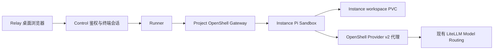

# Pi Agent 接入研究

研究日期：2026 年 10 月 24 日。状态：已完成接入、OrbStack 部署和原生 TUI 验收。

实际结果见 [本地验收记录](../../output/pi-agent-acceptance/README.md)。
下文保留研究时的设计依据和分阶段方案。

Pi Coding Agent 可以作为 Relay 的第四种 Agent 平台接入，沿用 OpenClaw、Hermes
和 Deep Agents 的 Project、Instance、OpenShell Sandbox、模型路由及持久卷设计。
当前 NemoClaw v0.0.138 已包含 Pi 的镜像、启动脚本、配置生成器和策略定义。
主要工作是补齐 Relay 的平台注册、镜像流水线、Provider v2 配置与终端验收。

首阶段使用 Pi 原生 TUI。NemoClaw 此版本把 Pi 定义为终端 Agent，没有对应的
原生 Web 服务；浏览器交互复用 Relay 现有终端，不增加对外转发组件。
这里的“类似 OpenClaw 扩展”是扩展 Relay 的 Agent 平台，与 OpenClaw 并列部署。

## 版本与上游依据

| 项目 | 接入基线 | 依据 |
| --- | --- | --- |
| NemoClaw | v0.0.138 | Relay 当前构建版本，源码提交 `7312e7f49e3e96125b8237968e2552a48e2cb1b6` |
| OpenShell | 0.0.116 | 当前 CLI、Project Gateway、supervisor 和 Worker Chart 版本 |
| Pi | `@earendil-works/pi-coding-agent@0.84.1` | NemoClaw Pi manifest、镜像构建参数和 npm lockfile 一致 |
| 架构 | linux/arm64、linux/amd64 | NemoClaw Pi manifest 声明两种架构 |
| 交互 | `pi` TUI、print、JSON、RPC、SDK | Pi 0.84.1 文档；NemoClaw 默认提供终端生命周期 |

首阶段锁定 NemoClaw 已集成的 Pi 0.84.1。官方 Release 页面当前最新为
[Pi v1.4.0](https://github.com/earendil-works/pi/releases/tag/v1.4.0)，与此基线存在
明显版本差距；若改用 1.4.0，需要单独更新锁文件、完整性校验、配置和扩展接口验收。
不能把当前 main 文档中的能力直接视为 0.84.1 的能力。

上游入口：

- [NemoClaw Pi manifest](https://github.com/NVIDIA/NemoClaw/blob/v0.0.138/agents/pi/manifest.yaml)
- [Pi 镜像及锁定依赖](https://github.com/NVIDIA/NemoClaw/tree/v0.0.138/agents/pi)
- [Pi 0.84.1 使用文档](https://github.com/earendil-works/pi/blob/v0.84.1/packages/coding-agent/README.md)
- [Pi 0.84.1 模型配置](https://github.com/earendil-works/pi/blob/v0.84.1/packages/coding-agent/docs/models.md)
- [Pi 0.84.1 RPC](https://github.com/earendil-works/pi/blob/v0.84.1/packages/coding-agent/docs/rpc.md)
- [Pi 0.84.1 扩展接口](https://github.com/earendil-works/pi/blob/v0.84.1/packages/coding-agent/docs/extensions.md)

NemoClaw 的 Pi 依赖审查记录包含历史 audit 结果，但构建接入时仍需重新执行审计。
仓库中的 Pi qualification receipt 指向另一个 source revision/release，不能当作
Relay 当前 v0.0.138 镜像已验收的证据，也不能直接拿其中的 digest 替代本地构建。

## 复用现有部署结构



Control 继续拥有用户身份、Project 授权和产品资源。Worker 负责 Kubernetes
资源所有权与生命周期；Runner 选择平台镜像、生成启动配置并调用 OpenShell。
Pi 的模型进程、工具、bash 和扩展都在同一个 Instance Sandbox 内运行。

拟新增 `agentPlatform: "pi"` 和镜像
`ghcr.io/tasklattice/tali-nemoclaw-pi-sandbox:dev`。Project Gateway 和 Instance
命名、Namespace、PVC 所有权、删除语义与现有 Agent 保持一致。

本地仍由 OrbStack 暴露 Relay，例如 `http://localhost:38080`。Pi 不增加独立
域名、NodePort、LoadBalancer、证书或本地 CA。现有资源路径继续以
`/<projectId>/.../<instanceId>/...` 组织；终端沿用现有 Instance 页面及终端会话 API。

`/<projectId>/<instanceId>/ui/` 保留现有原生 HTTP UI 语义。Pi 首阶段设置
`interactionSurface: "terminal"`，不生成虚假的 Web UI endpoint。如果后续需要
浏览器聊天界面，可评估用 Pi RPC 做独立适配，那将包含新的 UI 开发工作。

## 必须处理的运行差异

### 模型路由与 Provider v2

Relay 的 Instance Provider 当前声明 `OPENAI_API_KEY`，由 OpenShell 代理管理
Instance 范围的 LiteLLM 凭据。Pi 应消费同一 Provider 的运行时引用，模型 ID 和
endpoint 来自用户选择的 Model Routing，保持 endpoint 与凭据绑定。

2026 年 10 月 24 日的本地纯配置探针使用 NemoClaw 原始
`agents/pi/generate-config.ts` 的 `readSettings` 和 `buildConfig`，关闭文件写入
入口，输入测试模型与 Relay Service 地址，未读取凭据或发起模型调用：

```json
{
  "NEMOCLAW_UPSTREAM_PROVIDER": "tali-litellm",
  "baseUrl": "http://tali-relay-litellm.tali.svc.cluster.local:4000/v1",
  "generatedApiKey": "nemoclaw-managed-inference",
  "rejectedMalformedEndpoints": 4,
  "modelCalls": 0
}
```

结果说明，直接复用现有平台传入的 `tali-litellm` 参数，会落到上游通用占位值。
接入时需要小范围的 Relay bootstrap/adapter，把 `providers.openshell.apiKey`
连接到已附加 Provider 的 `OPENAI_API_KEY` 运行时引用，并验证实际请求由代理注入。
不要将真实 Key 写入 models.json、settings.json、镜像层、启动参数或日志。

具体引用表示法须用 Pi 0.84.1 与 OpenShell 0.0.116 的实际镜像验证。Pi 支持
models.json 环境插值，但上游还支持存储凭据及命令形式的配置，必须覆盖凭据优先级、
endpoint 篡改和错误引用的负向用例。不要照搬针对其他 Provider 的 `!command`。

上游 hosted 分支在 settings.json 不存在时不会创建默认选择。Relay 应明确设置
`defaultProvider: "openshell"` 和选定的 `defaultModel`，并在受控启动入口中选择
对应 provider/model，避免 TUI 打开后要求用户重新配置 Provider。

### 镜像与启动

复用 `agents/pi/Dockerfile.base`、锁文件和 `agents/pi/Dockerfile`，再加 Relay
wrapper。上游最终 Dockerfile 要求显式传入 `BASE_IMAGE`；先验证选定版本的基础
镜像可用性，不可用时按同一提交构建基础镜像，不能猜测标签或回退到 latest。

wrapper 对齐 UID/GID 1000、以 `USER sandbox` 结束，并保持安装目录由 root
拥有且不可由 Agent 修改。保留上游依赖审计、离线配置、凭据检查和完整性断言。
`PI_OFFLINE=1`、`PI_TELEMETRY=0` 是配置项；出网限制仍由 OpenShell 策略执行。

Pi 的 `nemoclaw-start` 无参数时初始化环境并保持 Sandbox 存活，TUI 按终端会话
启动。沿用 Runner 已适配的 canonical main command，避免把 `--upload` 与主命令
组合使用。保留一次性 instructions 初始化和可重复执行的配置更新。

建议 Runner 定义：

| 字段 | 拟定值或行为 |
| --- | --- |
| `instructionsPath` | `/sandbox/.pi/agent/AGENTS.md` |
| `terminalCommand` | 调用受控 Pi launcher，进入 Instance workspace 后启动原生 TUI |
| `headlessCommand` | `pi --no-approve --print`，执行时由参数数组追加任务和固定模型选择 |
| `endpointKind` | 不设置 |
| `inferenceBinaries` | 依据上游策略与实际审计记录，限制为镜像内 Pi 和 Node 执行路径 |
| `healthProbe` | 版本、配置可解析性、文件权限、环境初始化及主进程状态 |

Readiness 表示运行环境可用，实际模型推理另设验收，不在健康检查里反复调用模型。
`--no-approve` 在此版本中表示忽略项目本地配置的信任，不代表跳过工具安全检查。

### 状态与 Memory

Pi 的配置和会话放在 `/sandbox/.pi/agent/`，包括 models.json、settings.json、
AGENTS.md 和 sessions；工作目录建议固定为 `/sandbox/workspace`。两者都落在
Instance PVC 内。重启重新生成受管模型配置，保留用户会话、项目文件及可信配置。

Pi 0.84.1 的原生会话恢复、AGENTS.md 上下文和扩展能力，不等于 Hermes 的
原生 Hindsight Provider。当前 NemoClaw Pi adapter 没有提供相应 Hindsight 配置。
首阶段建议 `capabilities.memory: "none"`，保留会话恢复和指令加载，但不展示
已经支持 Durable Memory 的入口。后端同样拒绝不支持的 Memory 请求。

Hindsight 后续可通过 Pi 官方 extension API 调用 Relay 的 Project Runtime
Bridge，由服务端约束 Bank、Project 和 Instance。该能力需要单独实现、标注为
Pi 扩展，并通过写入、跨会话召回、越权拒绝验收；不能沿用 Hermes Provider 名义。
Pi 新版的 Durable 能力也不能直接替代本项目的 Hindsight 平台。

## 安全与能力声明

首阶段拟声明 `interactive: true`，`canDelegate: false`、
`acceptsDelegation: false`、`embeddedRunTelemetry: false`。Pi 0.84.1 文档和
NemoClaw manifest 不提供开箱即用的 MCP 集成；不能因为其他 Agent 支持就自动
启用 Pi 的 MCP、A2A、Knowledge 或 Run telemetry。

- 复用终端会话授权、短期凭据和 Project 隔离，验证失效与注销后不能继续新建连接。
- 默认拒绝出网，仅附加已选 Routing 和 Access Policy 授权的目标；工具命令不能
  借修改模型配置把凭据发送到其他地址。
- 受管配置使用固定路径、原子替换、owner/mode 检查和链接防护。上游生成器会跟随
  配置符号链接，不能把直接重跑生成器视为 Relay 已有的安全 bootstrap。
- Pi global/project extensions 会执行代码。平台扩展安装在只读镜像目录，项目
  信任沿用 Pi 语义；文件和进程级权限由 Sandbox 强制，不依赖提示词。
- 模型、终端和审计日志复用已有脱敏，禁止保存真实凭据、完整认证头或会话能力票据。

## Relay 修改范围

以下实施清单已完成；实际修复与验证结果见本地验收记录。

| 层 | 主要文件 | 修改 |
| --- | --- | --- |
| 平台契约 | `packages/contracts/src/agent-platforms.ts` | 注册 pi、镜像、终端入口和真实能力 |
| 前端与 Catalog | `apps/control/src/lib/agent-platforms.ts`、`create-instance-sheet.tsx`、平台测试 | 展示 Pi，按能力隐藏不支持的选项；Catalog 使用已有注册表生成 |
| Runner | `apps/runner/src/agent-platform.ts`、`runner-config.ts`、`nemoclaw.ts` | bootstrap、终端、健康检查、配置 schema；避免落入 OpenClaw Memory 默认分支 |
| Provider 与策略 | `apps/runner/src/openshell.ts` 及相关测试 | 复用 Instance Provider，验证 Node/Pi 执行路径及 endpoint 绑定 |
| 镜像 | `scripts/build-nemoclaw-sandbox.sh`、新 Pi wrapper 和 bootstrap、`package.json` | 构建分支、同版本基础镜像回退、dev 命令、镜像内探针 |
| Helm | values、`_helpers.tpl`、`project-openshell-validation.yaml` | Pi 镜像配置、Runner 镜像映射和允许镜像集合 |
| 发布与离线 | 两个 release workflow、`control-plane-release.mjs`、`ocp-runtime-image-plan.mjs`、airgap 验证 | 多架构构建、镜像清单、增量发布及离线一致性 |
| 验收 | 平台契约测试、Runner 测试、现有 live 脚本 | 创建、TUI、推理、会话恢复、安全边界和现有三平台回归 |

## 分阶段实施与验收

| 阶段 | 实施内容 | 通过标准 |
| --- | --- | --- |
| 0 研究 | 上游版本、注册扩展点、纯配置探针 | 已确认 NemoClaw Pi 来源、版本和 Provider 适配缺口 |
| 1 镜像 | 固定版本构建 Pi 与 Relay wrapper | 版本正确、non-root、UID/GID 一致、依赖审计与 bootstrap 正负向探针通过 |
| 2 运行集成 | 平台注册、Provider v2、策略、Helm、生命周期 | 在已有 Project 创建 Pi 到 READY；路由正确；读写 workspace；stop/start 保留 PVC 和会话 |
| 3 浏览器 | Relay 前端创建和原生 TUI | 创建页选 Pi，终端发送任务、流式回复、执行文件工具；关闭后重开、恢复会话、桌面键盘及缩放可用 |
| 4 安全与回归 | 权限、网络、配置篡改、旧平台 | 匿名及跨 Project 访问拒绝；凭据不泄漏；OpenClaw/Hermes 原生 UI 与 Deep Agents TUI 仍正常 |
| 5 可选能力 | Hindsight、A2A、Run telemetry、RPC UI 分项扩展 | 每项具备独立能力声明和正负向验收后再开放 |

阶段 2 和 3 使用已有 Relay Model Routing，新增一个 Pi 测试 Instance，不替换
现有三个 Agent。浏览器验收至少包含一次真实模型回复、一次 workspace 文件写入、
一次重启后的会话恢复。模型调用失败不能用健康检查通过来替代。

## 退出与回滚

出现 Pi 接入失败时，停止发布 Pi 镜像和新建 Pi Instance，保留失败诊断及 PVC。
不迁移现有 OpenClaw、Hermes 或 Deep Agents 数据。回滚包含平台枚举的 Control
版本前，先处理已创建的 Pi 产品记录，避免旧版本无法解析；不能只回滚镜像而留下
无法识别的 Instance 类型。

首个可交付范围为阶段 1 至 4：Pi 原生终端作为第四种 Agent，复用现有部署、安全
边界和模型路由。Hindsight 与浏览器聊天适配分别进入后续能力开发。
